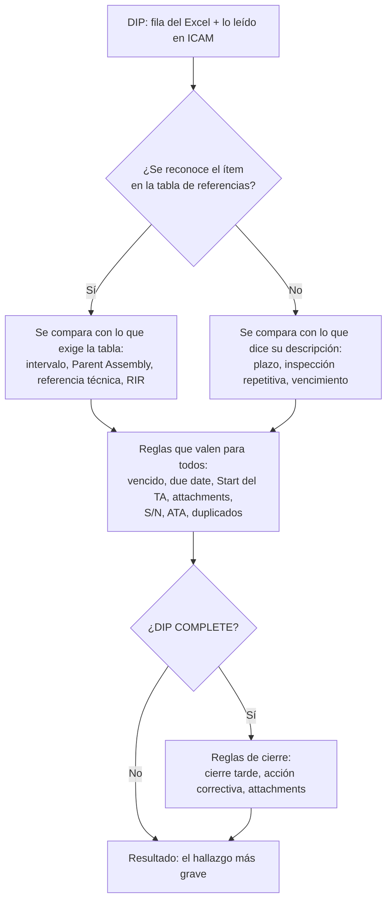

# Cómo funciona el auditor de DIPs

Este documento explica qué hace el programa en cada corrida, en el orden en que lo hace y con qué criterio decide. Para usarlo alcanza con el [README](README.md). El detalle de cada regla y cómo se calibró con los auditores está en [docs/tecnico.md](docs/tecnico.md).

## La idea general

El programa hace la primera pasada de la auditoría de DIPs. Lee el Excel exportado de ICAM y, si se le pide con `--icam`, entra a ICAM y lee la ficha completa de cada DIP. Después reconoce qué ítem es cada uno (una botella de oxígeno, un FAK, un amortiguador...), busca en `DIPs References.xlsx` qué exige ese ítem (plazo, Parent Assembly, referencia técnica y RIR) y compara. Entrega un Excel nuevo con un resultado por DIP y sus motivos; la decisión final es del auditor.

Todo sale de reglas escritas, sin inteligencia artificial, y cada hallazgo dice qué dato lo produjo. Se probó un modo con un modelo de lenguaje, pero no mejoró los resultados y se quitó ([docs/comparacion_modos.md](docs/comparacion_modos.md)). En ICAM el programa solo busca barcodes y lee páginas; nunca escribe. El Excel de entrada tampoco se modifica.

Cada DIP termina con uno de estos resultados:

| Resultado | Cuándo | Qué hace el auditor |
| --- | --- | --- |
| POSIBLE DISCREPANCIA | Falló al menos una regla | Lee `HALLAZGOS` y decide |
| REVISAR | La tabla da el TA o el RIR según el daño (DEPENDING ON, CONSULT REF., MMEL) y el programa no puede saber cuál corresponde | Lo verifica en el manual que cita el hallazgo |
| SIN FUENTE EN DIPS REFERENCES | El ítem no está en la tabla de referencias | Lo verifica contra la fuente que cita el DIP, o se agrega la fila a la tabla |
| OK | No falló ninguna regla (puede tener observaciones) | Hace lo que pide `VERIFICACIÓN MANUAL` |
| FUERA DE ALCANCE | Su tipo de DIP se excluyó con `--tipos-dip` | Nada |

Lo que más cambia qué se revisa en un DIP es si su ítem está en la tabla y si el DIP ya se cerró:



Un DIP que no está en la tabla sale SIN FUENTE EN DIPS REFERENCES si pasa todas las reglas que se le pueden aplicar, y POSIBLE DISCREPANCIA si falla alguna. Un DIP cerrado se audita dos veces, en la apertura y en el cierre.

## Archivos

El programa lee:

- el Excel de entrada, `DIPs Audit (...).xlsx`, exportado de ICAM;
- `DIPs References.xlsx`, la tabla de referencias, que mantienen ingeniería y los auditores;
- `config/catalogo_others.yaml`, las palabras con que se reconoce cada fila de la tabla (pese al nombre, cubre Others, Powerplant y Structures);
- `config/discrepancias.yaml`, qué reglas están activas y con qué severidad;
- `config/config.yaml`, rutas, tolerancias y parámetros de la lectura de ICAM.

Y escribe:

- `data/icam.json`, todo lo leído en ICAM, un registro por barcode;
- `salida/`, los Excel de resultado y de comparación;
- `... FILTERED.xlsx`, junto al original, cuando se filtran los pendientes;
- `.icam_perfil/`, el perfil del Edge que usa para ICAM (ahí queda guardada la sesión).

`pruebas/` guarda las corridas del modo prueba y `benchmark/` la muestra anónima con que se mide el programa. `tools/` tiene los scripts de la primera extracción de ICAM; el programa no los usa. El Excel de entrada, `data/`, `pruebas/` y `salida/` tienen nombres del personal o datos operativos, así que están en `.gitignore` y nunca se suben.

## Instalación y actualización

`setup.bat` llama a `setup.ps1`. Si no encuentra Python 3.11 o superior, instala Python 3.12 solo para el usuario (con winget o desde python.org). Después crea el entorno `.venv`, instala `requirements.txt`, comprueba que estén Microsoft Edge y `DIPs References.xlsx` y corre las pruebas (`setup.bat -SinPruebas` las salta). Se puede ejecutar varias veces; lo que ya está instalado se omite. No descarga ningún navegador: usa el Edge del equipo.

Cada vez que se abre `auditar.bat`, `comparar.bat` o `filtrar.bat`, el programa mira si hay una versión más nueva en GitHub (`dips_audit/actualizar.py`). Si la hay, muestra los cambios y pregunta si se actualiza (Enter es sí). Al actualizar baja los cambios, reinstala las librerías si cambió `requirements.txt` y vuelve a lanzar el `.bat`. No busca nada si la PC no tiene git, si no hay conexión, si la rama no es `main`, si hay commits locales sin subir o si está definida la variable de entorno `DIPS_SIN_ACTUALIZAR`.

## Cómo se ejecuta

Los `.bat` se usan arrastrando el Excel encima o desde una consola abierta en la carpeta del programa. Desde la consola se les pueden agregar opciones. Arrastrar el Excel sobre `auditar.bat` es lo mismo que el primer comando.

```bat
:: Auditar solo con los datos del Excel
auditar.bat "DIPs Audit (29SEP2026).xlsx"

:: Leer antes cada DIP en ICAM (unos 5 minutos cada 380 DIPs)
auditar.bat "DIPs Audit (29SEP2026).xlsx" --icam

:: Solo los DIPs que faltan auditar: crea antes la copia FILTERED y audita esa
auditar.bat "DIPs Audit (29SEP2026).xlsx" --icam --pendientes

:: Con lo ya leído en ICAM, sin abrirlo y sin importar cuándo se leyó
auditar.bat "DIPs Audit (29SEP2026).xlsx" --datos-icam data\icam.json

:: Solo los DIPs Others; los demás quedan FUERA DE ALCANCE
auditar.bat "DIPs Audit (29SEP2026).xlsx" --tipos-dip Others

:: Como si fuera otro momento (cambia, por ejemplo, qué DIPs están vencidos)
auditar.bat "DIPs Audit (29SEP2026).xlsx" --fecha "2026-09-29 14:00"

:: Solo algunos tipos de discrepancia, o todos menos algunos (basta parte del nombre)
auditar.bat "DIPs Audit (29SEP2026).xlsx" --categorias "Incorrect DIP Interval" RIR
auditar.bat "DIPs Audit (29SEP2026).xlsx" --excluir-categorias "Missing S/N"

:: Uno o varios DIPs por su barcode, sin Excel: los lee en ICAM y muestra el resultado en consola
auditar.bat T40S0099V9C
auditar.bat T40S0099V9C T40S009H0QN
```

```bat
:: Comparar con la auditoría manual que trae el Excel
comparar.bat "DIPs Audit (29SEP2026).xlsx"
comparar.bat "DIPs Audit (29SEP2026).xlsx" --icam

:: Crear la copia FILTERED con los DIPs que faltan auditar
filtrar.bat "DIPs Audit (29SEP2026).xlsx"
```

Los demás comandos se ejecutan con el Python del entorno:

```bat
:: Solo leer ICAM y guardar en data\icam.json
.venv\Scripts\python -m dips_audit extraer-icam "DIPs Audit (29SEP2026).xlsx"

:: Ver en JSON lo que se interpretó de un DIP en ICAM (para diagnosticar)
.venv\Scripts\python -m dips_audit extraer-icam --barcode T40S0099V9C

:: Abrir el Edge de ICAM para iniciar sesión, sin auditar
.venv\Scripts\python -m dips_audit abrir-icam

:: Ver cómo se interpretó la tabla de referencias: TA, Parent Assy, referencia técnica y advertencias
.venv\Scripts\python -m dips_audit referencias

:: Listar los tipos de discrepancia y sus reglas (los nombres que acepta --categorias)
.venv\Scripts\python -m dips_audit categorias

:: Medir el programa contra DIPs ya auditados
.venv\Scripts\python -m dips_audit benchmark

:: Rearmar la muestra anónima del benchmark desde el histórico
.venv\Scripts\python -m dips_audit anonimizar

:: Correr las pruebas
.venv\Scripts\python -m pytest

:: Ver todas las opciones de un comando
.venv\Scripts\python -m dips_audit auditar --help
```

Las opciones de los ejemplos tienen forma corta: `-i` es `--icam`, `-f` es `--fecha`, `-c` es `--categorias`, `-e` es `--excluir-categorias` y `-t` es `--tipos-dip`. `--datos-icam` también acepta un CSV o Excel con las columnas `barcode` y `technical_references`. Otras opciones:

| Opción | Qué hace |
| --- | --- |
| `--no-cache` | Vuelve a leer en ICAM también los DIPs leídos hace menos de una hora |
| `-j`, `--hoja NOMBRE` | Hoja a leer. Por defecto, la primera con `Fault Barcode` y `Fault Name` |
| `-n`, `--sin-excel` | Solo consola, sin Excel de salida |
| `--max-filas N` | Cuántos DIPs con posible discrepancia mostrar en consola (40 por defecto) |
| `-o`, `--salida RUTA` | Dónde guardar el Excel de resultado |
| `-p`, `--prueba` | Fuerza el modo prueba |
| `--config RUTA` | Usa otro `config.yaml`. Va antes del comando: `python -m dips_audit --config RUTA auditar ...` |

Si el argumento de `auditar.bat` no es un archivo que existe, se toma como barcode; por eso una ruta mal escrita termina en "... no es un barcode ni un Excel de entrada que exista". Si el `.bat` se abrió desde el Explorador (arrastrando o con doble clic), la ventana espera una tecla al final para que se pueda leer el resultado; desde una consola no espera. El programa termina con código 0 si salió bien, 1 si hubo un error y 2 si el benchmark empeoró.

## Una auditoría, paso a paso

Esto es lo que pasa con `auditar.bat "DIPs Audit (29SEP2026).xlsx" --icam`. El recorrido está en `cmd_auditar` (`dips_audit/__main__.py`) y en `dips_audit/auditor.py`.

### Arranque

Se lee `config/config.yaml` y se decide si la corrida es de prueba: lo es si el Excel está dentro de `pruebas/` o si se pasó `--prueba`. En ese caso lo leído en ICAM va a `pruebas/icam.json`, el resultado va a `pruebas/salida/` con el prefijo `PRUEBA_`, el Excel lleva el aviso "PRUEBA: datos de prueba, no es una auditoría real." y la consola muestra un recuadro amarillo. Así una prueba nunca se confunde con una auditoría real.

Con `--pendientes`, antes de seguir se crea la copia FILTERED (ver [Filtrar los pendientes](#filtrar-los-pendientes)) y el resto de la corrida trabaja sobre ella.

### Lectura de ICAM

Solo ocurre con `--icam`. El código está en `dips_audit/extractor_icam.py`, que guarda el texto de cada página sin interpretarlo; eso se hace más adelante, y por eso se puede volver a auditar sin entrar otra vez a ICAM.

Se leen todos los barcodes de la hoja, de cualquier tipo de DIP (`--tipos-dip` no limita la lectura). Un DIP leído en los últimos 60 minutos no se vuelve a leer, salvo con `--no-cache`.

Para ICAM se usa un Edge aparte, con su propio perfil en `.icam_perfil/` y el puerto local 9222, por donde el programa lo maneja con Playwright. Convive con el Edge de uso diario, y si ya estaba abierto lo reutiliza. La sesión queda guardada en el perfil: mientras siga vigente, no hay que volver a iniciarla.

El programa nunca escribe usuario ni contraseña. Si aparece la página de inicio de sesión, avisa "Inicie sesión en la ventana de Edge..." y espera hasta 3 minutos, revisando cada medio segundo; sigue apenas aparece el campo Barcode Search. Se detiene si la página muestra un error de usuario o clave, si se cierra la ventana o si en 30 segundos no cargó nada ("ICAM no cargó").

Con la sesión abierta, lee tres DIPs a la vez. Para cada uno busca el barcode con el mismo POST que usa Barcode Search (`ScanBarcode`), que devuelve la pestaña Task Execution, y pide en paralelo las otras cuatro: Fault Information, Task Information, Scheduling e History. También abre Show Historical Tasks, para ver las RIR cerradas, y la página de cada RIR vigente (su Scheduling y su Task Information). En los DIPs de oxígeno (OXYGEN en el título o la descripción) descarga los PDF adjuntos y guarda solo los campos del formulario, que son el inventario de generators.

Cada respuesta se carga en una página aislada, sin red y sin los scripts de ICAM. ICAM esconde las pestañas y tablas que no están activas, y como sus scripts no corren, el programa las hace visibles antes de copiar el texto. Sin ese paso se perderían las referencias técnicas, los attachments y los intervalos.

Una respuesta solo se acepta si no es la página de inicio de sesión (eso querría decir que la sesión venció, y ahí se detiene todo), si es la página de un DIP con el barcode pedido y si la pestaña trae contenido (Scheduling, por ejemplo, tiene que tener "Deadline", "Interval" o "Due"). Cada consulta se intenta hasta tres veces. Si la búsqueda o una pestaña fallan igual, el DIP queda con error y no se guarda a medias. Un error en una RIR o en un PDF no invalida el DIP: queda anotado en su registro.

Todo va a `data/icam.json`, un registro por barcode con el texto de cada pestaña y la fecha de lectura. Una lectura nueva reemplaza la anterior del mismo barcode. El archivo se escribe como mucho cada 5 segundos y al final, siempre a través de un temporal, para que nunca quede cortado. Si hay JSON sueltos de versiones anteriores en `data/icam/`, se unen a este archivo y se borran.

Al terminar se cierra el Edge de ICAM con todos los procesos de su perfil, también los que haya dejado una corrida anterior (el Edge de uso diario no se toca), y la consola dice cuántos DIPs se leyeron, cuántos salieron de lo guardado y cuántos dieron error. Si la sesión vence a mitad de camino, la corrida se detiene sin auditar. Lo leído queda guardado y la próxima vez no se relee lo de la última hora.

Si un DIP da error pero tenía una lectura anterior en `data/icam.json`, se audita con esa lectura aunque sea vieja. Si nunca se leyó, se audita solo con el Excel.

Leer 380 DIPs tarda unos 5 minutos: no se dibujan las páginas ni se descargan imágenes.

### Carga de la tabla, el catálogo y las reglas

Primero se fija la fecha de auditoría: la de `--fecha` o la hora actual, al minuto. Todas las reglas que dependen del momento, como DIP vencido, usan esa fecha.

De `DIPs References.xlsx` se lee solo la hoja `References`. La primera fila tiene que tener TYPE, AREA, ATA, FLEET, DESCRIPTION, PARENT ASSY, REFERENCES, TA y RIR, y las filas sin DESCRIPTION se saltan. Hoy son 92 filas: 60 Others, 20 Powerplant y 12 Structures.

Cada entrada del catálogo se une a sus filas de la tabla por el texto exacto de DESCRIPTION. Si ese texto no existe en la tabla, o si dos entradas tienen el mismo `id`, el programa se detiene y lo dice. Las filas que ninguna entrada usa reciben una entrada automática `FILA_<n>`, así que una fila nueva en la tabla ya sirve aunque nadie le haya escrito su entrada en el catálogo.

El TA de cada fila se interpreta así:

| En la tabla | Se interpreta como |
| --- | --- |
| "3 DAYS", "12 MONTHS" | Un límite |
| "60 DAYS OR 500 FH" | Dos límites; manda el que se cumpla primero |
| "UNTIL DUE DATE" | El due date no puede pasar la fecha de vencimiento del ítem |
| Con DEPENDING, CONSULT, SEGÚN o MMEL | Según el manual: el DIP sale REVISAR, salvo que el catálogo defina `intervalos` |
| Otra condición (IF, AFTER, ":" o ";") | Hay que definirla en el catálogo con `intervalos`. Si no está, queda para verificación manual y se avisa al cargar |

El RIR se interpreta de la misma manera. Un Parent Assy con asterisco ("AIRCRAFT*") acepta avión o motor.

También se arma un índice con los números de tarea de cada entrada (AMM, EC/RA, task card JIC, SRM), que después sirve para reconocer un DIP por su referencia técnica. Si REFERENCES empieza con "[AIRCRAFT SPECIFIC]", esos números son ejemplos y no se indexan.

Por último se carga `config/discrepancias.yaml`, aplicando `--categorias` o `--excluir-categorias` si se usaron, y se fijan los tipos de DIP a auditar (`--tipos-dip` o `tipos_auditados`; vacío quiere decir todos).

Para ver cómo quedó todo esto: `python -m dips_audit referencias`.

### Lectura del Excel de entrada

El código está en `dips_audit/cargador.py`. Si no se pasa `--hoja`, se usa la primera hoja que tenga `Fault Barcode` y `Fault Name` en alguna de sus primeras 20 filas, y esa fila se toma como encabezado (puede haber títulos encima). En el export actual es la primera hoja; ACTIVE y COMPLETE son subconjuntos y no se leen. Las filas sin barcode se saltan, y si un barcode se repite se audita la primera fila y se avisa cuántas se omitieron.

Las columnas se reconocen por su nombre, sin importar mayúsculas:

| Dato | Columna |
| --- | --- |
| Barcode | Fault Barcode |
| Nombre | Fault Name |
| Intervalo y su tipo | DIP Interval, Interval Type |
| Estado | Fault Status |
| Avión | Aircraft |
| Tipo de DIP | Type DIP o Area |
| ATA, Deferral Reference, severidad | ATA, Deferral Reference, Fault Severity |
| Descripción | Fault Description o Description |
| Parent Assy | Task Parent Assy |
| Due date y due date original | Fault Due Date, Orig Fault Due Date |
| Apertura | Found On Date o Fault Found on Date |
| Defer Date | Defer Dt, Deferral Date o Fault Deferral Date |
| Paquete programado | Scheduled Date, Work Package Barcode |
| Usage Remaining | Usage Remaining |
| Cierre | Complete Dt, Completed Date, Fault Completed Date o Completion Date |
| Referencia técnica | Technical References, Technical Reference, Referencias Técnicas o Referencia Técnica |
| RIR activo | Rir Barcode, Rir Name, Rir Driver Interval, Rir Driver Type |
| Attachments | Attachment Status, Attach Docs |

Las seis primeras son obligatorias; si falta alguna, el programa se detiene con "Faltan columnas obligatorias en el Excel: ...". Las demás columnas del Excel (QC Validation, Deferred By, las de la auditoría manual...) no intervienen en la auditoría, pero se copian tal cual a la salida.

Al leer cada valor:

- Las fechas se aceptan como fecha de Excel o como texto (`Sep/26/26 14:00`, `09/26/2026 2:00:00 PM`, `26-SEP-2026`, `2026-09-26`). Lo que no se entiende queda vacío.
- A veces Excel guarda la fecha con día y mes invertidos (el 9 de julio como 7 de septiembre). Si la apertura cae después del due date y su día es 12 o menos, se prueba invertirlos; si así queda antes del due date, se acepta y se deja anotado en `VERIFICACIÓN MANUAL`.
- A los números se les quitan las comas de miles.
- El tipo de intervalo se lleva a DAY, FH, FC o MONTH. DAYS, CDY o DIA son días; HOURS o HRS son FH; CYCLES, LANDINGS o CYC son FC. Cualquier otro texto queda sin unidad.
- ACTV, OPEN e IN WORK son estados activos; COMPLETE es cerrado.
- El Parent Assy se clasifica en ENGINE (si dice ENGINE, CFM o LEAP), APU, AIRCRAFT (si dice BOEING o 737) u otro.
- La flota sale de la matrícula: HP-98xx y HP-99xx son MAX y cualquier otra HP-xxxx es NG. Si el Parent Assy es el avión, su modelo precisa NG-700, NG-800 o NG-900. Un DIP cargado en un motor toma la flota de otro DIP del mismo avión.
- `Attach Docs` da la cantidad de attachments. `Attachment Status` PENDING sin cantidad se toma como ninguno.

Si el Excel no trae fecha de cierre o descripción, se avisa: sin la fecha no se puede saber si un DIP se cerró tarde, y sin descripción los S/N y las referencias se buscan solo en el Fault Name.

El resultado es un `Lote` con dos tablas: `original`, con las columnas tal como vinieron, y `datos`, con los valores ya interpretados. Las reglas trabajan con `datos`; la salida copia `original`.

### Lo que aporta ICAM

Si se leyó ICAM (o se pasó `--datos-icam`), a cada DIP del Excel que esté en `data/icam.json` se le suma lo leído allí (`cargador.completar_con_icam`, que interpreta las pestañas con `icam.leer_ficha`).

Hay datos que solo están en ICAM: el TA completo (límites, Start, deadlines y extensión), el uso al encontrar la falla (History, "Usage When Found"), las notas de la descripción (Deferral Notes), el Parent Assembly según ICAM (para compararlo con el de las RIR), la acción correctiva con los S/N removido e instalado, los cambios de deadline, las marcas AUDITDIP (las que deja el auditor en Technical References al terminar su auditoría manual) y el inventario de generators. La referencia técnica, los attachments y las RIR se toman de ICAM en lugar del Excel, y la descripción también, cuando ICAM trae texto. En todo lo demás (due date, apertura, estado, avión, Parent Assy, ATA) manda el Excel. ICAM solo completa la fecha de cierre y el intervalo cuando el Excel no los trae; si tuvo que usar el intervalo de ICAM, lo deja como observación.

Un DIP que no está en el JSON sigue solo con el Excel. Las notas de la carga dicen cuántos se completaron.

Esto importa para leer los resultados: sin ICAM, un dato que falta queda vacío y la regla que lo necesita no marca nada, o deja una verificación manual. Con ICAM, una lista vacía sí quiere decir que no hay nada; por ejemplo, cero attachments.

### Alcance

Con `--tipos-dip` (o `tipos_auditados` en `config.yaml`) solo se auditan los DIPs cuyo `Area` o `Type DIP` coincide, sin importar mayúsculas. Los demás quedan FUERA DE ALCANCE: no se asocian, no se revisan y no cuentan al buscar duplicados. Un DIP sin tipo siempre se audita. Si se pide un tipo que no aparece en el Excel (un error de tipeo, por ejemplo), la consola muestra los que hay.

### Qué ítem es cada DIP

Es la parte más difícil, porque el Fault Name lo escribe el técnico a mano ("CREW OXY 850 PSI", "DIP-FWD CABIN FIRT AID KIT") y la tabla tiene sus propias descripciones. El código está en `dips_audit/texto.py`, `dips_audit/asociacion.py` y `Auditor._asociar`.

Primero se limpia el texto, tanto el del DIP como el del catálogo: se pasa a mayúsculas sin acentos, se juntan las siglas con puntos ("P.O.B" queda "POB"), los signos se cambian por espacios y se corrigen errores y sinónimos frecuentes con la lista `_SINONIMOS` de `texto.py`. Así FIRT se lee FIRST; OXY, O2 y OXIGEN se leen OXYGEN; EXTINTOR se lee EXTINGUISHER, y BREAK, BRAKE.

Después se compara con las palabras clave del catálogo. Una entrada se ve así:

```yaml
- id: OXIGENO_TRIPULACION
  referencias: ["CREW OXYGEN BOTTLE PRESSURE"]     # DESCRIPTION exacta de la tabla
  requiere: [[OXYGEN], [CREW, FLIGHT COMPARTMENT, FLIGHT DECK, COCKPIT]]
  excluir: [PORTABLE, HYDRO, POB, MASK, MASKS]
```

El nombre tiene que tener al menos una frase de cada grupo de `requiere`, en cualquier orden, y ninguna de `excluir`. Se comparan palabras completas, así que "ELT" no coincide dentro de "BELT". Si coinciden varias entradas gana la más específica: cada grupo suma 100 más el largo de la frase encontrada. Si empatan entradas que llevan a las mismas verificaciones (mismo TA, flotas, vencimiento y Parent Assy), da igual cuál se tome. Si empatan entradas distintas, el nombre es ambiguo.

Cuando el nombre no coincide con ninguna entrada, se sigue probando en este orden y se toma lo primero que lleve a un solo ítem:

1. El nombre, tolerando errores de escritura en palabras de 5 letras o más con al menos 85 % de parecido ("FUNIGATION" por "FUMIGATION"). En siglas y palabras cortas no hay tolerancia: ELT y EMK son ítems distintos. Queda una observación con la palabra corregida.
2. Las filas de la tabla sin entrada en el catálogo (`FILA_<n>`). El nombre tiene que tener todas las palabras de la DESCRIPTION anteriores a la aclaración (" - ", "(" o "["), sin contar números ni palabras genéricas. Queda una observación para verificar.
3. La referencia técnica cargada en ICAM o en el Excel, si su número de tarea (AMM, EC/RA o JIC) aparece en una sola entrada. La SRM no cuenta, porque es un capítulo de daños y no un ítem. Si la descripción dice claramente otro ítem, manda la descripción, y la regla de referencia técnica marca después que la cargada es de otro ítem.
4. El Fault Name junto con la descripción, con las mismas palabras clave y sin tolerar errores. Se descarta si la descripción cita una tarea que no es la de esa entrada.
5. La tarea citada en la descripción: "IAW EC/RA 2500-0538C" lleva a la entrada que tiene esa EC/RA.

Un nombre ambiguo salta directo al paso 3. Las task cards JIC que aparecen en la descripción no sirven para reconocer el ítem, porque son la tarea donde se encontró la falla (el Service Visit), no la fuente del DIP.

Si nada funciona, el DIP queda SIN FUENTE EN DIPS REFERENCES; si era ambiguo, el hallazgo nombra las candidatas ("varias referencias posibles"). Además se buscan las dos filas de la tabla más parecidas y se anotan en `VERIFICACIÓN MANUAL`. Si el DIP se parece mucho (90 % o más) a una fila de otro tipo de DIP, queda una observación de que quizá se abrió con el tipo equivocado.

La columna `REFERENCIA ASOCIADA` dice con qué ítem se reconoció el DIP, y `ASOCIACIÓN` cómo: REGLAS (ALTA) por el nombre, REF_TECNICA (ALTA) por la referencia técnica cargada o citada, DESCRIPCION (MEDIA) por la descripción, y AMBIGUA o NINGUNA (BAJA) si no se pudo.

### Reglas que comparan un DIP con los demás

Antes de revisar cada DIP por separado se buscan duplicados, S/N repetidos y Parent Assembly distintos de sus pares, mirando todos los DIPs en alcance a la vez.

Dos DIPs son posibles duplicados si están en el mismo avión, son el mismo ítem del catálogo, citan las mismas posiciones (FWD/AFT, LH/RH, #1/#2...) en el nombre y en la descripción, y estuvieron abiertos al mismo tiempo (sin fecha de cierre, basta con que se hayan abierto el mismo día). Además, si los dos citan S/N tienen que compartir alguno, y si citan mensajes de mantenimiento tienen que ser los mismos: 75-20451 y 75-10451 son dos fallas. En un ítem con varias etapas deben tener el mismo intervalo (un re-torque a 60 días y otro a 12 meses son etapas distintas), y en un ítem con vencimiento, el mismo due date. Se marca el que se abrió después. Un duplicado es un duplicado, no una discrepancia: queda como observación.

Hay S/N repetido cuando dos o más DIPs activos del mismo avión citan el mismo S/N, como un FAK 1 y un FAK 2 con el mismo número. Es la señal de un duplicado: también queda como observación, y no se anota si ya se anotó el duplicado.

La regla de Parent Assembly distinto de sus pares es solo para DIPs SIN FUENTE EN DIPS REFERENCES. Si el DIP cita una EC/ECRA y al menos otros dos DIPs del archivo que citan la misma están todos en otro Parent Assembly, se marca. Por ejemplo, cinco cambios de toberas por la ECRA 7300-0132C cargados en el motor y uno en el avión. Solo se hace con EC, porque una AMM puede ser genérica.

### Reglas de cada DIP

A cada DIP en alcance se le aplican, en este orden:

1. Intervalo, Parent Assembly y S/N requerido, solo si el DIP está en la tabla.
2. Fechas: due date, vencimiento del ítem, DIP vencido, Usage Remaining y, si está COMPLETE, las reglas de cierre. Después, Start del TA, attachments, paquete programado después del due date, S/N contra las notas de la descripción, ATA, Deferral Reference y Fault Severity.
3. Referencia técnica y RIR.
4. Si el DIP es SIN FUENTE EN DIPS REFERENCES, las reglas contra su propia descripción.
5. Lo que salió de comparar con los demás DIPs, el aviso de intervalo tomado de ICAM y las observaciones de la asociación.
6. Si el técnico declaró que el DIP se creó por error o es un duplicado, se borra todo lo anterior y queda solo ese hallazgo.

A los DIPs con `Defer Dt` desde el 9 de julio de 2026 se les agrega en `VERIFICACIÓN MANUAL` el recordatorio "Verificar attachments: captura de referencia técnica y EC/RA adjunta.". Si el DIP tiene marcas AUDITDIP, esa columna empieza con "Ya se había auditado manualmente" y lo que anotó el auditor en cada marca, por ejemplo "Apertura: DISCREPANCIA (MISSING RIR INTERVAL); Cierre: sin discrepancia".

Las reglas están en `reglas.py`, salvo la referencia técnica y la RIR (`Auditor._referencia_tecnica` y `Auditor._rir`) y las de los DIPs SIN FUENTE EN DIPS REFERENCES (`reglas_descripcion.py`). Lo que sigue es qué revisa cada una.

#### Intervalo

Se compara el intervalo del DIP con el TA de la tabla:

| Caso | Resultado |
| --- | --- |
| Igual al TA de la tabla (en meses se acepta de 30 a 31 días por mes, más 1 día) | Correcto: el comentario sugerido dice "T/A aperturado correctamente" |
| Igual a B - A en una ventana "AFTER A, BEFORE B" | Correcto (el Start se revisa en [Start del TA](#start-del-ta)) |
| Mayor que el TA de la tabla | Posible discrepancia, si de verdad vence después: con el Start de ICAM, un TA que empieza antes de la apertura y vence dentro del TA no se marca (el Start sí). Sin ICAM se cuenta desde la apertura |
| En otra unidad que el TA de la tabla | Posible discrepancia |
| Menor que el TA de la tabla | Observación |
| Sin intervalo o sin tipo | Posible discrepancia, salvo que el DIP solo siga un RIR y la tabla no dé plazo: verificación manual |
| 0 o negativo | Posible discrepancia |
| Ítem UNTIL DUE DATE con el TA del DIP en otra unidad que días | Posible discrepancia |
| La tabla da el TA según el daño o el tipo | REVISAR, citando la tabla y el manual |
| TA que no se pudo interpretar y no está definido en el catálogo | Verificación manual |

El intervalo se compara exacto, porque es un número que se escribe a mano. Solo cuentan las variantes de la flota del DIP; si la flota no se conoce, se acepta cualquiera y se anota. Si el intervalo coincide con una variante condicional (el oxígeno de tripulación tiene 3 días, 1 día o 1 ciclo según la presión), queda la observación "corresponde a la condición ... Verificar que aplique", con la presión que diga el DIP.

Cuando el TA de la tabla tiene dos límites ("45 DAYS OR 225 FC"), con ICAM se exige que el del DIP tenga los dos; si falta uno, es posible discrepancia. Sin ICAM queda para verificación manual, porque el Excel solo muestra el límite que vence primero.

#### Due date y vencimiento del ítem

En los TA en días, el due date tiene que ser el Start del TA más el intervalo, con un día de tolerancia. Sin ICAM se cuenta desde la apertura (o desde la apertura más A, si el TA es una ventana: el FDR de 23 días cuenta desde la apertura más 7). Un due date posterior es posible discrepancia; uno anterior, observación.

En los ítems UNTIL DUE DATE, el due date no puede pasar la fecha de vencimiento del ítem. En los generators de oxígeno esa fecha sale del PDF de inventario; en los demás, de la primera fecha del nombre o la descripción que sea posterior a la apertura. Pasarla es posible discrepancia, quedar más de un día antes es observación y, si no hay fecha, queda para verificación manual.

#### Generators de oxígeno

Aplica solo a la entrada del catálogo con `inventario: true` (FCD 3500-0018C-JIC). El PDF adjunto es un formulario con Position, PN, SN, Manufac. Date, Exp. Date y DIP Barcode. Los generators del DIP son los que tienen su barcode en DIP Barcode y los de los S/N que cita la descripción. Cada uno vence el último día del mes de su Exp. Date ("01-2029" es el 31-JAN-2029) y, si hay varios, manda el que vence primero.

Un due date posterior a ese vencimiento, o un S/N del DIP que no está en el PDF, es posible discrepancia. Un due date más de un día anterior es observación. Si se leyó ICAM y el DIP no tiene el PDF, queda una observación y se usa la fecha de la descripción. Si el PDF es escaneado, no se pudo leer o no se leyó ICAM, también se usa la fecha de la descripción y queda para verificación manual.

#### DIP vencido y Usage Remaining

Un DIP activo está vencido si su due date es anterior al momento de la auditoría (un due date sin hora vence al final del día) o si su Usage Remaining es negativo. Es posible discrepancia.

Si el Usage Remaining de un DIP activo es mayor que el intervalo (con un día de tolerancia en días), queda una observación. Pasa cuando el TA empieza después de la apertura, y los auditores lo aceptan.

#### Start del TA

Solo se revisa con ICAM y no en ítems UNTIL DUE DATE. El Start es desde dónde cuenta el TA en ICAM (una fecha, o un contador de horas o ciclos) y tiene que ser la apertura. En días, el Start debe estar entre la fecha en que se encontró la falla y el Defer Date, con un día de tolerancia. En FH o FC debe ser el uso al encontrar la falla (History, "Usage When Found"), con 2 FH o 0 FC de tolerancia; en un motor se compara con el uso del motor y con el del avión. Si el uso es 0, o la diferencia es tan grande que es otro contador, no se compara.

Algunos ítems tienen una ventana "AFTER A, BEFORE B": su TA tiene que empezar A después de la apertura y durar B - A. La ventana se define con `inicio` en el catálogo:

| Ítem | Ventana | TA correcto |
| --- | --- | --- |
| Amortiguador NG | After 5 landings, not later than 20 | Start + 5 FC, 15 FC |
| Amortiguador MAX | Five to ten landings | Start + 5 FC, 5 FC |
| FDR | 30 días, no antes de 7 | Start + 7 días, 23 días |
| Desgaste de frenos | NG-700 27/37, NG-800 12/20, MAX 34/42 FC | Start + A, B - A |
| Filtro de combustible del motor | Después de 10 FH, antes de 75 | Start + 10 FH, 65 FH |
| Sellante de ventanas | Opcional: 7 días desde la apertura, o Start + 3 y 4 días | Cualquiera de las dos |

Un TA que empieza en otro momento (antes de la apertura, o en la apertura cuando debía empezar en A) es posible discrepancia. Si empieza bien pero dura B, vence después de la ventana y sale como intervalo excedido. En un ítem sin ventana, un Start posterior a la apertura con eso descontado del intervalo (más ciclos en el Start, menos en el TA) se acepta si vence dentro del TA de la tabla; si vence después, es posible discrepancia. En un DIP SIN FUENTE EN DIPS REFERENCES no se sabe si hay ventana: un Start posterior a la apertura queda como observación, pero uno anterior sí es posible discrepancia.

#### Attachments y paquete programado

Los DIPs con `Defer Dt` desde el 9 de julio de 2026 tienen que tener attachments. Los diferidos antes quedan exentos. Si no tiene ninguno (según ICAM o, sin ICAM, según `Attach Docs` o `Attachment Status` PENDING), es posible discrepancia, aunque la descripción cite el manual. Si falta la fecha de diferimiento o no hay ningún dato de adjuntos, no se revisa. Un attachment con la matrícula de otro avión en el nombre ("... HP1830.png" en un DIP del HP-1836) queda como observación.

Si un DIP activo tiene su paquete programado (`Scheduled Date`) después del due date (final del día más 5 horas), va a vencer si no se reprograma. Es posible discrepancia.

#### S/N

Los S/N se reconocen por su prefijo (`S/N`, `S/` o `SN`) seguido de un código con al menos un dígito.

En las entradas del catálogo con `requiere_sn`, si ni el nombre ni la descripción citan un S/N, queda una observación, y siempre se deja la verificación de que el S/N del attachment coincida con el componente.

Con ICAM, los S/N de la descripción se comparan con los de las notas de la descripción, solo por los dígitos (P11101989 y 11101989 son el mismo). Si difieren (11101989 y 11101998), es posible discrepancia. Un S/N que está en un texto y no en el otro no cuenta.

#### ATA, Deferral Reference, Fault Severity y Parent Assembly

El ATA del DIP no es relevante para la auditoría: un Deferral Reference que empieza con otro ATA ("25-..." en un DIP ATA 35) y un ATA distinto del de la fila de la tabla son observaciones. Una Fault Severity distinta de DIP también.

El tipo de Parent Assy del DIP (AIRCRAFT, ENGINE o APU) tiene que ser el de la tabla; si no, es posible discrepancia. Si la tabla tiene asterisco, o la entrada tiene `parent_assy_flexible` (ítems que se transfieren al robar el motor), queda como observación. Un Parent Assy vacío queda para verificación manual.

#### Referencia técnica

Se revisa en DIPs con `Defer Dt` desde el 9 de julio de 2026, solo si hay con qué: una descripción, una columna de referencias en el Excel o datos de ICAM.

Primero, si el DIP tiene referencia. Como lo acepta el auditor, vale cualquiera de tres evidencias: una referencia cargada en ICAM (sin contar "REFERENCE REQUIRED", las marcas "RT AUDIT COMPLETED", el MGM ni notas sin números), una captura adjunta (cualquier attachment) o una cita en la descripción, las notas o el nombre (AMM, SRM, FIM, IPC, CMM, EC, ECRA, EC/RA, EA, FCD, SB, AD, JIC, task card...).

- Si no hay ninguna de las tres, con ICAM es posible discrepancia (y aclara si solo cita el MGM, que no es referencia técnica). Sin ICAM queda para verificación manual, porque no se sabe si hay captura.
- Si no hay cita ni referencia cargada y todos los attachments son capturas de un barcode de trabajo, es posible discrepancia.
- Si cita un barcode de trabajo como fuente ("IAW BARCODE: TRF7N00900V4") y no tiene referencia del manual, o la que tiene es una task card, es posible discrepancia por referencia no específica.
- Una referencia sin attachments, sin REV o sin fecha es observación. AMM, SRM y task card no necesitan REV ni fecha (`revision_opcional`). La fecha solo cuenta si va junto a "REV", para no tomar una fecha de vencimiento del ítem ("Battery Due: 31-JAN-2027").

Después, si es la de la tabla. Si el DIP tiene ítem asociado y la tabla da números de tarea, se comparan con los de la referencia cargada, los attachments y la descripción (sin las task cards de la descripción, que suelen ser el Service Visit). La AMM se compara sin el sufijo de efectividad, la EC/RA sin la letra y la SRM hasta capítulo-sección-tema.

| Caso | Resultado |
| --- | --- |
| Algún número coincide | Correcto |
| La task card de la descripción o de un attachment es justo la de la tabla | Correcto |
| Tiene el número de otra entrada de la tabla (o de una fila Powerplant o Structures) | Posible discrepancia |
| Otra tarea del mismo capítulo-sección-tema (AMM 12-15-21-200-801 por 12-15-21-210-801) | Observación |
| Una tarea que la tabla no tiene | Observación, salvo que la tabla pida una EC/ECRA y el DIP no la cite, o que el DIP solo cite task cards: posible discrepancia |

#### RIR

En ICAM las RIR son las Follow-on Tasks de clase ADHOC; las REQ, como el servicio de taller, no son RIR. El intervalo sale de la página de la RIR (Scheduling) y, si no se pudo leer, de la diferencia entre la vigente (ACTV) y la siguiente (FORECAST): de 594 a 1394 CYCLES son 800 FC. Sin ICAM se usa el RIR activo de las columnas `Rir ...` del Excel.

| Caso | Resultado |
| --- | --- |
| La tabla da el RIR según el daño | REVISAR |
| La tabla pide RIR y el DIP activo no tiene (o se leyeron las históricas y no hay ninguna) | Posible discrepancia |
| La tabla pide RIR, el DIP está cerrado y no se ve ninguna | Verificación manual en Show Historical Tasks |
| RIR con otro intervalo | Posible discrepancia |
| RIR más seguida que la tabla (cada 1 día cuando pide 2) | Observación, porque es más conservador |
| El TA tiene dos límites y la RIR uno solo | Posible discrepancia |
| La RIR no empieza donde empieza el TA (salvo redondeo) | Posible discrepancia |
| La RIR está en otro Parent Assembly que el DIP | Posible discrepancia |

Las tres últimas necesitan la página de la RIR, así que solo se revisan con ICAM.

#### DIPs SIN FUENTE EN DIPS REFERENCES: contra su propia descripción

Si el DIP no está en la tabla, se revisa contra lo que dice su descripción (`reglas_descripcion.py` y `limites_declarados.py`):

| Si la descripción dice | Se revisa que |
| --- | --- |
| Un plazo: "within 60 days", "for 45 days or 225 FC", "no more than 100FH, 50FC or 10 days" | El TA no sea mayor (con un día de tolerancia en días) ni esté en otra unidad. Si pide varios límites, con ICAM el TA debe tenerlos todos; sin ICAM, queda para verificación manual |
| Una inspección repetitiva: "every 30 days", "after each 400 cycles", "inspect within 50 FH and correct within 100 FH" | Exista la RIR con ese intervalo, y con todos los límites si pide varios |
| El vencimiento del ítem: "DUE DATE NOVEMBER/2027", "DUE DATE 11/2029" | El due date no lo pase. Con varios componentes, manda el que vence primero |
| Nada, y el DIP no tiene intervalo ni RIR | Es posible discrepancia, salvo que se haya abierto y cerrado el mismo día |

"Not prior to 7 days" no es un plazo sino cuándo empieza, y "50.000 FC" son cincuenta mil ciclos.

#### Cierre

Solo para DIPs COMPLETE.

Para saber si se cerró tarde, primero se mira el Usage Remaining: negativo quiere decir tarde. Si no hay, la fecha de cierre no puede pasar el final del día del due date más 5 horas, porque el cierre viene en UTC y el due date en hora de Panamá (`horas_cierre`). Cerrar tarde es posible discrepancia. Si la acción correctiva remite a otra tarea (T40S..., TRF7...), la fecha se deja para verificar en esa tarea, y si no hay fecha de cierre, queda para verificación manual.

Si el due date es posterior al original (`Orig Fault Due Date`) y el cierre fue después del original, hubo una extensión y se marca como posible discrepancia para que se verifique. Los cambios de deadline que muestra History se listan en `VERIFICACIÓN MANUAL`.

La acción correctiva se revisa solo con ICAM. Vacía no es discrepancia (queda así cuando se cierra por la validación de QC o solo con partes): observación. Sin cita del manual también es observación, salvo que remita a otra tarea o que no haya habido trabajo ("BY MISTAKE", "PREVIOUSLY ACCOMPLISHED", "NO FURTHER ACTION"), en cuyo caso queda para verificación manual. Una cita sin REV o sin fecha es observación. Si ni el S/N removido ni el instalado coinciden con el de la descripción, también es observación.

Un DIP cerrado sin attachments es posible discrepancia de cierre si su `Defer Dt` es del 9 de julio de 2026 o posterior. Los diferidos antes quedan exentos.

#### DIP creado por error o declarado duplicado

Si la acción correctiva dice "DUPLICATED", "BY MISTAKE", "BY ERROR", "POR ERROR"..., o si el nombre, la descripción o las notas lo dicen refiriéndose al DIP ("DIP DUPLICADO", pero no "MASK DEPLOYED BY MISTAKE", que es la falla), el DIP no se audita. Se borran sus hallazgos y verificaciones y queda uno solo: "DIP creado por error." o "DIP duplicado (ver T40S...).". Es observación, esté abierto o cerrado.

### El resultado

Cada hallazgo tiene la severidad que le asigna `config/discrepancias.yaml` a su regla. Al iniciar una auditoría se comprueba que todas las reglas del programa estén en el archivo; si falta alguna, se informa el error. El resultado del DIP es el de su hallazgo más grave:

| Severidad | Se muestra como | Da el resultado |
| --- | --- | --- |
| POSIBLE DISCREPANCIA | `[POSIBLE DISCREPANCIA]` | POSIBLE DISCREPANCIA |
| REVISAR | `[REVISAR]` | REVISAR |
| SIN FUENTE EN DIPS REFERENCES | `[SIN FUENTE EN DIPS REFERENCES]` | SIN FUENTE EN DIPS REFERENCES |
| OBSERVACION | `[OBSERVACIÓN]` | Ninguno: no cambia el resultado |

Sin hallazgos, o solo con observaciones, el DIP es OK. Los valores configurados coinciden con el resultado: POSIBLE DISCREPANCIA, REVISAR o SIN FUENTE EN DIPS REFERENCES. OBSERVACION informa el hallazgo sin cambiar el resultado. La prioridad es POSIBLE DISCREPANCIA, REVISAR y SIN FUENTE EN DIPS REFERENCES.

CORREGIDO EN CIERRE se calcula para un DIP COMPLETE con POSIBLE DISCREPANCIA en apertura y OK en cierre; no se asigna a una regla.

Algunos casos fijan la severidad en el código, siempre como observación: Parent Assembly flexible, Start posterior en un SIN FUENTE EN DIPS REFERENCES y referencia técnica distinta cuando no es grave. Si la regla, su tipo de discrepancia o su categoría (con `--categorias`) están desactivados, el hallazgo directamente no se agrega. Por eso, con `--categorias`, un DIP sin referencia puede salir OK: SIN FUENTE EN DIPS REFERENCES es del tipo "Missing Reference in Table" y también quedó afuera. La consola y el Excel lo avisan.

Un DIP COMPLETE tiene hallazgos de apertura y de cierre. Son de cierre `completado_fuera_de_plazo`, `cierre_deadline_extendido`, `cierre_sin_accion_correctiva`, `cierre_sin_referencia_tecnica`, `cierre_referencia_incompleta`, `cierre_sn_distinto` y `cierre_sin_adjuntos` (`reglas.CODIGOS_CIERRE`); todos los demás son de apertura. En el Excel, `ESTADO APERTURA` es el resultado de los hallazgos de apertura y `ESTADO CIERRE` el de los de cierre más el SIN FUENTE EN DIPS REFERENCES, que vale para las dos. `RESULTADO` junta todos. `AUDITORÍA` dice CIERRE si el DIP está COMPLETE y APERTURA si no.

El `COMENTARIO SUGERIDO` es un texto listo para el comentario del auditor: "T/A aperturado correctamente" si el intervalo coincide con la tabla, seguido de los mensajes de los hallazgos que no son observaciones ni "revisar en el manual", separados por " // ". Un DIP cerrado sin attachments tiene dos hallazgos (apertura y cierre), pero el comentario lo dice una vez. En un DIP creado por error, el comentario es solo ese mensaje.

`VERIFICACIÓN MANUAL` tiene una línea por cada cosa que el programa no pudo decidir: el recordatorio general, la referencia técnica sin ICAM, el límite doble sin ICAM, la flota desconocida, el Parent Assy vacío, el S/N del attachment, la fecha corregida, el cierre sin fecha o en otra tarea, los cambios de deadline, las filas parecidas de la tabla, las marcas AUDITDIP, el PDF de generators...

### Consola

Mientras corre, la consola muestra el recuadro de MODO PRUEBA si corresponde, cuántas filas quedaron al filtrar los pendientes y, con ICAM, una línea por DIP leído (`[12/380]  T40S009H0QN  leido  falta ~4 min 10 s`, o `error` con el motivo).

Al terminar muestra el archivo y la fecha de auditoría, una tabla con hasta 40 DIPs con posible discrepancia (el resto está en el Excel), las notas de la carga (barcodes repetidos, fechas corregidas, datos de ICAM, columnas faltantes), la ruta del Excel generado, los hallazgos por tipo de discrepancia y un resumen con cuántos DIPs hay de cada resultado, cuántos tienen verificación manual y cuánto tardó cada etapa.

### Excel de salida

Se guarda en `salida/<nombre del Excel>_AUDITORIA_<AAAAMMDD_HHMMSS>.xlsx`, con `PRUEBA_` delante en modo prueba. Si hay un archivo con ese nombre abierto en Excel, falla con "Permission denied". Lo escribe `dips_audit/reporte.py` y tiene cuatro hojas:

- Dashboard: indicadores por resultado y gráficos por resultado, apertura y cierre, tipo de DIP, flota (MAX 8, MAX 9, 700, 800 o "Sin flota") y las 10 referencias y los 10 aviones con más posibles discrepancias. Los datos de los gráficos están a la derecha, desde la columna T. Se imprime en una página.
- Resumen: archivo, hoja, fecha, cantidad de DIPs, tiempo, conteo por resultado y las notas de la carga.
- Auditoría: un DIP por fila, con todas las columnas del Excel de entrada en su orden (menos `Index`) y al final las del programa, con encabezado morado. Tiene filtro, y quedan fijos el encabezado y las columnas hasta `Fault Barcode`.
- Hallazgos: un hallazgo por fila, con barcode, avión, nombre, apertura o cierre, resultado, código de la regla, detalle y fila del Excel.

Columnas que agrega el programa en la hoja Auditoría:

| Columna | Contenido |
| --- | --- |
| `RESULTADO` | POSIBLE DISCREPANCIA, REVISAR, SIN FUENTE EN DIPS REFERENCES, OK o FUERA DE ALCANCE, con color |
| `COMENTARIO SUGERIDO` | Ver [El resultado](#el-resultado) |
| `HALLAZGOS` | Uno por línea, del más grave al más leve: `[POSIBLE DISCREPANCIA] [CIERRE] mensaje` |
| `VERIFICACIÓN MANUAL` | Un punto por línea |
| `REFERENCIA ASOCIADA` | El ítem del catálogo con que se reconoció el DIP |
| `ASOCIACIÓN` | Cómo se reconoció: `REGLAS (ALTA)`, `DESCRIPCION (MEDIA)`... |
| `TA SEGÚN REFERENCIA` | Por cada fila de la tabla: `DESCRIPTION: TA / RIR x` |
| `REFERENCIA TÉCNICA ESPERADA` | La columna REFERENCES de la tabla |
| `REFERENCIA TÉCNICA DEL DIP` | La referencia cargada o la cita encontrada, y `Adjunto: nombre` por cada attachment |
| `RIR EN ICAM` | Cada RIR con su intervalo, o "Sin RIR". Sin ICAM muestra el RIR de las columnas `Rir ...` del Excel |
| `ADJUNTOS EN ICAM` | Cantidad y nombres; "0" si no tiene; vacío sin ICAM |
| `AUDITORÍA MANUAL EN ICAM` | Lo que anotó el auditor en cada marca AUDITDIP, apertura primero: "DISCREPANCIA (motivo)" o "sin discrepancia". Vacío sin ICAM o sin marcas |
| `AUDITORÍA` | APERTURA o CIERRE |
| `FECHA AUDITORÍA` | El momento al que se auditó |
| `ESTADO APERTURA`, `ESTADO CIERRE` | Resultado de cada auditoría, con color |
| `Fila Excel` | Número de fila en el Excel de entrada |

Los colores son naranja claro para POSIBLE DISCREPANCIA, amarillo para REVISAR, celeste para SIN FUENTE EN DIPS REFERENCES, verde para OK y gris para FUERA DE ALCANCE.

## Auditar un solo DIP

`auditar.bat T40S0099V9C`, o `python -m dips_audit barcode T40S0099V9C [T40S...]`. El código está en `cmd_barcode` y `cargador.lote_desde_icam`.

El programa comprueba que cada argumento parezca un barcode (de 8 a 15 letras y números), lee el DIP en ICAM igual que en una auditoría normal (con la misma hora de vigencia, `--no-cache` y `--datos-icam`) y arma con eso una fila como si viniera del Excel. El Fault Name sale del título de la página; el estado, de la tarea; la apertura y el Defer Date, del Found on Date y del Fault History; el due date, del límite del TA que vence primero (su Extended Deadline o, si no se puede leer, su Estimated Date); el intervalo y el Usage Remaining, del primer límite; el avión, de la matrícula del Parent Assembly; la flota, de la matrícula o, si está en un motor, de su modelo (LEAP es MAX, CFM56 es NG); y el ATA, de los dos primeros dígitos del Deferral Reference.

Lo audita con las mismas reglas y muestra en consola sus datos, el resultado, los hallazgos, la verificación manual y el comentario sugerido. No genera archivos. Como no hay otros DIPs, no se buscan duplicados, S/N repetidos ni pares; ICAM no trae el tipo de DIP, así que no se aplica `--tipos-dip`; y si el DIP está en un motor no se conoce la matrícula del avión, así que no se revisa si un attachment es de otro avión.

## Comparar con la auditoría manual

`comparar.bat "DIPs Audit (...).xlsx"`, con `--icam` si se quiere leer ICAM. Sirve para medir si el programa llega a lo mismo que los auditores. El Excel tiene que traer las columnas `DIP Open - RT Audit Completed`, `DIP Open Audit User`, `DIP Closed - RT Audit Completed`, `DIP Closed Audit User` y `DIP Discrepancy Found`. El código está en `dips_audit/comparacion.py`.

El archivo se audita dos veces: una con la fecha y hora en que el auditor hizo la auditoría de apertura de cada DIP y otra con la de cierre. Solo se toman los DIPs en alcance que tienen alguna auditoría manual. De la primera pasada se cuentan los hallazgos de apertura y de la segunda los de cierre. El resultado del programa para el DIP es el peor de las auditorías que hizo el auditor, y se compara con `DIP Discrepancy Found` (Y quiere decir que el auditor encontró discrepancia; es una sola marca por DIP):

| Auditor | Programa | Lectura |
| --- | --- | --- |
| Sin discrepancia | OK | Coinciden |
| Con discrepancia | Posible discrepancia | Coinciden |
| Sin discrepancia | Posible discrepancia | El programa marca algo que el auditor no marcó |
| Con discrepancia | OK | El programa no la detecta |
| Cualquiera | SIN FUENTE EN DIPS REFERENCES o REVISAR | No cuenta ni como acierto ni como error |

El resultado va a `salida/<nombre>_COMPARACION_<fecha>.xlsx`, con tres hojas: Resumen (una tabla por pregunta: si coinciden, qué dijo el programa de cada grupo, por qué marca DIPs que el auditor dio OK...), Detalle por DIP (la auditoría manual y la del programa lado a lado) y Hallazgos del programa (uno por fila, con el motivo en palabras simples).

La comparación tiene un límite: ICAM muestra el DIP como está hoy, no como lo vio el auditor. Un attachment que se agregó después cuenta como si siempre hubiera estado.

## Filtrar los pendientes

`filtrar.bat "DIPs Audit (...).xlsx"`, o `--pendientes` al auditar. El código está en `dips_audit/filtrar.py`.

Se abre el Excel conservando formato, hojas y filtros. En cada hoja que tenga en la fila 1 las columnas `Fault Status`, `DIP Open Audit User` y `DIP Closed Audit User` quedan solo las filas pendientes: ACTV (o "ACTV (Active)") sin `DIP Open Audit User`, que les falta la auditoría de apertura, y COMPLETE sin `DIP Closed Audit User`, que les falta la de cierre. Todo lo demás se borra, incluidos otros estados. La copia se guarda como `<nombre> FILTERED.xlsx` junto al original, reemplazándola si ya existía, y la consola dice cuántas filas quedaron por hoja. Si ninguna hoja tiene esas columnas, se detiene con un error.

## Con ICAM y sin ICAM

Sin `--icam` la corrida tarda segundos en vez de minutos, pero revisa menos y deja más verificaciones manuales:

| Revisión | Sin ICAM | Con ICAM |
| --- | --- | --- |
| ¿Tiene referencia técnica? | Solo si la cita la descripción del Excel; si no, verificación manual | Cargada, captura adjunta o citada |
| Referencia técnica contra la tabla | Con lo que diga el Excel | Con la referencia cargada, los attachments y la descripción |
| Attachments | `Attach Docs` o `Attachment Status` | La lista de ICAM, con los nombres |
| Start del TA | No se revisa | Sí |
| Due date contra el intervalo | Desde la apertura | Desde el Start del TA |
| TA con dos límites | Verificación manual | Se revisa |
| RIR | El RIR activo de las columnas `Rir ...`, sin Start ni Parent | Todas, con intervalo, límites, Start y Parent |
| S/N contra las notas de la descripción | No | Sí |
| Reglas de los SIN FUENTE EN DIPS REFERENCES | Con la descripción del Excel | Con la descripción y las notas de ICAM |
| Acción correctiva y S/N removido | No | Sí |
| Generators de oxígeno | Verificación manual, con la fecha de la descripción | Exp. Date del PDF de inventario |
| DIP ya auditado (AUDITDIP) | No se sabe | Nota en verificación manual y lo que anotó el auditor |
| Tiempo | Segundos | Unos 5 minutos cada 380 DIPs |

## Configuración

El criterio de la auditoría está fuera del código Python: se puede ajustar sin programar.

### `config/config.yaml`

| Clave | Para qué |
| --- | --- |
| `referencias`, `hoja_referencias` | Tabla de referencias y su hoja (`References`) |
| `catalogo`, `discrepancias` | Rutas del catálogo y de las reglas |
| `carpeta_salida`, `carpeta_pruebas` | `salida` y `pruebas` |
| `tipos_auditados` | Tipos de DIP a auditar por defecto (`[]` es todos) |
| `tolerancias.dias` | Diferencia aceptada en días (1) |
| `tolerancias.meses_min`, `meses_max` | Un mes es entre 30 y 31 días |
| `tolerancias.horas_cierre` | Horas aceptadas después del due date al cerrar (5: UTC contra hora de Panamá) |
| `tolerancias.inicio_fh`, `inicio_fc` | Diferencia aceptada en el Start de un TA por uso (2 FH, 0 FC) |
| `referencia_tecnica.revision_opcional` | Manuales cuya cita no necesita REV ni fecha (AMM, SRM, TASK CARD) |
| `icam.url`, `icam.perfil`, `icam.puerto` | Dirección de ICAM, perfil y puerto del Edge |
| `icam.archivo` | Dónde se guarda lo leído (`data/icam.json`) |
| `icam.paralelo` | DIPs que se leen a la vez (3) |
| `icam.vigencia_minutos` | Minutos durante los que se reutiliza una lectura (60) |
| `icam.intentos` | Intentos por consulta (3) |
| `icam.espera_segundos` | Espera máxima por página (30) |
| `icam.espera_sesion_minutos` | Tiempo para iniciar sesión (3) |
| `icam.selector_error_sesion`, `selector_busqueda`, `selector_contenido` | Selectores de la página; vacíos usan los de ICAM |

### `config/discrepancias.yaml`

Agrupa las reglas por tipo de discrepancia, con los nombres que usa el departamento:

```yaml
tipos:
  Incorrect DIP Interval:
    reglas:
      intervalo_excedido: POSIBLE DISCREPANCIA
      intervalo_menor: OBSERVACION
```

Todas las reglas y tipos están activos por defecto. `intervalo_excedido: {activa: false, severidad: POSIBLE DISCREPANCIA}` desactiva una regla y `activo: false` debajo del tipo desactiva todo ese tipo; una regla desactivada no aparece en ningún lado. La severidad decide qué pasa con el DIP (ver [El resultado](#el-resultado)). Ejecute `python -m dips_audit validar-reglas` antes de auditar: detecta valores, campos y códigos inválidos. Para revisar solo algunos tipos en una corrida sin tocar el archivo están `--categorias` y `--excluir-categorias`. El procedimiento completo está en [configurar_reglas.md](docs/configurar_reglas.md).

### `config/catalogo_others.yaml`

Una entrada por ítem:

| Campo | Para qué |
| --- | --- |
| `id` | Identificador único |
| `nombre` | Lo que se muestra en `REFERENCIA ASOCIADA` |
| `referencias` | Filas de la tabla, por su DESCRIPTION exacta |
| `requiere` | Grupos de frases; el nombre debe tener una de cada grupo |
| `excluir` | Frases que descartan la entrada |
| `intervalos` | Variantes de TA cuando la tabla es condicional: `variante` (texto), `limites` (`valor` y `unidad`), `flotas` (NG, NG-700, MAX...), `rir`, `inicio` (ventana "AFTER A") e `inicio_opcional` |
| `requiere_sn` | El DIP debe citar el S/N |
| `parent_assy_flexible` | Otro Parent Assembly queda como observación |
| `inventario` | El vencimiento sale del PDF de inventario de generators |

### Cambios frecuentes

- Para que se entienda un error de escritura frecuente, se agrega a `_SINONIMOS` en `dips_audit/texto.py`.
- Para cubrir un ítem que sale SIN FUENTE EN DIPS REFERENCES, se agrega la fila a `DIPs References.xlsx`. Con eso ya se reconoce por su referencia técnica y por sus palabras; para reconocer todos sus DIPs, conviene escribirle su entrada en el catálogo.
- Si un DIP se asocia a un ítem equivocado, se agrega la palabra que lo distingue en `excluir` de esa entrada.
- Para que una regla sea solo observación, se cambia su valor a `OBSERVACION` en `discrepancias.yaml`. Para desactivarla, se usa `{activa: false, severidad: VALOR_ACTUAL}`.
- Las tolerancias están en `config/config.yaml`.
- Una regla nueva lleva una función en `reglas.py` (o un método en `auditor.py`, si necesita la asociación o datos de ICAM), su código en `discrepancias.yaml` (y en `CODIGOS_CIERRE`, si es de cierre), su motivo en `comparacion.MOTIVOS` y una prueba en `tests/`.
- Un dato nuevo de ICAM se interpreta en `icam.leer_ficha`, se pasa al DIP en `cargador._dato_icam` y `completar_con_icam`, y se usa en la regla.

Después de cualquier cambio conviene correr `python -m dips_audit referencias` (si se tocó la tabla o el catálogo), las pruebas (`.venv\Scripts\python -m pytest`) y el benchmark (`.venv\Scripts\python -m dips_audit benchmark`).

## Lista de reglas

PD es posible discrepancia y Obs. es observación. La severidad es la que tiene hoy `config/discrepancias.yaml`; `python -m dips_audit categorias` muestra la lista tal como está configurada en cada momento.

### Reglas de apertura

| Código | Tipo de discrepancia | Qué revisa | Resultado |
| --- | --- | --- | --- |
| `intervalo_excedido` | Incorrect DIP Interval | TA que vence después del de la tabla (o empieza bien pero vence después de la ventana) | PD |
| `intervalo_menor` | Incorrect DIP Interval | TA menor que el de la tabla | Obs. |
| `intervalo_cero` | Incorrect DIP Interval | TA con intervalo 0 | PD |
| `tipo_intervalo_incorrecto` | Incorrect DIP Interval | TA en otra unidad que el de la tabla (o UNTIL DUE DATE no en días) | PD |
| `variante_condicional` | Incorrect DIP Interval | El intervalo es el de una condición de la tabla (presión...) | Obs. |
| `usage_remaining_mayor_a_intervalo` | Incorrect DIP Interval | Usage Remaining mayor que el intervalo | Obs. |
| `limite_faltante` | Incorrect DIP Interval | La tabla pide dos límites y el TA en ICAM no los tiene | PD |
| `intervalo_segun_manual` | Incorrect DIP Interval | La tabla da el TA según el daño o el tipo | REVISAR |
| `intervalo_mayor_a_descripcion` | Incorrect DIP Interval | SIN FUENTE EN DIPS REFERENCES: TA mayor que el plazo de la descripción | PD |
| `tipo_intervalo_distinto_a_descripcion` | Incorrect DIP Interval | SIN FUENTE EN DIPS REFERENCES: TA en otra unidad que la descripción | PD |
| `limite_declarado_faltante` | Incorrect DIP Interval | SIN FUENTE EN DIPS REFERENCES: la descripción pide varios límites y el TA no los tiene | PD |
| `datos_incompletos` | Deferral Interval Not Documented | Sin intervalo o sin tipo (en SIN FUENTE EN DIPS REFERENCES: sin TA ni RIR) | PD |
| `intervalo_de_icam` | Missing Data | El Excel no trae intervalo; se usó el de ICAM | Obs. |
| `inicio_ta_incorrecto` | Incorrect DIP Start Values | Start del TA distinto de la apertura (o de apertura + A); posterior con el intervalo descontado se acepta | PD (Obs. en SIN FUENTE EN DIPS REFERENCES con Start posterior) |
| `due_date_posterior_a_intervalo` | Incorrect Due Date | Due date después del Start + intervalo | PD |
| `due_date_anterior_a_intervalo` | Incorrect Due Date | Due date antes del Start + intervalo | Obs. |
| `due_date_posterior_a_vencimiento_item` | Incorrect Due Date | Due date después del vencimiento del ítem | PD |
| `due_date_anterior_a_vencimiento_item` | Incorrect Due Date | Due date antes del vencimiento del ítem | Obs. |
| `dip_vencido` | Overdue DIP | DIP activo vencido a la hora de la auditoría | PD |
| `programado_despues_del_due` | Overdue DIP | Paquete de trabajo programado después del due date | PD |
| `parent_assy_incorrecto` | Incorrect Parent Assembly | Parent Assembly distinto del de la tabla | PD (Obs. si es flexible) |
| `parent_assy_distinto_a_pares` | Incorrect Parent Assembly | SIN FUENTE EN DIPS REFERENCES: los demás DIPs con la misma EC están en otro | PD |
| `deferral_reference_ata` | Incorrect ATA | Deferral Reference no empieza con el ATA | Obs. |
| `ata_distinto_a_referencia` | Incorrect ATA | ATA distinto del de la tabla | Obs. |
| `sin_sn_en_descripcion` | Missing S/N | La tabla pide S/N y el DIP no lo cita | Obs. |
| `sn_repetido` | Incorrect S/N | Mismo S/N en otro DIP activo del avión (señal de duplicado) | Obs. |
| `sn_inconsistente` | Incorrect S/N | S/N distinto del de las notas de la descripción | PD |
| `sn_fuera_de_inventario` | Incorrect S/N | Generators: S/N que no está en el PDF | PD |
| `duplicado` | Duplicated DIP | Mismo avión, ítem y posición, abiertos a la vez | Obs. |
| `duplicado_declarado` | Duplicated DIP | El técnico dice que es duplicado o creado por error | Obs. |
| `fault_severity` | Incorrect Fault Severity | Fault Severity distinta de DIP | Obs. |
| `sin_referencia_tecnica` | Missing Technical Reference | Sin referencia cargada, sin captura y sin cita | PD |
| `referencia_tecnica_incompleta` | Missing Technical Reference | La cita sin REV o sin fecha | Obs. |
| `referencia_tecnica_no_especifica` | Non-Specific Technical Reference | Cita un barcode de trabajo, no el manual | PD |
| `referencia_tecnica_equivocada` | Incorrect Technical Reference | Tiene la referencia de otro ítem de la tabla | PD |
| `referencia_tecnica_distinta` | Incorrect Technical Reference | Tiene una tarea que la tabla no tiene | Obs. (PD si falta la EC que pide la tabla o solo cita task cards) |
| `referencia_tecnica_mismo_tema` | Incorrect Technical Reference | Otra tarea del mismo capítulo-sección-tema | Obs. |
| `rir_faltante` | RIR | La tabla pide RIR y no hay | PD |
| `rir_intervalo_incorrecto` | RIR | RIR con otro intervalo | PD |
| `rir_intervalo_menor` | RIR | RIR más seguida que la tabla | Obs. |
| `rir_limite_faltante` | RIR | El TA tiene un límite que la RIR no tiene | PD |
| `rir_inicio_distinto` | RIR | La RIR no empieza donde empieza el TA | PD |
| `rir_parent_distinto` | RIR | RIR en otro Parent Assembly | PD |
| `rir_segun_manual` | RIR | La tabla da el RIR según el daño | REVISAR |
| `rir_descripcion_faltante` | RIR | SIN FUENTE EN DIPS REFERENCES: la descripción pide inspección repetitiva y no hay RIR | PD |
| `rir_descripcion_distinto` | RIR | SIN FUENTE EN DIPS REFERENCES: RIR distinta de la que pide la descripción | PD |
| `sin_adjuntos` | Missing Attachment | Sin attachments | PD |
| `adjunto_otro_avion` | Missing Attachment | Attachment con la matrícula de otro avión | Obs. |
| `sin_inventario_generadores` | Missing Attachment | Generators: sin el PDF de inventario | Obs. |
| `asociacion_aproximada` | Reference Match | Fault Name con error de escritura | Obs. |
| `asociacion_por_referencia_tecnica` | Reference Match | Asociado por la referencia técnica | Obs. |
| `asociacion_por_descripcion` | Reference Match | Asociado por la descripción | Obs. |
| `asociacion_por_tabla` | Reference Match | Asociado a una fila sin entrada en el catálogo | Obs. |
| `sin_referencia` | Missing Reference in Table | No está en la tabla, o es ambiguo | SIN FUENTE EN DIPS REFERENCES |
| `tipo_dip_distinto_a_referencia` | Incorrect DIP Type | Parece una fila de otro tipo de DIP | Obs. |

### Reglas de cierre

| Código | Tipo de discrepancia | Qué revisa | Resultado |
| --- | --- | --- | --- |
| `completado_fuera_de_plazo` | Late Completion | Cerrado después del due date | PD |
| `cierre_deadline_extendido` | Late Completion | Cerrado después del due date original, con extensión | PD |
| `cierre_sin_accion_correctiva` | Missing Technical Reference | Sin acción correctiva | Obs. |
| `cierre_sin_referencia_tecnica` | Missing Technical Reference | La acción correctiva no cita el manual | Obs. |
| `cierre_referencia_incompleta` | Missing Technical Reference | La cita de la acción sin REV o sin fecha | Obs. |
| `cierre_sn_distinto` | Incorrect S/N | S/N removido distinto del de la descripción | Obs. |
| `cierre_sin_adjuntos` | Missing Attachment | Cerrado sin attachments | PD |

## Pruebas y benchmark

Las pruebas (`.venv\Scripts\python -m pytest`, carpeta `tests/`) revisan cada regla por separado, la lectura del Excel, la interpretación de ICAM, la asociación, el filtro y la salida. Cada regla recibe un DIP armado a mano, así que no hace falta ni ICAM ni el Excel real.

El benchmark (`python -m dips_audit benchmark`) tarda un segundo. Audita 50 DIPs que ya auditaron personas (`benchmark/dips_auditados.xlsx`, una copia sin nombres del histórico hecha con `anonimizar`) y compara con su veredicto; prueba 46 nombres difíciles de asociar (`benchmark/casos_asociacion.yaml`), cada uno con su referencia correcta o "ninguna"; y compara los indicadores con la línea base (`benchmark/linea_base.json`). Si alguno empeora lo dice y termina con código 2; si el cambio era intencional, se copia el resultado nuevo sobre la línea base. Los resultados quedan en `benchmark/resultados/`, en JSON para comparar y en Markdown para leer.

Conviene correrlo después de cualquier cambio en reglas, catálogo, tabla o configuración, porque arreglar un caso puede romper otro.

## Mapa del código

La carpeta `dips_audit/`, más o menos en el orden en que interviene cada archivo:

| Archivo | Qué hace |
| --- | --- |
| `__main__.py` | Comandos, opciones y resumen en consola |
| `actualizar.py` | Al abrir un `.bat`, ofrece actualizar si GitHub tiene una versión más nueva |
| `pausa.py` | Decide si el `.bat` espera una tecla al final |
| `filtrar.py` | Copia FILTERED con los pendientes |
| `extractor_icam.py` | Lee ICAM (solo lectura) y guarda `data/icam.json` |
| `icam.py` | Interpreta el texto de cada pestaña |
| `inventario.py` | Lee el PDF de inventario de generators |
| `cargador.py` | Lee el Excel y lo une con ICAM |
| `referencias.py` | Lee la tabla, interpreta el TA y carga el catálogo |
| `texto.py` | Limpieza de texto, sinónimos, S/N, fechas y posiciones |
| `asociacion.py` | Reconoce qué ítem es cada DIP |
| `referencia_tecnica.py` | Encuentra y compara referencias técnicas |
| `discrepancias.py` | Carga `discrepancias.yaml` |
| `reglas.py` | Reglas de apertura y cierre, duplicados y resultado |
| `rir.py` | Arma las RIR y las revisa |
| `limites_declarados.py` | Lee plazos, inspecciones y vencimientos de la descripción |
| `reglas_descripcion.py` | Reglas de los DIPs SIN FUENTE EN DIPS REFERENCES |
| `auditor.py` | Une todo: asociación, reglas y resultado |
| `reporte.py` | Escribe el Excel de salida y el dashboard |
| `comparacion.py` | Compara con la auditoría manual |
| `benchmark.py`, `evaluacion.py`, `anonimizar.py` | El benchmark y su muestra anónima |

Los datos pasan de una etapa a la siguiente en un solo sentido. El Excel se convierte en un `Lote`, y cada fila de `Lote.datos` es un `dip`, un diccionario con lo que ven las reglas (lo de ICAM queda en `None` si no se leyó). Lo interpretado de ICAM es una `FichaICAM`. Cada ítem del catálogo es una `EntradaCatalogo`, con sus `Variante` y `Limite`. La asociación produce una `Asociacion`; las reglas reciben un `Contexto` (fecha de auditoría, tolerancias y reglas activas) y devuelven `Hallazgo` dentro de un `ResultadoReglas`. Al final, `ResultadoAuditoria` tiene una fila por DIP y una por hallazgo, y de ahí leen la consola, el Excel y la comparación. Una regla no sabe si un dato vino del Excel o de ICAM, y el Excel de salida no sabe cómo se decidió el resultado; por eso cada parte se puede probar por separado.

## Límites conocidos

- ICAM muestra el presente. El programa ve el DIP como está hoy, no como estaba cuando lo auditó una persona. Por eso el mismo Excel puede dar otro resultado más tarde: pudo cambiar ICAM (se agregó un attachment, se cerró el DIP), pudo cambiar la fecha de auditoría (un DIP venció, un duplicado se cerró) o una corrida usó ICAM y la otra no. Con `--fecha` se audita a un momento fijo.
- Los attachments se cuentan, no se leen. El programa no sabe si un attachment es la captura de la referencia o una foto, salvo los PDF de inventario de generators y los nombres que parecen capturas de un barcode.
- La tabla de referencias no está completa. Lo que no tiene (daños de Structures con ECRA propia, CNR de vibración, aire o combustible, cables de spoiler...) sale SIN FUENTE EN DIPS REFERENCES.
- Hay criterios por confirmar con los auditores: los niveles de discrepancia, el cierre tarde con Usage Remaining -1, el TA de algunos ítems (amortiguadores MAX, filtro de combustible, sellante de ventanas, pitot MAX) y la revisión vigente de los manuales. El detalle está en [docs/tecnico.md](docs/tecnico.md#12-pendientes).
- Se audita una sola hoja por corrida: la primera con encabezados, o la de `--hoja`.
- La flota se deduce de la matrícula. MAX 8 y MAX 9 se distinguen por HP-98xx y HP-99xx, y un DIP sin matrícula conocida queda como "Sin flota" en el dashboard.
- Al auditar un solo DIP no hay contexto: sin los demás DIPs del avión no se buscan duplicados ni S/N repetidos.
