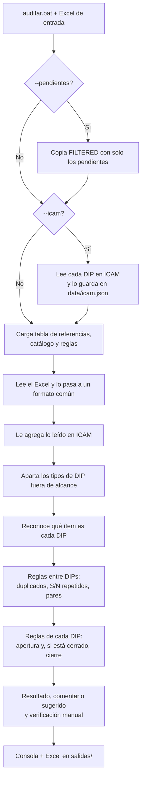
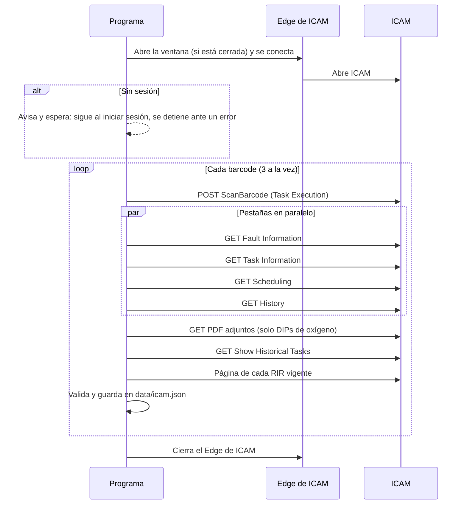
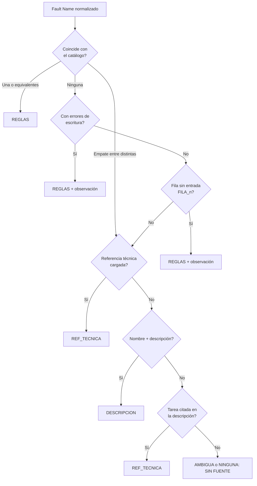
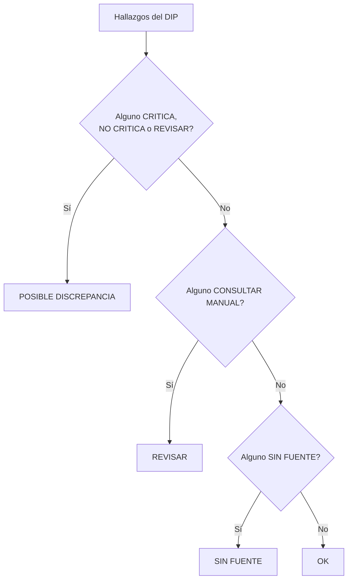

# Cómo funciona el Auditor de DIPs, de principio a fin

Este documento recorre todo lo que hace el programa cada vez que se ejecuta: qué lee, en qué orden, qué decide, con qué criterio y qué entrega. Cada paso dice en qué archivo del código está, para poder confirmarlo.

Otros documentos, si hace falta más detalle:

- [README.md](README.md): uso rápido.
- [docs/tecnico.md](docs/tecnico.md): reglas en detalle y cómo se calibraron con los auditores.
- [docs/proceso.md](docs/proceso.md): el proceso en diagramas.

## Índice

1. [En pocas palabras](#1-en-pocas-palabras)
2. [Vocabulario](#2-vocabulario)
3. [Archivos que intervienen](#3-archivos-que-intervienen)
4. [Instalación](#4-instalación)
5. [Formas de ejecutarlo](#5-formas-de-ejecutarlo)
6. [Recorrido completo de una auditoría](#6-recorrido-completo-de-una-auditoría)
7. [Auditar un solo DIP por su barcode](#7-auditar-un-solo-dip-por-su-barcode)
8. [Comparar con la auditoría manual](#8-comparar-con-la-auditoría-manual)
9. [Filtrar los DIPs pendientes](#9-filtrar-los-dips-pendientes)
10. [Con ICAM y sin ICAM: qué cambia](#10-con-icam-y-sin-icam-qué-cambia)
11. [Configuración: qué se toca y dónde](#11-configuración-qué-se-toca-y-dónde)
12. [Todas las reglas](#12-todas-las-reglas)
13. [Benchmark y pruebas](#13-benchmark-y-pruebas)
14. [Preguntas frecuentes](#14-preguntas-frecuentes)
15. [Mensajes de error y qué hacer](#15-mensajes-de-error-y-qué-hacer)
16. [Mapa del código](#16-mapa-del-código)
17. [Límites conocidos](#17-límites-conocidos)

---

## 1. En pocas palabras

El programa hace la primera pasada de la auditoría de DIPs, la misma que hace un auditor a mano:

1. Lee el Excel exportado de ICAM (por ejemplo `DIPs Audit (29SEP2026).xlsx`).
2. Si se le pide (`--icam`), abre ICAM en una ventana de Edge y lee la ficha completa de cada DIP.
3. Reconoce qué ítem es cada DIP (botella de oxígeno, FAK, amortiguador...) y busca en `DIPs References.xlsx` qué exige ese ítem: plazo (TA), Parent Assembly, referencia técnica y RIR.
4. Aplica reglas fijas de apertura y, si el DIP está cerrado, también de cierre.
5. Entrega un Excel nuevo con un resultado por DIP y los motivos. El auditor confirma.

Tres cosas que el programa **nunca** hace:

- **No usa inteligencia artificial.** Cada hallazgo sale de una regla escrita y dice qué dato lo produjo. Hubo un modelo de lenguaje opcional; no mejoró nada y se eliminó ([docs/comparacion_modos.md](docs/comparacion_modos.md)).
- **No escribe en ICAM.** Solo busca el barcode y lee páginas. No abre formularios ni pulsa botones.
- **No modifica el Excel de entrada.** El resultado siempre es un archivo nuevo en `salidas/`.

Cada DIP termina con uno de estos resultados:

| Resultado | Qué significa | Qué hace el auditor |
| --- | --- | --- |
| **POSIBLE DISCREPANCIA** | Falló al menos una regla | Lee `HALLAZGOS` y decide si es discrepancia |
| **REVISAR** | La tabla da el TA o el RIR "según el daño" ("DEPENDING ON...", "CONSULT REF.", MMEL): el programa no puede compararlo | Lo verifica en el manual que cita el hallazgo |
| **SIN FUENTE** | El DIP no está en la tabla de referencias: no hay contra qué comparar intervalo, Parent Assembly ni referencia técnica | Lo verifica contra la fuente que cita el DIP (o se agrega la referencia a la tabla) |
| **OK** | No falló ninguna regla (puede tener observaciones) | Hace las verificaciones de `VERIFICACIÓN MANUAL` |
| **FUERA DE ALCANCE** | Tipo de DIP excluido con `--tipos-dip` | Nada: no se auditó |



---

## 2. Vocabulario

| Término | Qué es |
| --- | --- |
| **DIP** | Ítem diferido (deferred item). En ICAM es una falla con un T/A abierto |
| **Barcode** | Identificador del DIP en ICAM (`T40S009H0QN`). Es la clave que une el Excel, ICAM y el resultado |
| **T/A** | El plazo cargado en ICAM para el DIP (pestaña Scheduling): uno o varios límites (días, FH, FC), su Start y su deadline |
| **TA** | El plazo que exige la tabla de referencias para ese ítem ("3 DAYS", "60 DAYS OR 500 FH") |
| **Intervalo** | El valor del T/A (`DIP Interval` + `Interval Type` en el Excel) |
| **Unidades** | DAY (días calendario), FH (horas de vuelo), FC (ciclos), MONTH (se compara como 30 a 31 días por mes) |
| **Start** | Desde dónde cuenta el T/A en ICAM: una fecha (días) o un contador de uso (FH, FC) |
| **Due date** | Cuándo vence el DIP (`Fault Due Date`). Sin hora, vence al final del día |
| **Found On Date** | Apertura: cuándo se encontró la falla |
| **Defer Dt** | Cuándo se difirió la acción correctiva |
| **Usage Remaining** | Lo que le queda al T/A (en un DIP cerrado, lo que le quedaba al cerrarlo) |
| **Parent Assembly** | Dónde está cargado el DIP: el avión (AIRCRAFT), un motor (ENGINE) o el APU |
| **RIR** | Inspección repetitiva. En ICAM son Follow-on Tasks del DIP de clase ADHOC |
| **Technical References** | Referencias del manual cargadas en ICAM (AMM, EC/RA, SRM, task card...) |
| **Attachments** | Archivos adjuntos al DIP en ICAM (capturas, fotos, PDF) |
| **Deferral Reference** | Referencia del diferimiento; debe empezar con el ATA del DIP |
| **Tipo de DIP** | Columna `Area` o `Type DIP`: Others, Powerplant, Structures... |
| **Tabla de referencias** | `DIPs References.xlsx`, hoja `References`: qué exige cada ítem |
| **Catálogo** | `config/catalogo_others.yaml`: cómo reconocer cada fila de la tabla en el nombre de un DIP |
| **Entrada del catálogo** | Un ítem reconocible, con una o más filas de la tabla |
| **Variante** | Una de las opciones de TA de un ítem (por flota, por presión, por etapa) |
| **Ventana "AFTER A, BEFORE B"** | El T/A empieza A después de la apertura y dura B - A (amortiguador, FDR, frenos...) |
| **Hallazgo** | Una regla que falló, con su mensaje. Va en `HALLAZGOS` |
| **Observación** | Hallazgo que se anota pero no cambia el resultado del DIP |
| **Verificación manual** | Algo que el programa no puede decidir y deja para el auditor (`VERIFICACIÓN MANUAL`) |
| **Apertura / cierre** | Las dos auditorías de un DIP: al abrirse (ACTV) y al cerrarse (COMPLETE) |
| **AUDITDIP** | Marca que el auditor pone en Technical References al terminar su auditoría manual |
| **Modo prueba** | Corridas con datos de prueba, separadas de las reales (carpeta `pruebas/`) |

---

## 3. Archivos que intervienen

| Archivo o carpeta | Qué es | Quién lo escribe | En Git |
| --- | --- | --- | --- |
| `DIPs Audit (...).xlsx` | Excel de entrada exportado de ICAM | ICAM / el usuario | No (tiene nombres del personal) |
| `DIPs References.xlsx` | Tabla de referencias (hoja `References`) | Ingeniería / auditores | Sí |
| `config/catalogo_others.yaml` | Palabras con que se reconoce cada fila de la tabla (88 entradas) | Quien mantiene el programa | Sí |
| `config/discrepancias.yaml` | Qué reglas están activas y cuánto pesan | Quien mantiene el programa | Sí |
| `config/config.yaml` | Rutas, tolerancias y lectura de ICAM | Quien mantiene el programa | Sí |
| `data/icam.json` | Todo lo leído en ICAM, un registro por barcode | El programa | No |
| `.icam_perfil/` | Perfil del Edge de ICAM (ahí vive la sesión) | Edge | No |
| `salidas/` | Excel de resultado y de comparación | El programa | No |
| `... FILTERED.xlsx` | Copia filtrada, junto al original | `filtrar.bat` o `--pendientes` | No |
| `pruebas/` | Excel, datos de ICAM y resultados del modo prueba | El programa | No (solo el README) |
| `benchmark/` | Muestra anónima de DIPs auditados, casos y línea base | El programa / quien mantiene | Sí |
| `tools/` | Scripts de la primera extracción de ICAM. El programa **no** los usa | - | Sí |

Lo que tiene datos del personal o datos operativos (Excel de entrada, `data/`, `pruebas/`, `salidas/`) está en `.gitignore` y nunca se sube.

---

## 4. Instalación

`setup.bat` ejecuta `setup.ps1`, que:

1. Busca Python 3.11 o superior; si no hay, instala Python 3.12 (con winget, o desde python.org), solo para el usuario.
2. Crea el entorno virtual `.venv` e instala `requirements.txt`: pandas, openpyxl, rapidfuzz (parecido entre textos), pyyaml, rich (consola), pytest, playwright (maneja Edge) y pypdf (lee los PDF de inventario).
3. Verifica que existan Microsoft Edge y `DIPs References.xlsx`.
4. Corre las pruebas (`setup.bat -SinPruebas` las omite).

Se puede ejecutar varias veces: lo que ya está instalado se omite. No descarga ningún navegador: el programa usa el Edge del equipo.

---

## 5. Formas de ejecutarlo

### 5.1 Los .bat

| Archivo | Qué hace |
| --- | --- |
| `auditar.bat` | Si el primer argumento es un archivo que existe, audita ese Excel (`python -m dips_audit auditar ...`). Si no, lo toma como barcode (`python -m dips_audit barcode ...`). Sin argumentos, muestra cómo usarlo |
| `comparar.bat` | Compara el programa con la auditoría manual del Excel (`python -m dips_audit comparar ...`) |
| `filtrar.bat` | Crea la copia `... FILTERED.xlsx` con los DIPs pendientes de auditar (`python -m dips_audit.filtrar ...`) |
| `setup.bat` | Instalación |

Al arrastrar un Excel sobre un `.bat` (o con doble clic), la ventana espera una tecla al final para que se pueda leer el resultado. Desde una consola abierta no espera. Lo decide `dips_audit/pausa.py` mirando si el proceso que abrió la ventana es el Explorador de Windows.

Ojo: como `auditar.bat` decide por la existencia del archivo, una ruta mal escrita se interpreta como barcode y termina con "... no es un barcode ni un Excel de entrada que exista".

### 5.2 Comandos

Todos se ejecutan con `.venv\Scripts\python -m dips_audit <comando>`:

| Comando | Qué hace |
| --- | --- |
| `auditar ARCHIVO` | La auditoría completa (sección 6) |
| `barcode T40S... [T40S...]` | Audita uno o varios DIPs solo con ICAM, sin Excel; resultado en consola (sección 7) |
| `comparar ARCHIVO` | Compara con la auditoría manual (sección 8) |
| `extraer-icam ARCHIVO` o `--barcode X` | Solo lee ICAM y guarda en `data/icam.json`. Con un solo `--barcode`, muestra en JSON lo que interpretó de ese DIP (útil para diagnosticar) |
| `abrir-icam` | Abre el Edge de ICAM para iniciar sesión, sin auditar |
| `referencias` | Muestra cómo se interpretó la tabla de referencias: TA de cada entrada, Parent Assy, referencia técnica y advertencias |
| `categorias` | Lista los tipos de discrepancia y sus reglas (los nombres que acepta `--categorias`) |
| `benchmark` | Mide el programa contra DIPs ya auditados (sección 13) |
| `anonimizar` | Crea la muestra anónima del benchmark desde el histórico |

`python -m dips_audit.filtrar ARCHIVO` es el filtro de pendientes (sección 9).

### 5.3 Opciones

| Opción | Comandos | Qué hace |
| --- | --- | --- |
| `-i`, `--icam` | auditar, comparar | Leer antes en ICAM todos los DIPs del archivo. Sin esta opción se audita solo con el Excel |
| `--no-cache` | auditar, comparar, barcode, extraer-icam | Leer en ICAM también los DIPs leídos hace menos de 1 hora |
| `--datos-icam RUTA` | auditar, comparar, barcode | Usar datos de ICAM ya leídos (`data/icam.json` o un CSV/Excel con `barcode` y `technical_references`), sin abrir ICAM y sin importar su antigüedad |
| `--pendientes` | auditar | Filtrar antes el Excel y auditar solo los pendientes (sección 9) |
| `-j`, `--hoja NOMBRE` | auditar, comparar, extraer-icam | Hoja a leer. Por defecto, la primera que tenga `Fault Barcode` y `Fault Name` |
| `-f`, `--fecha "AAAA-MM-DD HH:MM"` | auditar, barcode | Auditar como si fuera ese día y hora (por defecto, ahora). Cambia, por ejemplo, qué DIPs están vencidos |
| `-c`, `--categorias TIPO ...` | auditar, comparar, barcode | Revisar solo esos tipos de discrepancia (basta una parte del nombre) |
| `-e`, `--excluir-categorias TIPO ...` | auditar, comparar, barcode | Revisar todos menos esos |
| `-t`, `--tipos-dip TIPO ...` | auditar, comparar | Auditar solo esos tipos de DIP (`Others`, `Powerplant`...). Los demás quedan FUERA DE ALCANCE |
| `-n`, `--sin-excel` | auditar | Solo consola, sin Excel de salida |
| `--max-filas N` | auditar | Cuántos DIPs con posible discrepancia mostrar en consola (40 por defecto) |
| `-o`, `--salida RUTA` | auditar | Dónde guardar el Excel de resultado |
| `-p`, `--prueba` | auditar, comparar, barcode, extraer-icam | Forzar el modo prueba |
| `--config RUTA` | todos (antes del comando) | Usar otro `config.yaml` |

Códigos de salida: 0 bien, 1 error, 2 el benchmark empeoró.

---

## 6. Recorrido completo de una auditoría

Esto es lo que pasa, en orden, con `auditar.bat "DIPs Audit (29SEP2026).xlsx" --icam`. El código de este recorrido está en `dips_audit/__main__.py` (`cmd_auditar`) y `dips_audit/auditor.py`.

### Paso 1. Arranque: configuración y modo prueba

`auditor.cargar_configuracion` lee `config/config.yaml` y convierte las rutas relativas en rutas desde la carpeta del proyecto.

Después, `__main__._modo_prueba` decide si es una corrida de prueba: el Excel está dentro de `pruebas/` o se usó `--prueba`. En modo prueba:

- lo leído en ICAM va a `pruebas/icam.json` en vez de `data/icam.json`;
- los resultados van a `pruebas/salidas/`, con el prefijo `PRUEBA_` en el nombre;
- el Excel de salida lleva el aviso "PRUEBA: datos de prueba, no es una auditoría real.";
- la consola muestra un recuadro amarillo "MODO PRUEBA".

Así las pruebas nunca se mezclan con las auditorías reales.

### Paso 2 (opcional). Solo los pendientes: `--pendientes`

Se ejecuta el mismo filtro que `filtrar.bat` (sección 9): se crea `DIPs Audit (...) FILTERED.xlsx` junto al original y, desde ahí, todo el recorrido usa ese archivo filtrado. La consola muestra cuántas filas quedaron por hoja.

### Paso 3 (opcional). Lectura de ICAM: `--icam`

Código: `dips_audit/extractor_icam.py`. Solo lee texto; la interpretación se hace después (paso 6), así se puede volver a auditar sin volver a leer ICAM.

**3.1 Qué DIPs se leen.** Todos los barcodes de la hoja del Excel, de cualquier tipo (`--tipos-dip` no limita la lectura). Un DIP leído hace menos de 60 minutos (`icam.vigencia_minutos`) no se vuelve a leer: se usa lo guardado. `--no-cache` los lee todos.

**3.2 El Edge de ICAM.** El programa usa un Edge aparte, con su propio perfil (`.icam_perfil/`) y un puerto local de depuración (9222) por el que Playwright lo maneja. Convive con el Edge de uso diario. Si ese Edge ya está abierto, lo reutiliza; si no, lo abre directo en la URL de ICAM. La sesión queda guardada en el perfil: si sigue vigente, no hace falta volver a iniciarla.

**3.3 Inicio de sesión.** El programa nunca escribe usuario ni contraseña. Revisa la ventana cada medio segundo:

| Lo que ve | Qué hace |
| --- | --- |
| ICAM con el campo Barcode Search | Hay sesión: sigue |
| La página de inicio de sesión esperando datos | Avisa "Inicie sesión en la ventana de Edge..." y espera hasta 3 minutos (`espera_sesion_minutos`). Sigue apenas se inicia sesión |
| Un mensaje de error en esa página (usuario o clave) | Se detiene: "No se pudo iniciar sesión en ICAM: ..." |
| La ventana cerrada | Se detiene |
| Nada de eso en 30 segundos (`espera_segundos`) | Se detiene: "ICAM no cargó" |

Con la sesión confirmada, toma la dirección del formulario Barcode Search (`ScanBarcode`), que es por donde buscará cada DIP.

**3.4 Qué hace con cada DIP.** Lee 3 DIPs a la vez (`icam.paralelo`). Por cada uno:

1. **Busca el barcode** con un POST a `ScanBarcode`, igual que Barcode Search. La respuesta es la página del DIP con la pestaña Task Execution.
2. **Lee las otras 4 pestañas** en paralelo con GET: Fault Information, Task Information, Scheduling e History.
3. **DIPs de oxígeno** (la palabra OXYGEN en el título o la descripción): descarga cada PDF de Attachments y guarda solo los campos del formulario (el inventario de generators), no el archivo.
4. **RIR cerradas:** abre "Show Historical Tasks" de Fault Information.
5. **Cada RIR vigente** (Follow-on Task de clase ADHOC; si hay varias con el mismo nombre, la ACTV): la busca por su ID y lee su Scheduling y su Task Information.

Cada respuesta de ICAM se carga en una página aislada: sin conexión a la red y sin los scripts de ICAM (se quitan antes). Como ICAM oculta las pestañas y tablas que no están activas y los scripts que las muestran no corren, el programa las hace visibles antes de copiar el texto. Sin ese paso se perderían las referencias técnicas, los attachments y los intervalos.

**3.5 Validaciones y reintentos.** Cada respuesta se valida:

- que siga en ICAM y no sea la página de inicio de sesión (si lo es, la sesión venció: se detiene todo);
- que sea la página de un DIP y que el barcode de la página sea el pedido;
- que la pestaña traiga su contenido (por ejemplo, Scheduling debe tener "Deadline", "Interval" o "Due").

Cada consulta se reintenta hasta 3 veces (`icam.intentos`), esperando 0.5 s y 1 s entre intentos. Si la búsqueda o una pestaña fallan igual, el DIP queda con error y **no se guarda** a medias. Un error en una RIR o en un PDF no invalida el DIP: queda anotado en el registro (`rir_errores`, `pdf_errores`).

**3.6 Dónde se guarda.** Todos los DIPs van a un solo archivo, `data/icam.json` (`{"records": [...]}`), un registro por barcode con el texto de cada pestaña, la fecha de lectura y, si corresponde, los PDF y las RIR. Una lectura nueva reemplaza a la anterior del mismo barcode. El archivo se reescribe como mucho cada 5 segundos y al terminar (también si algo falla), primero en un temporal y después se reemplaza: nunca queda a medias. Si quedan JSON sueltos de versiones anteriores (`data/icam/*.json`), se unen a `data/icam.json` y se borran.

**3.7 Al terminar.** Cierra el Edge de ICAM (`cerrar_al_terminar: false` lo deja abierto) y muestra "ICAM: N leídos, M de lo guardado, K con error", con los primeros 10 errores.

**3.8 Si la sesión vence a mitad de camino.** La corrida se detiene con "La sesión de ICAM venció" y **no audita**. Lo leído hasta ahí queda guardado; al volver a ejecutar, los DIPs leídos en la última hora no se vuelven a leer.

**Importante:** si un DIP da error de lectura pero ya tenía una lectura anterior en `data/icam.json`, la auditoría usa esa lectura anterior (puede ser vieja). Si nunca se leyó, se audita solo con el Excel.

Rapidez: sin dibujar páginas ni descargar imágenes, unos 5 minutos para 380 DIPs.



### Paso 4. Carga de las referencias

Al crear el `Auditor` (`auditor.Auditor.__init__`):

1. **Fecha de auditoría:** la de `--fecha` o ahora, al minuto. Todas las reglas que dependen del momento (DIP vencido, duplicado ya cerrado) usan esta fecha.
2. **Tabla de referencias** (`referencias.cargar_referencias`): lee solo la hoja `References` de `DIPs References.xlsx` (las otras hojas, como "Referencias sugeridas", se ignoran). La fila 1 debe tener las columnas TYPE, AREA, ATA, FLEET, DESCRIPTION, PARENT ASSY, REFERENCES, TA y RIR. Las filas sin DESCRIPTION se saltan. Hoy tiene 92 filas: 60 Others, 20 Powerplant y 12 Structures.
3. **Catálogo** (`referencias.cargar_catalogo`): cada entrada de `catalogo_others.yaml` se une con sus filas de la tabla por el texto de DESCRIPTION. Si una referencia del catálogo no existe con ese texto en la tabla, o hay dos entradas con el mismo `id`, el programa **se detiene** con un mensaje que lo dice.
4. **Interpretación del TA** de cada fila (`interpretar_ta` y `remite_al_manual`):

   | Texto del TA en la tabla | Cómo se interpreta |
   | --- | --- |
   | "3 DAYS", "12 MONTHS" | Un límite |
   | "60 DAYS OR 500 FH" | Límite dual: lo que ocurra primero |
   | "UNTIL DUE DATE" | Ítem con vencimiento: el due date no puede pasar la fecha del ítem |
   | Con DEPENDING, CONSULT, SEGÚN o MMEL | TA según el manual: el DIP queda en REVISAR (salvo que el catálogo defina `intervalos`) |
   | Otro texto condicional (IF, AFTER, ":" o ";") | No se interpreta solo: se define en el catálogo con `intervalos`. Si no está definido, queda como verificación manual y se avisa al cargar |

   El RIR se interpreta igual: "1 DAY", "100 FH" es un RIR comparable; con DEPENDING/CONSULT es RIR según el manual (REVISAR). Un Parent Assy con asterisco ("AIRCRAFT*") acepta avión o motor.
5. **Filas sin entrada en el catálogo:** cada fila de la tabla que ninguna entrada usa recibe una entrada automática `FILA_<n>`. Así, agregar una fila a la tabla ya sirve aunque nadie haya escrito su entrada en el catálogo (paso 8).
6. **Índice de números de tarea** (`referencia_tecnica.IndiceReferencias`): qué números AMM, EC/RA, task card JIC y SRM tiene cada entrada y cada fila. Si REFERENCES empieza con "[AIRCRAFT SPECIFIC]", sus números son ejemplos y no se indexan.
7. **Reglas** (`discrepancias.cargar_discrepancias`): lee `config/discrepancias.yaml`. Si se usó `--categorias` o `--excluir-categorias`, se marcan qué tipos se revisan y la consola los muestra.
8. **Tipos de DIP auditados:** `--tipos-dip` o `tipos_auditados` de `config.yaml` (vacío = todos).

Para ver cómo quedó todo esto: `python -m dips_audit referencias`.

### Paso 5. Lectura del Excel de entrada

Código: `dips_audit/cargador.py` (`cargar_export` y `normalizar_lote`).

**Hoja y encabezados.** Usa la hoja de `--hoja` o, si no se indica, la primera hoja que tenga `Fault Barcode` y `Fault Name` en alguna de sus primeras 20 filas. Esa fila es el encabezado, así que puede haber títulos arriba. En el export actual la primera hoja (`DIPs Audit (n)`) tiene todos los DIPs; las hojas ACTIVE y COMPLETE son subconjuntos y no se leen. Si dos columnas se llaman igual, la segunda se renombra con "(2)".

**Filas.** Las filas sin barcode se saltan. Si un barcode aparece dos veces, se audita la primera fila y se avisa cuántas se omitieron.

**Columnas que reconoce** (sin importar mayúsculas):

| Dato | Nombres aceptados | Obligatoria |
| --- | --- | --- |
| Barcode | Fault Barcode | Sí |
| Nombre | Fault Name | Sí |
| Intervalo | DIP Interval | Sí |
| Tipo de intervalo | Interval Type | Sí |
| Estado | Fault Status | Sí |
| Avión | Aircraft | Sí |
| Tipo de DIP | Type DIP, Area | |
| ATA | ATA | |
| Descripción | Fault Description, Description | |
| Parent Assy | Task Parent Assy | |
| Severidad | Fault Severity | |
| Deferral Reference | Deferral Reference | |
| Due date | Fault Due Date | |
| Due date original | Orig Fault Due Date | |
| Apertura | Found On Date, Fault Found on Date | |
| Diferido | Defer Dt, Deferral Date, Fault Deferral Date | |
| Programado | Scheduled Date | |
| Paquete de trabajo | Work Package Barcode | |
| Usage Remaining | Usage Remaining | |
| Cierre | Complete Dt, Completed Date, Fault Completed Date, Completion Date | |
| Referencia técnica | Technical References, Technical Reference, technical_references, Referencias Técnicas, Referencia Técnica | |
| RIR activo | Rir Barcode, Rir Name, Rir Driver Interval, Rir Driver Type | |
| Attachments | Attachment Status, Attach Docs | |

Si falta una obligatoria: "Faltan columnas obligatorias en el Excel: ...". Las demás columnas del Excel (QC Validation, Deferred By, las de la auditoría manual...) no se usan para auditar, pero se copian tal cual al Excel de salida. Las de la auditoría manual solo las usan `comparar` y el filtro de pendientes.

**Cómo se interpreta cada valor:**

| Dato | Qué se hace |
| --- | --- |
| Fechas | Acepta fechas de Excel y textos como `Sep/26/26 14:00`, `09/26/2026 2:00:00 PM`, `26-SEP-2026`, `2026-09-26`. Lo que no se entiende queda sin dato |
| Fecha de apertura con día y mes invertidos | Si la apertura es posterior al due date y su día es 12 o menos, se prueba invertir día y mes; se acepta solo si así queda antes del due date. Se anota en `VERIFICACIÓN MANUAL` y en las notas |
| Números | Se quitan las comas de miles |
| Tipo de intervalo | Se lleva a DAY (DAY, DAYS, CDY, D, DIA), FH (HOURS, HRS, FH), FC (CYCLES, LANDINGS, FC, CYC) o MONTH. Otro texto queda sin unidad |
| Fault Status | En mayúsculas. ACTV, OPEN e IN WORK son activos; COMPLETE es cerrado |
| Parent Assy | Se clasifica en ENGINE (dice ENGINE, CFM o LEAP), APU, AIRCRAFT (dice BOEING o 737) u OTRO |
| Flota | La matrícula dice MAX (HP-98xx y HP-99xx) o NG (otra HP-xxxx); el modelo del Parent Assy, cuando es el avión, precisa NG-700, NG-800 o NG-900. Un DIP cargado en un motor toma la flota de otro DIP del mismo avión |
| RIR | Si hay `Rir Barcode`, ese es el RIR activo del DIP (con `Rir Driver Interval` y `Rir Driver Type` como intervalo) |
| Attachments | `Attach Docs` da la cantidad; `Attachment Status` PENDING sin cantidad = ninguno |

Además avisa si el Excel no trae fecha de cierre (no se puede verificar el cierre tarde) o no trae descripción (S/N y referencias se buscan solo en el Fault Name).

El resultado es un `Lote` con dos tablas: `original` (las columnas tal como vienen, para copiarlas a la salida) y `datos` (columnas estándar ya interpretadas, lo que usan las reglas). Cada DIP es un diccionario (`dip`) con esos datos.

### Paso 6. Se agrega lo leído en ICAM

Código: `cargador.completar_con_icam`, que usa `icam.leer_ficha` para interpretar el texto de cada pestaña.

Solo pasa si se leyó ICAM (`--icam`) o se indicó `--datos-icam`. Por cada DIP del Excel que está en `data/icam.json`:

| Dato | Qué manda |
| --- | --- |
| Referencia técnica | ICAM (Technical References, sin las marcas de auditoría) |
| Descripción | ICAM, si trae texto |
| Notas de la descripción (Deferral Notes) | Solo ICAM |
| Attachments | ICAM (lista con los nombres) |
| RIR | ICAM (Follow-on Tasks abiertas e históricas, y la página de cada RIR) |
| T/A completo (límites, Start, deadlines, extensión) | Solo ICAM (Scheduling) |
| Uso al encontrar la falla (ciclos y horas) | Solo ICAM (History, "Usage When Found") |
| Parent Assembly de ICAM | Solo ICAM (se compara con el de las RIR) |
| Acción correctiva, S/N removido e instalado | Solo ICAM (Task Execution) |
| Cambios de deadline | Solo ICAM (History) |
| Marcas AUDITDIP | Solo ICAM (Technical References) |
| Inventario de generators | Solo ICAM (PDF adjuntos) |
| Fecha de cierre | El Excel; ICAM (Actual End Date) solo si el Excel no la trae |
| Intervalo y tipo | El Excel; ICAM (primer límite del T/A) solo si el Excel no lo trae, y queda una observación |
| Todo lo demás (due date, apertura, estado, avión, Parent Assy, ATA...) | El Excel |

Las notas de la carga dicen "Datos de ICAM (icam.json): X de Y DIPs". Un DIP que no está en el JSON sigue solo con el Excel.

**"Sin dato" no es "cero".** Sin ICAM, esos campos quedan vacíos (`None`) y las reglas que los necesitan no marcan nada: usan lo que dice el Excel o dejan una verificación manual. Con ICAM, una lista vacía (`[]`) sí significa "no hay": por ejemplo, cero attachments.

### Paso 7. Qué DIPs están en alcance

Con `--tipos-dip Others` (o `tipos_auditados` en `config.yaml`), solo se auditan los DIPs cuyo `Area` / `Type DIP` coincide (sin importar mayúsculas). Los demás quedan **FUERA DE ALCANCE**: no se asocian, no se revisan y no cuentan para duplicados. Un DIP sin tipo siempre se audita. Si un tipo pedido no aparece en el Excel (por ejemplo, por un error de escritura), la consola avisa qué tipos hay.

### Paso 8. Qué ítem es cada DIP (asociación)

Código: `dips_audit/texto.py`, `dips_audit/asociacion.py` y `auditor.Auditor._asociar`.

Es el paso más delicado: el Fault Name lo escribe el técnico a mano ("CREW OXY 850 PSI", "DIP-FWD CABIN FIRT AID KIT") y la tabla usa sus propias descripciones. El programa trabaja en capas.

**8.1 Limpieza del texto** (`texto.normalizar`). Todo texto, del DIP y del catálogo, pasa por lo mismo:

1. Mayúsculas y sin acentos ("Oxígeno" -> "OXIGENO").
2. Siglas con puntos juntas ("P.O.B" -> "POB").
3. Signos a espacios ("DIP-CREW/OXY" -> "DIP CREW OXY").
4. Errores y sinónimos frecuentes (`_SINONIMOS`): FIRT -> FIRST, OXY/O2/OXIGEN -> OXYGEN, EXTINTOR -> EXTINGUISHER, TIRES/TYRE -> TIRE, BREAK -> BRAKE, LIFE VEST -> LIFEVEST, ELT2 -> ELT 2...

**8.2 Palabras clave del catálogo.** Cada entrada dice qué palabras debe tener el nombre:

```yaml
- id: OXIGENO_TRIPULACION
  referencias: ["CREW OXYGEN BOTTLE PRESSURE"]     # DESCRIPTION exacta de la tabla
  requiere: [[OXYGEN], [CREW, FLIGHT COMPARTMENT, FLIGHT DECK, COCKPIT]]
  excluir: [PORTABLE, HYDRO, POB, MASK, MASKS]
```

- `requiere`: el nombre debe tener **al menos una frase de cada grupo**, en cualquier orden.
- `excluir`: si aparece alguna, no es esta entrada.
- Se comparan palabras completas: "ELT" no coincide dentro de "BELT".

Si coinciden varias, gana la de mayor puntaje: por cada grupo, 100 más el largo de la frase encontrada (más grupos y frases más largas = más específica). Si empatan y llevan a las mismas verificaciones (mismo TA, flotas, vencimiento y Parent Assy), da igual cuál: se toma la primera. Si empatan y son distintas, el nombre es **ambiguo**: se prueba por la referencia técnica y la descripción (8.5) y, si tampoco se resuelve, el DIP queda SIN FUENTE con las candidatas en el hallazgo ("varias referencias posibles").

**8.3 Errores de escritura.** Si ninguna entrada coincide exacto, se vuelve a probar tolerando errores, solo en palabras de 5 letras o más y con 85 % de parecido o más ("FUNIGATION" -> "FUMIGATION"). En siglas y palabras cortas no hay tolerancia: ELT y EMK son ítems distintos. Se acepta solo si gana una entrada (o varias equivalentes), y queda la observación "'FUNIGATION' se leyó como 'FUMIGATION'".

**8.4 Filas de la tabla sin entrada en el catálogo** (`FILA_<n>`). Se prueban solo si ninguna entrada del catálogo coincide. El nombre debe tener todas las palabras de la DESCRIPTION antes de la aclaración (" - ", "(" o "["), sin números ni palabras genéricas: "TIRE PRESSURE RECHECK IN 24 HOURS (LOW PRESSURE...)" -> TIRE, PRESSURE, RECHECK, HOURS. Queda la observación "Fila n de la tabla sin entrada en el catálogo... Verificar".

**8.5 Si el nombre no alcanza**, se prueba en este orden:

1. **La referencia técnica cargada** (ICAM o columna del Excel): si su número de tarea (AMM, EC/RA, JIC; no SRM, que es un capítulo de daños, no un ítem) está en una sola entrada, o en varias equivalentes, se asocia a esa. Pero si la descripción dice claramente otro ítem, manda la descripción (y después la regla de referencia técnica marca que la cargada es de otro ítem).
2. **El Fault Name junto con la descripción**, con las mismas palabras clave y sin tolerar errores. Se descarta si la descripción cita una tarea que no es la de esa entrada (el DIP sigue otra fuente).
3. **La tarea citada en la descripción** ("IAW EC/RA 2500-0538C" -> la entrada con esa EC/RA).

Las task cards JIC de la descripción no cuentan para asociar: son la tarea donde se encontró la falla (el Service Visit), no la fuente del DIP.

**8.6 Resultado de la asociación.** Queda en las columnas `REFERENCIA ASOCIADA` y `ASOCIACIÓN`:

| Método | Confianza | Cuándo | Deja |
| --- | --- | --- | --- |
| REGLAS | ALTA | Por el Fault Name | Nada, u observación si hubo error de escritura |
| REF_TECNICA | ALTA | Por la referencia técnica cargada o citada | Observación "identificada por la referencia técnica" |
| DESCRIPCION | MEDIA | Por el nombre junto con la descripción | Observación "identificada por la descripción. Verificar." |
| AMBIGUA | BAJA | Empate entre entradas distintas, sin que 8.5 lo resuelva | SIN FUENTE |
| NINGUNA | BAJA | Nada coincide | SIN FUENTE |

A un DIP sin fuente se le buscan las 2 filas más parecidas de la tabla (de cualquier tipo) y se anotan en `VERIFICACIÓN MANUAL` ("Parecido en la tabla: ..."). Si se parece mucho (90 % o más) a una fila de otro tipo de DIP, queda la observación de que quizá se abrió con el tipo equivocado.



### Paso 9. Reglas que comparan un DIP con los demás

Se calculan sobre todos los DIPs en alcance a la vez, antes de revisar cada DIP (`reglas.buscar_duplicados`, `reglas.buscar_sn_repetidos`, `reglas_descripcion.buscar_parent_distinto_de_pares`).

**Duplicados.** Dos DIPs son posibles duplicados si se cumplen **todas** estas condiciones. Se marca el que se abrió después.

- Mismo avión y misma entrada del catálogo.
- Mismas posiciones en el nombre (FWD/AFT, LH/RH, #1/#2...) y en la descripción (el squib LEFT y el RIGHT de la misma botella no son duplicados).
- S/N compatibles: si los dos citan S/N, comparten alguno.
- Mismos mensajes de mantenimiento, si los citan (75-20451 y 75-10451 son dos fallas).
- Abiertos al mismo tiempo: los dos activos, o se solapan entre apertura y cierre, o (sin fecha de cierre) abiertos el mismo día.
- En una referencia con varias etapas, el mismo intervalo (otro intervalo es otra etapa: re-torque a 60 días y a 12 meses).
- En un ítem con vencimiento, el mismo due date (distinto vencimiento = distinto componente).

Si uno de los dos ya estaba cerrado a la hora de la auditoría, el duplicado ya se corrigió: queda como observación.

**S/N repetido.** Dos o más DIPs **activos** del mismo avión que citan el mismo S/N (por ejemplo, FAK 1 y FAK 2 con el mismo número). Solo se marca si el DIP no se marcó ya como duplicado.

**Parent Assembly distinto de sus pares** (solo DIPs SIN FUENTE). Si el DIP cita una EC/ECRA en su descripción y al menos otros dos DIPs del archivo que citan la misma están todos en otro Parent Assembly, se marca (cinco cambios de toberas por la ECRA 7300-0132C en el motor y uno en el avión). Solo con EC: una AMM puede ser genérica.

### Paso 10. Reglas de cada DIP

Para cada DIP en alcance se arma un `Contexto` (fecha de auditoría, tolerancias y reglas activas) y se aplican las reglas en este orden:

1. `reglas.auditar_dip`:
   - intervalo, Parent Assembly y S/N requerido (**solo si el DIP tiene referencia**);
   - fechas: due date, vencimiento del ítem, DIP vencido, Usage Remaining y, si el DIP está COMPLETE, **todas las reglas de cierre**;
   - Start del T/A;
   - attachments;
   - paquete programado después del due date;
   - S/N contra las notas de la descripción;
   - ATA y Deferral Reference;
   - Fault Severity;
   - y siempre el recordatorio general en `VERIFICACIÓN MANUAL`: "Verificar attachments: captura de referencia técnica y EC/RA adjunta."
2. Referencia técnica (`Auditor._referencia_tecnica`).
3. RIR (`Auditor._rir`).
4. Reglas contra la descripción, **solo si el DIP es SIN FUENTE** (`reglas_descripcion.revisar_descripcion`).
5. Parent Assembly distinto de sus pares (del paso 9), intervalo tomado de ICAM, observaciones de la asociación y, si no tiene referencia, el hallazgo SIN FUENTE.
6. Duplicado o, si no, S/N repetido (del paso 9).
7. DIP creado por error o declarado duplicado: si aplica, **reemplaza todos los hallazgos anteriores**.
8. Si tiene marcas del auditor en Technical References, la nota "Ya se había auditado manualmente" al principio de `VERIFICACIÓN MANUAL`, con lo que anotó en cada una (p. ej. "Apertura: DISCREPANCIA (MISSING RIR INTERVAL); Cierre: sin discrepancia").

Cada regla, al fallar, agrega un **hallazgo** (código, tipo de discrepancia, severidad y mensaje) o una línea de verificación manual. El detalle de cada grupo:

#### 10.1 Intervalo (`regla_intervalo`)

| Caso | Resultado |
| --- | --- |
| Sin intervalo o sin tipo de intervalo | Posible discrepancia (salvo que solo siga un RIR y la tabla no dé plazo: verificación manual) |
| Intervalo 0 o negativo | Posible discrepancia |
| Ítem UNTIL DUE DATE con T/A que no está en días | Posible discrepancia |
| La tabla da el TA según el daño o el tipo | REVISAR, citando el texto de la tabla y el manual |
| TA de la tabla no interpretable y sin `intervalos` en el catálogo | Verificación manual |
| Igual al TA (en meses: entre 30 y 31 días por mes, más 1 día) | Bien: "T/A aperturado correctamente" en el comentario |
| Igual a B - A de una ventana "AFTER A, BEFORE B" | Bien (el Start se revisa en 10.4) |
| En otra unidad que la tabla | Posible discrepancia |
| Mayor que el TA | Posible discrepancia |
| Menor que el TA | Observación |

El intervalo del DIP se compara **exacto** con el de la tabla (es un número escrito a mano). Solo se consideran las variantes de la flota del DIP; si no se sabe la flota, se acepta cualquiera y se anota. Si el intervalo coincide con una variante condicional (por ejemplo, oxígeno de tripulación: 3 días, 1 día o 1 ciclo según la presión), queda la observación "corresponde a la condición ... Verificar que aplique", con la presión que diga el DIP.

**Límite dual.** Si la variante tiene dos límites ("45 DAYS OR 225 FC"): con ICAM, el T/A debe tener los dos (si falta uno, posible discrepancia); sin ICAM, verificación manual (el Excel solo muestra el que vence primero).

#### 10.2 Due date y vencimiento (`regla_fechas`)

- **Due date contra el intervalo** (solo T/A en días y no UNTIL DUE DATE): el due date debe ser el Start del T/A en ICAM más el intervalo; sin ICAM, la apertura más el intervalo (o la apertura + A, si el T/A está armado con una ventana: el FDR de 23 días cuenta desde la apertura + 7). Con 1 día de tolerancia. Posterior: posible discrepancia. Anterior: observación.
- **Ítems con vencimiento** (UNTIL DUE DATE): el due date no puede pasar la fecha del ítem. La fecha sale del PDF de inventario en los generators de oxígeno (10.3) o, si no, de la primera fecha en el nombre o la descripción que sea posterior a la apertura. Posterior: posible discrepancia. Anterior por más de 1 día: observación. Sin fecha: verificación manual.

#### 10.3 Generators de oxígeno (`regla_inventario`, `inventario.py`)

Solo en la entrada del catálogo con `inventario: true` (FCD 3500-0018C-JIC). El PDF adjunto es un formulario con Position, PN, SN, Manufac. Date, Exp. Date y DIP Barcode.

| Caso | Resultado |
| --- | --- |
| Generators del DIP | Los que tienen su barcode en DIP Barcode y los de los S/N de la descripción |
| Vencimiento | Último día del mes de Exp. Date ("01-2029" = 31-JAN-2029). Con varios, el que vence primero |
| Due date después del Exp. Date | Posible discrepancia |
| Due date antes del Exp. Date (más de 1 día) | Observación |
| S/N del DIP que no está en el PDF | Posible discrepancia |
| Con ICAM y sin PDF en los attachments | Observación; se usa la fecha de la descripción |
| PDF escaneado, que no se pudo leer, o sin ICAM | Verificación manual; se usa la fecha de la descripción |

#### 10.4 DIP vencido y Usage Remaining

- **DIP vencido:** un DIP activo cuyo due date (sin hora = final del día) es anterior al **momento de la auditoría**, o con Usage Remaining negativo. Posible discrepancia.
- **Usage Remaining mayor que el intervalo** (DIP activo, más 1 día de tolerancia en días): observación. Pasa cuando el T/A empieza después de la apertura, y los auditores lo aceptan.

#### 10.5 Start del T/A (`regla_inicio_ta`, "Incorrect DIP Start Values")

Solo con ICAM y no en ítems UNTIL DUE DATE. El T/A debe empezar en la apertura:

| Unidad | Start aceptado |
| --- | --- |
| Días | Entre la fecha en que se encontró la falla y el Defer Date, con 1 día de tolerancia |
| FH / FC | El uso al encontrar la falla (History, "Usage When Found"), con 2 FH o 0 FC de tolerancia. En un motor se compara con el uso del motor y del avión. Si el uso es 0 o la diferencia es enorme (otro contador), no se compara |

Con una ventana "AFTER A, BEFORE B" (definida con `inicio` en el catálogo), el T/A debe empezar A después de la apertura y durar B - A:

| Ítem | Ventana | T/A correcto |
| --- | --- | --- |
| Amortiguador NG | After 5 landings, not later than 20 | Start + 5 FC, 15 FC |
| Amortiguador MAX | Five to ten landings | Start + 5 FC, 5 FC |
| FDR | 30 días, no antes de 7 | Start + 7 días, 23 días |
| Desgaste de frenos | NG-700 27/37, NG-800 12/20, MAX 34/42 FC | Start + A, B - A |
| Filtro de combustible del motor | Después de 10 FH, antes de 75 | Start + 10 FH, 65 FH |
| Sellante de ventanas | Opcional: 7 días desde la apertura, o Start + 3 y 4 días | Cualquiera de las dos |

Se marca como posible discrepancia el T/A que empieza en otro momento (antes de la apertura, o en la apertura cuando debía empezar en A). Si empieza bien pero dura B, vence después de la ventana: intervalo excedido. En un DIP SIN FUENTE no se sabe si hay ventana: un Start posterior a la apertura queda como observación; uno anterior sí es posible discrepancia.

#### 10.6 Attachments (`regla_adjuntos`)

- Todo DIP debe tener attachments. Sin ninguno (en ICAM o, sin ICAM, según `Attach Docs` / `Attachment Status` PENDING): posible discrepancia, aunque la descripción cite el manual. Sin ningún dato, no se revisa.
- Un attachment con la matrícula de otro avión en el nombre ("... HP1830.png" en un DIP del HP-1836): observación.

#### 10.7 Paquete programado después del due date

DIP activo cuyo `Scheduled Date` es posterior al due date (final del día + 5 h): va a vencer si no se reprograma. Posible discrepancia.

#### 10.8 S/N

- **S/N requerido** (entradas con `requiere_sn`): si el nombre y la descripción no citan un S/N, observación. Siempre deja la verificación "que el S/N del attachment coincida con el componente".
- **S/N distinto de las notas de la descripción** (con ICAM): se comparan los dígitos (P11101989 y 11101989 son el mismo). Si difieren (11101989 / 11101998), posible discrepancia. Un S/N de más en uno de los textos no cuenta.

Los S/N se reconocen por su prefijo: `S/N`, `S/`, `SN`, seguidos de un código con al menos un dígito.

#### 10.9 ATA, Deferral Reference y Fault Severity

- Deferral Reference que empieza con otro ATA ("25-..." en un DIP ATA 35): posible discrepancia.
- ATA distinto del de la fila de la tabla: observación.
- Fault Severity distinta de DIP: observación.

#### 10.10 Parent Assembly (`regla_parent_assy`)

El tipo del Parent Assy del DIP (AIRCRAFT, ENGINE, APU) debe ser el de la tabla. Si no: posible discrepancia. Si la tabla tiene asterisco o la entrada tiene `parent_assy_flexible` (se transfiere al robar el motor): observación. Parent Assy vacío: verificación manual.

#### 10.11 Referencia técnica (`Auditor._referencia_tecnica`, `referencia_tecnica.py`)

Solo si hay con qué revisarla (descripción o columna de referencias en el Excel, o datos de ICAM).

**¿Tiene referencia?** Vale cualquiera de estas tres evidencias, como la acepta el auditor:

1. cargada en ICAM (Technical References), sin contar "REFERENCE REQUIRED", las marcas "RT AUDIT COMPLETED", el MGM ni notas sin números;
2. una captura adjunta (cualquier attachment);
3. citada en la descripción, las notas o el nombre (AMM, SRM, FIM, IPC, CMM, EC, ECRA, EC/RA, EA, FCD, SB, AD, JIC, task card...).

| Caso | Resultado |
| --- | --- |
| Ninguna de las tres, sin ICAM | Verificación manual (no se sabe si hay captura) |
| Ninguna de las tres, con ICAM | Posible discrepancia (y aclara si solo cita el MGM, que no es referencia técnica) |
| Referencia (cargada o citada) sin attachments, sin REV o sin fecha | Observación. AMM, SRM y task card no necesitan REV ni fecha (`revision_opcional`) |
| Sin cita ni referencia cargada, y todos los attachments son capturas de un barcode de trabajo | Posible discrepancia |
| Cita un barcode de trabajo como fuente ("IAW BARCODE: TRF7N00900V4") y no tiene referencia del manual, o la que tiene es una task card | Posible discrepancia: referencia no específica |

La fecha de una revisión solo cuenta si va junto a "REV": así no se toma una fecha de vencimiento del ítem ("Battery Due: 31-JAN-2027").

**¿Es la de la tabla?** Si el DIP tiene referencia asociada y la tabla da números de tarea, se comparan los números (AMM sin el sufijo de efectividad, EC/RA sin la letra, task card, SRM hasta capítulo-sección-tema) de la referencia cargada, los attachments y la descripción (sin las task cards, que suelen ser el Service Visit):

| Caso | Resultado |
| --- | --- |
| Algún número coincide | Bien |
| La task card de la descripción o de un attachment es justo la de la tabla | Bien |
| Tiene el número de otra entrada de la tabla (o de una fila Powerplant/Structures) | Posible discrepancia |
| Otra tarea del mismo capítulo-sección-tema (AMM 12-15-21-**200**-801 por **210**) | Observación |
| Una tarea que la tabla no tiene | Observación, salvo que la tabla pida una EC/ECRA y el DIP no la cite, o que el DIP solo cite task cards: entonces posible discrepancia |

#### 10.12 RIR (`Auditor._rir`, `rir.py`)

En ICAM las RIR son Follow-on Tasks ADHOC (las REQ, como el servicio de taller, no son RIR). Su intervalo sale de la página de la RIR (Scheduling); si no se pudo leer, de la diferencia entre la vigente (ACTV) y la siguiente (FORECAST): 594 -> 1394 CYCLES = 800 FC. Sin ICAM se usa el RIR activo de las columnas `Rir ...` del Excel.

| Caso | Resultado |
| --- | --- |
| La tabla da el RIR según el daño | REVISAR |
| La tabla pide RIR y el DIP activo no tiene (o se leyeron las históricas y no hay) | Posible discrepancia |
| La tabla pide RIR, el DIP está cerrado y no se ve ninguna | Verificación manual en Show Historical Tasks |
| RIR con otro intervalo | Posible discrepancia |
| RIR más seguido que la tabla (cada 1 día cuando pide 2) | Observación (más conservador) |
| El T/A tiene dos límites y la RIR solo uno | Posible discrepancia |
| La RIR no empieza donde empieza el T/A (salvo redondeo) | Posible discrepancia |
| La RIR está en otro Parent Assembly que el DIP | Posible discrepancia |

Las tres últimas necesitan la página de la RIR (solo con ICAM).

#### 10.13 DIPs SIN FUENTE: contra su propia descripción (`reglas_descripcion.py`, `limites_declarados.py`)

Un DIP que la tabla no tiene se revisa contra lo que dice su descripción:

| Qué dice la descripción | Qué se revisa |
| --- | --- |
| Un plazo: "within 60 days", "for 45 days or 225 FC", "no more than 100FH, 50FC or 10 days" | El T/A no puede ser mayor (más 1 día en días), ni estar en otra unidad. Si pide varios límites, con ICAM el T/A debe tenerlos todos; sin ICAM, verificación manual |
| Una inspección repetitiva: "every 30 days", "after each 400 cycles", "inspect within 50 FH and correct within 100 FH" | Debe existir la RIR con ese intervalo (y con todos los límites, si pide varios) |
| El vencimiento del ítem: "DUE DATE NOVEMBER/2027", "DUE DATE 11/2029" | El due date no puede pasarlo. Con varios componentes, manda el que vence primero |
| Nada, y el DIP no tiene intervalo ni RIR | Posible discrepancia, salvo que se haya abierto y cerrado en el mismo día |

"Not prior to 7 days" no es un plazo (es cuándo empieza) y "50.000 FC" son cincuenta mil ciclos.

Las reglas generales que no dependen de la tabla (vencido, cierre tarde, attachments, S/N, duplicados, Start del T/A) también se aplican a los SIN FUENTE. Si alguna falla, el DIP queda en POSIBLE DISCREPANCIA en vez de SIN FUENTE.

#### 10.14 Cierre (`regla_cierre`, solo DIPs COMPLETE)

| Qué se revisa | Cómo |
| --- | --- |
| Cierre tarde | Si hay Usage Remaining, negativo = tarde. Si no, la fecha de cierre no puede pasar el final del día del due date más 5 horas (`horas_cierre`: el cierre viene en UTC y el due date en hora de Panamá). Tarde: posible discrepancia. Si la acción correctiva remite a otra tarea (T40S..., TRF7...), verificación manual de la fecha en esa tarea |
| Deadline extendido | Due date posterior al original (`Orig Fault Due Date`) y cierre después del original: posible discrepancia para verificar la extensión |
| Sin fecha de cierre | Verificación manual |
| Cambios de deadline en History | Se listan en verificación manual |
| Acción correctiva (solo con ICAM) | Vacía: posible discrepancia. Sin cita del manual: observación, salvo que remita a otra tarea o que no hubo trabajo ("BY MISTAKE", "PREVIOUSLY ACCOMPLISHED", "NO FURTHER ACTION"): verificación manual. Con cita sin REV o sin fecha: observación |
| S/N removido | Si ni el removido ni el instalado coinciden con el S/N de la descripción: observación |
| Attachments | Sin ninguno: posible discrepancia de cierre |

#### 10.15 DIP creado por error o declarado duplicado (`reglas.dip_por_error`)

Si la acción correctiva dice "DUPLICATED", "BY MISTAKE", "BY ERROR", "POR ERROR"... o el nombre, la descripción o las notas lo dicen **referido al DIP** ("DIP DUPLICADO"; en cambio "MASK DEPLOYED BY MISTAKE" es la falla), el DIP no se audita: se borran todos sus hallazgos y verificaciones y queda un único hallazgo, "DIP creado por error." o "DIP duplicado (ver T40S...).". Si sigue abierto, posible discrepancia ("; sigue abierto."); si ya se cerró, observación.

### Paso 11. El resultado de cada DIP

Código: `reglas.estado_final`, `auditor.Auditor._fila` y `_comentario`.

**Severidad de cada hallazgo.** Sale de `config/discrepancias.yaml` para su código. Una regla que no está en el archivo cuenta como NO CRITICA. Algunos casos especiales fijan la severidad en el código (siempre hacia observación): Parent Assembly flexible, duplicado ya cerrado, creado por error ya cerrado, Start posterior en un SIN FUENTE y referencia técnica distinta no grave. Si la regla, su tipo de discrepancia o su categoría (con `--categorias`) están desactivados, el hallazgo **no se agrega**.

| Severidad interna | Se muestra como | Pesa |
| --- | --- | --- |
| CRITICA | `[POSIBLE DISCREPANCIA]` | 6 |
| NO CRITICA | `[POSIBLE DISCREPANCIA]` | 5 |
| REVISAR | `[POSIBLE DISCREPANCIA]` | 4 |
| CONSULTAR MANUAL | `[REVISAR]` | 3 |
| SIN FUENTE | `[SIN FUENTE]` | 2 |
| OBSERVACION | `[OBSERVACIÓN]` | 1 |

**El resultado del DIP es el de su hallazgo que más pesa:** POSIBLE DISCREPANCIA le gana a REVISAR, que le gana a SIN FUENTE, que le gana a OK. Las observaciones no cambian el resultado. Sin hallazgos (o solo observaciones), OK.

Atención con los nombres: la severidad interna "REVISAR" da POSIBLE DISCREPANCIA. El **resultado** REVISAR sale de la severidad "CONSULTAR MANUAL". Las severidades CRITICA, NO CRITICA y REVISAR se conservan para cuando se definan los niveles con los auditores; hoy solo ordenan los hallazgos.



**Apertura y cierre.** Estos códigos son de cierre: `completado_fuera_de_plazo`, `cierre_deadline_extendido`, `cierre_sin_accion_correctiva`, `cierre_sin_referencia_tecnica`, `cierre_referencia_incompleta`, `cierre_sn_distinto`, `cierre_sin_adjuntos` (`reglas.CODIGOS_CIERRE`). Todos los demás son de apertura. Por eso:

- `AUDITORÍA` dice CIERRE si el DIP está COMPLETE, y APERTURA en los demás casos.
- `ESTADO APERTURA` es el resultado de los hallazgos de apertura.
- `ESTADO CIERRE` (solo DIPs COMPLETE) es el resultado de los hallazgos de cierre más el SIN FUENTE, que vale para las dos.
- `RESULTADO` es el de todos los hallazgos juntos: un DIP cerrado se audita en apertura **y** en cierre.

**COMENTARIO SUGERIDO.** Un texto listo para el comentario del auditor: "T/A aperturado correctamente" si el intervalo coincide con la tabla, seguido de los mensajes de los hallazgos que no son observaciones ni "revisar en el manual", separados por " // ". Un DIP cerrado sin attachments tiene dos hallazgos (apertura y cierre), pero el comentario lo dice una sola vez. En un DIP creado por error o duplicado declarado, el comentario es solo ese mensaje.

**VERIFICACIÓN MANUAL.** Lo que el programa no puede decidir, una línea por punto: el recordatorio general (siempre), referencia técnica sin ICAM, límite dual sin ICAM, RIR a verificar, flota desconocida, Parent Assy vacío, S/N del attachment, fecha corregida, cierre sin fecha, cambios de deadline, cierre en otra tarea, filas parecidas de la tabla, AUDITDIP, PDF de generators... La consola cuenta cuántos DIPs tienen algún punto además del recordatorio general.

### Paso 12. Qué se ve en la consola

Antes de auditar:

- en modo prueba, el recuadro "MODO PRUEBA";
- con `--pendientes`, cuántas filas quedaron por hoja y la ruta del archivo filtrado;
- con `--icam`, una línea por DIP leído (`[12/380]  T40S009H0QN  leido  falta ~4 min 10 s`, o `error` con el motivo) y el total al final;
- "Tipos de DIP auditados: ..." y, con `--categorias`, los tipos de discrepancia que se revisan.

Después de auditar, en este orden:

1. Recuadro con el archivo, la hoja, la fila del encabezado, la cantidad de DIPs y la fecha de auditoría.
2. Tabla "DIPs con posibles discrepancias": fila, barcode, avión, nombre, resultado y hallazgos (sin las observaciones). Hasta 40 (`--max-filas`); el resto, en el Excel.
3. Las notas de la carga (barcodes repetidos, fechas corregidas, datos de ICAM, columnas faltantes, categorías revisadas).
4. La ruta del Excel generado.
5. Tabla "Posibles discrepancias por tipo": hallazgos de apertura, de cierre, total, DIPs y porcentaje, por tipo de discrepancia.
6. Recuadro "Resumen": DIPs auditados (abiertos y cerrados), cuántos por resultado con "qué hacer", cuántos tienen revisión manual y el tiempo de cada etapa (lectura de ICAM, carga de referencias, auditoría, Excel).

### Paso 13. El Excel de salida

Código: `dips_audit/reporte.py`. Se guarda en `salidas/<nombre del Excel>_AUDITORIA_<AAAAMMDD_HHMMSS>.xlsx` (con `PRUEBA_` delante en modo prueba). Si ese archivo está abierto en Excel, falla con "Permission denied".

| Hoja | Contenido |
| --- | --- |
| **Dashboard** | Título, archivo y fecha; indicadores (DIPs auditados, cada resultado con su %, fuera de alcance); gráficos: resultado, apertura y cierre, DIPs por tipo, DIPs por flota (MAX 8, MAX 9, 700, 800; lo que no se pudo precisar, "Sin flota"), las 10 referencias y los 10 aviones con más posibles discrepancias. Los datos de cada gráfico están a la derecha, desde la columna T. Se imprime en una página |
| **Resumen** | Archivo, hoja, fecha, cantidad de DIPs, tiempo, conteo por resultado y las notas de la carga |
| **Auditoría** | Un DIP por fila: todas las columnas del Excel de entrada en su orden (menos `Index`) y, al final, las del programa (encabezado morado, celdas lila) y `Fila Excel`. Quedan fijos el encabezado y las columnas hasta `Fault Barcode`, con filtro. `RESULTADO`, `ESTADO APERTURA` y `ESTADO CIERRE` van coloreados |
| **Hallazgos** | Un hallazgo por fila: barcode, avión, nombre, apertura o cierre, resultado, código de la regla, detalle y fila del Excel |

Columnas que agrega el programa en la hoja Auditoría:

| Columna | Contenido |
| --- | --- |
| `RESULTADO` | POSIBLE DISCREPANCIA, REVISAR, SIN FUENTE, OK o FUERA DE ALCANCE |
| `COMENTARIO SUGERIDO` | Ver paso 11 |
| `HALLAZGOS` | Un hallazgo por línea, del más grave al más leve: `[POSIBLE DISCREPANCIA] [CIERRE] mensaje` |
| `VERIFICACIÓN MANUAL` | Un punto por línea |
| `REFERENCIA ASOCIADA` | Nombre de la entrada del catálogo |
| `ASOCIACIÓN` | Método y confianza: `REGLAS (ALTA)`, `DESCRIPCION (MEDIA)`... |
| `TA SEGÚN REFERENCIA` | Por cada fila de la tabla: `DESCRIPTION: TA / RIR x` |
| `REFERENCIA TÉCNICA ESPERADA` | La columna REFERENCES de la tabla |
| `REFERENCIA TÉCNICA DEL DIP` | La referencia cargada (o la cita encontrada) y `Adjunto: nombre` por cada attachment |
| `RIR EN ICAM` | Cada RIR con su intervalo, "Sin RIR", o vacío si no hay dato. Sin ICAM muestra el RIR de las columnas `Rir ...` del Excel |
| `ADJUNTOS EN ICAM` | Cantidad y nombres; "0" si no tiene; vacío sin ICAM |
| `AUDITORÍA MANUAL EN ICAM` | Lo que anotó el auditor en cada marca "DIP OPEN / CLOSED - RT AUDIT COMPLETED", apertura primero: "DISCREPANCIA (motivo)" si la descripción dice "DIP DISCREPANCY FOUND: motivo"; "sin discrepancia" si está vacía (con la nota entre paréntesis si trae otro texto). Vacío sin ICAM o sin marcas |
| `AUDITORÍA` | APERTURA o CIERRE |
| `FECHA AUDITORÍA` | El momento al que se auditó |
| `ESTADO APERTURA` / `ESTADO CIERRE` | Resultado de cada auditoría |
| `Fila Excel` | Número de fila en el Excel de entrada |

Colores: POSIBLE DISCREPANCIA naranja claro, REVISAR amarillo, SIN FUENTE celeste, OK verde, FUERA DE ALCANCE gris.

---

## 7. Auditar un solo DIP por su barcode

`auditar.bat T40S0099V9C` (o `python -m dips_audit barcode T40S0099V9C [T40S...]`). Código: `__main__.cmd_barcode` y `cargador.lote_desde_icam`.

1. Verifica que cada argumento parezca un barcode (8 a 15 letras y números).
2. Lee el DIP en ICAM, igual que en el paso 3 (respeta la hora de vigencia; `--no-cache` lo lee igual; `--datos-icam` usa lo ya leído sin abrir ICAM).
3. Arma un "Excel" de una fila con lo leído en ICAM:

   | Dato | De dónde sale |
   | --- | --- |
   | Fault Name | Título de la página ("Fault Details - ...") |
   | Estado | Status de la tarea (ACTV, COMPLETE) |
   | Apertura, Defer Date | Found on Date y el Fault History |
   | Due date | La fecha del límite del T/A que vence primero: su Extended Deadline o, si no se puede leer (como en un límite por uso), su Estimated Date |
   | Due date original | Lo mismo con el Deadline sin extensión |
   | Cierre | La certificación de la falla en el Fault History (o Actual End Date) |
   | Intervalo, tipo, Usage Remaining | El primer límite del T/A |
   | Avión | La matrícula del Parent Assembly, si es el avión |
   | Flota | La matrícula; si el DIP está en un motor, el modelo (LEAP = MAX, CFM56 = NG) |
   | ATA | Los dos primeros dígitos del Deferral Reference |
   | Paquete, fecha programada | Subtask Of y Scheduled Start Date |

4. Lo audita con las mismas reglas y muestra en consola sus datos, el resultado, los hallazgos, la verificación manual y el comentario sugerido. **No genera archivos.**

Diferencias con una auditoría normal: ICAM no trae el tipo de DIP (no se aplica `--tipos-dip`); no hay otros DIPs, así que no se buscan duplicados, S/N repetidos ni pares; y si el DIP está en un motor no se conoce la matrícula (no se revisa si un attachment es de otro avión).

---

## 8. Comparar con la auditoría manual

`comparar.bat "DIPs Audit (...).xlsx"` (con `--icam` para leer ICAM). Código: `dips_audit/comparacion.py`.

Sirve para medir si el programa llega a lo mismo que los auditores. El Excel debe traer las columnas `DIP Open - RT Audit Completed`, `DIP Open Audit User`, `DIP Closed - RT Audit Completed`, `DIP Closed Audit User` y `DIP Discrepancy Found`.

1. Carga el Excel (y ICAM, si se pidió).
2. Audita el archivo **dos veces**: una con la fecha y hora de la auditoría manual de apertura de cada DIP, y otra con la de cierre.
3. Toma solo los DIPs en alcance que tienen alguna auditoría manual. De la primera pasada cuenta los hallazgos de apertura; de la segunda, los de cierre (más el SIN FUENTE, en los DIPs que el auditor solo revisó al cerrar).
4. El resultado del programa para el DIP es el peor de las auditorías que hizo el auditor.
5. Lo compara con `DIP Discrepancy Found` (Y = el auditor encontró discrepancia; es una sola marca por DIP):

   | Auditor | Programa | Se lee como |
   | --- | --- | --- |
   | Sin discrepancia | OK | Sí: ambos OK |
   | Con discrepancia | Posible discrepancia | Sí: ambos encuentran discrepancia |
   | Sin discrepancia | Posible discrepancia | No: el programa marca y el auditor no |
   | Con discrepancia | OK | No: el programa no la detecta |
   | Cualquiera | SIN FUENTE o REVISAR | No se cuenta como acierto ni como error |

6. Guarda `salidas/<nombre>_COMPARACION_<fecha>.xlsx`:
   - **Resumen:** una tabla por pregunta (qué se comparó; si coincide; qué dijo el programa de los DIPs sin discrepancia y de los con discrepancia; resultado de apertura y de cierre; por qué marca DIPs que el auditor dio OK, en apertura y en cierre; y la lista de discrepancias del auditor).
   - **Detalle por DIP:** una fila por barcode, con la auditoría manual y la del programa lado a lado.
   - **Hallazgos del programa:** una fila por hallazgo, con el motivo en palabras simples.

Limitación: ICAM muestra el estado **actual** del DIP, no el que vio el auditor en su momento. Un attachment agregado después cuenta como si siempre hubiera estado.

---

## 9. Filtrar los DIPs pendientes

`filtrar.bat "DIPs Audit (...).xlsx"` o `auditar ... --pendientes`. Código: `dips_audit/filtrar.py`.

1. Abre el Excel conservando formato, hojas y filtros.
2. En cada hoja que tenga en la fila 1 las columnas `Fault Status`, `DIP Open Audit User` y `DIP Closed Audit User`, deja solo las filas pendientes:
   - `Fault Status` ACTV (o "ACTV (Active)") y `DIP Open Audit User` vacío: falta la auditoría de apertura;
   - `Fault Status` COMPLETE y `DIP Closed Audit User` vacío: falta la de cierre.

   Cualquier otra fila se borra (incluidos otros estados).
3. Guarda `<nombre> FILTERED.xlsx` junto al original (si ya existe, lo reemplaza). El original no se toca.
4. Muestra cuántas filas quedaron de cuántas, por hoja. Si ninguna hoja tiene esas columnas, se detiene con un error.

---

## 10. Con ICAM y sin ICAM: qué cambia

Sin `--icam` el programa es mucho más rápido, pero revisa menos y deja más verificaciones manuales.

| Revisión | Sin ICAM | Con ICAM |
| --- | --- | --- |
| ¿Tiene referencia técnica? | Solo si el Excel la cita en la descripción; si no, verificación manual | Cargada, captura adjunta o citada |
| Referencia técnica contra la tabla | Solo con lo que diga el Excel | Con la referencia cargada, los attachments y la descripción |
| Attachments | `Attach Docs` / `Attachment Status` del Excel | La lista de ICAM, con sus nombres |
| Start del T/A | No se revisa | Sí |
| Due date contra el intervalo | Desde la apertura | Desde el Start del T/A |
| Límite dual ("X o Y") | Verificación manual | Se revisa |
| RIR | El RIR activo de las columnas `Rir ...` (sin Start ni Parent) | Todas, con intervalo, límites, Start y Parent |
| S/N contra las notas de la descripción | No | Sí |
| Reglas de la descripción (SIN FUENTE) | Con la descripción del Excel | Con la descripción y las notas de ICAM |
| Acción correctiva, S/N removido | No | Sí |
| Generators de oxígeno | Verificación manual, fecha de la descripción | Exp. Date del PDF de inventario |
| DIP ya auditado (AUDITDIP) | No se sabe | Nota en verificación manual y veredicto del auditor por etapa |
| Tiempo | Segundos | Unos 5 minutos cada 380 DIPs |

---

## 11. Configuración: qué se toca y dónde

Todo el criterio de auditoría está fuera del código Python: se ajusta sin programar.

### 11.1 `config/config.yaml`

| Clave | Para qué |
| --- | --- |
| `referencias`, `hoja_referencias` | Tabla de referencias y su hoja (`References`) |
| `catalogo`, `discrepancias` | Rutas del catálogo y de las reglas |
| `carpeta_salida`, `carpeta_pruebas` | `salidas` y `pruebas` |
| `tipos_auditados` | Tipos de DIP a auditar por defecto (`[]` = todos) |
| `tolerancias.dias` | Diferencia aceptada en días (1) |
| `tolerancias.meses_min`, `meses_max` | Un mes = entre 30 y 31 días |
| `tolerancias.horas_cierre` | Horas aceptadas después del due date al cerrar (5: UTC contra hora de Panamá) |
| `tolerancias.inicio_fh`, `inicio_fc` | Diferencia aceptada en el Start de un T/A por uso (2 FH, 0 FC) |
| `referencia_tecnica.revision_opcional` | Manuales cuya cita no necesita REV ni fecha (AMM, SRM, TASK CARD) |
| `icam.url` | Dirección de ICAM |
| `icam.perfil`, `icam.puerto` | Perfil y puerto del Edge de ICAM |
| `icam.archivo` | Dónde se guarda lo leído (`data/icam.json`) |
| `icam.paralelo` | DIPs que se leen a la vez (3) |
| `icam.vigencia_minutos` | Minutos en que una lectura se reutiliza (60) |
| `icam.intentos` | Reintentos por consulta (3) |
| `icam.espera_segundos` | Máximo por página (30) |
| `icam.espera_sesion_minutos` | Tope para iniciar sesión (3) |
| `icam.selector_error_sesion`, `selector_busqueda`, `selector_contenido` | Selectores de la página (vacío = los de ICAM por defecto) |
| `icam.cerrar_al_terminar` | Cerrar el Edge de ICAM al terminar (true) |

### 11.2 `config/discrepancias.yaml`

Agrupa las reglas por tipo de discrepancia (la nomenclatura del departamento):

```yaml
tipos:
  Incorrect DIP Interval:
    activo: true                     # false = no se revisa ninguna regla de este tipo
    reglas:
      intervalo_excedido: {activa: true, severidad: CRITICA}
      intervalo_menor:    {activa: true, severidad: OBSERVACION}
```

- `activa: false` desactiva una regla; `activo: false`, todo el tipo. Una regla desactivada no aparece en ningún lado.
- `severidad` decide qué pasa con el DIP (paso 11): CRITICA, NO CRITICA o REVISAR -> posible discrepancia; CONSULTAR MANUAL -> REVISAR; SIN FUENTE; OBSERVACION -> solo se anota.
- Si el archivo tiene un valor inválido (una severidad que no existe, `activa: si` en vez de `true`, una regla en dos tipos), el programa se detiene y dice cuál.

Para revisar solo algunos tipos en una corrida, sin tocar el archivo: `--categorias` y `--excluir-categorias`.

### 11.3 `config/catalogo_others.yaml`

Una entrada por ítem (Others, Powerplant y Structures, pese al nombre del archivo):

| Campo | Para qué |
| --- | --- |
| `id` | Identificador único |
| `nombre` | Nombre que se muestra en `REFERENCIA ASOCIADA` |
| `referencias` | Filas de la tabla, por su DESCRIPTION exacta |
| `requiere` | Grupos de frases; el nombre debe tener una de cada grupo |
| `excluir` | Frases que descartan la entrada |
| `intervalos` | Variantes de TA cuando la tabla es condicional: `variante` (texto), `limites` (`valor` y `unidad`), `flotas` (NG, NG-700, MAX...), `rir`, `inicio` (ventana "AFTER A") e `inicio_opcional` |
| `requiere_sn` | El DIP debe citar el S/N |
| `parent_assy_flexible` | Otro Parent Assembly queda como observación |
| `inventario` | El vencimiento sale del PDF de inventario de generators |

### 11.4 `DIPs References.xlsx`

La hoja `References`: TYPE, AREA, ATA, FLEET, DESCRIPTION, PARENT ASSY, REFERENCES, TA y RIR. Es la fuente de lo que exige cada ítem.

### 11.5 Recetas

| Quiero... | Qué hacer |
| --- | --- |
| Que se entienda un error de escritura frecuente | Agregar una línea a `_SINONIMOS` en `dips_audit/texto.py` |
| Cubrir un ítem que sale SIN FUENTE | Agregar la fila a `DIPs References.xlsx` (ya se reconoce por su referencia técnica y sus palabras) y, para reconocer todos sus DIPs, su entrada en el catálogo |
| Que un DIP deje de asociarse a un ítem equivocado | Agregar la palabra que lo distingue en `excluir` de esa entrada |
| Que una regla sea solo observación | Cambiar su `severidad` a OBSERVACION en `discrepancias.yaml` |
| Desactivar una regla | `activa: false` |
| Cambiar una tolerancia | `config/config.yaml` |
| Agregar una regla | Una función en `reglas.py` (o un método en `auditor.py` si necesita la asociación o datos de ICAM), su código en `discrepancias.yaml` (si es de cierre, también en `CODIGOS_CIERRE`), su motivo en `comparacion.MOTIVOS` y una prueba en `tests/` |
| Usar un dato nuevo de ICAM | Interpretarlo en `icam.leer_ficha`, pasarlo al DIP en `cargador._dato_icam` y `completar_con_icam`, y usarlo en la regla |

Después de cualquier cambio: `python -m dips_audit referencias` (si se tocó la tabla o el catálogo), `.venv\Scripts\python -m pytest` y `.venv\Scripts\python -m dips_audit benchmark`.

---

## 12. Todas las reglas

"PD" = POSIBLE DISCREPANCIA; "Obs." = observación. La severidad es la de `config/discrepancias.yaml` hoy.

### Apertura

| Código | Tipo de discrepancia | Qué revisa | Resultado |
| --- | --- | --- | --- |
| `intervalo_excedido` | Incorrect DIP Interval | T/A mayor que el TA (o empieza bien pero vence después de la ventana) | PD |
| `intervalo_menor` | Incorrect DIP Interval | T/A menor que el TA | Obs. |
| `intervalo_cero` | Incorrect DIP Interval | T/A con intervalo 0 | PD |
| `tipo_intervalo_incorrecto` | Incorrect DIP Interval | T/A en otra unidad que el TA (o UNTIL DUE DATE no en días) | PD |
| `variante_condicional` | Incorrect DIP Interval | El intervalo es el de una condición de la tabla (presión...) | Obs. |
| `usage_remaining_mayor_a_intervalo` | Incorrect DIP Interval | Usage Remaining mayor que el intervalo | Obs. |
| `limite_faltante` | Incorrect DIP Interval | La tabla pide dos límites y el T/A en ICAM no los tiene | PD |
| `intervalo_segun_manual` | Incorrect DIP Interval | La tabla da el TA según el daño o el tipo | REVISAR |
| `intervalo_mayor_a_descripcion` | Incorrect DIP Interval | SIN FUENTE: T/A mayor que el plazo de la descripción | PD |
| `tipo_intervalo_distinto_a_descripcion` | Incorrect DIP Interval | SIN FUENTE: T/A en otra unidad que la descripción | PD |
| `limite_declarado_faltante` | Incorrect DIP Interval | SIN FUENTE: la descripción pide varios límites y el T/A no los tiene | PD |
| `datos_incompletos` | Deferral Interval Not Documented | Sin intervalo o sin tipo (en SIN FUENTE: sin T/A ni RIR) | PD |
| `intervalo_de_icam` | Missing Data | El Excel no trae intervalo; se usó el de ICAM | Obs. |
| `inicio_ta_incorrecto` | Incorrect DIP Start Values | Start del T/A distinto de la apertura (o de apertura + A) | PD (Obs. en SIN FUENTE con Start posterior) |
| `due_date_posterior_a_intervalo` | Incorrect Due Date | Due date después del Start + intervalo | PD |
| `due_date_anterior_a_intervalo` | Incorrect Due Date | Due date antes del Start + intervalo | Obs. |
| `due_date_posterior_a_vencimiento_item` | Incorrect Due Date | Due date después del vencimiento del ítem | PD |
| `due_date_anterior_a_vencimiento_item` | Incorrect Due Date | Due date antes del vencimiento del ítem | Obs. |
| `dip_vencido` | Overdue DIP | DIP activo vencido a la hora de la auditoría | PD |
| `programado_despues_del_due` | Overdue DIP | Paquete de trabajo programado después del due date | PD |
| `parent_assy_incorrecto` | Incorrect Parent Assembly | Parent Assembly distinto del de la tabla | PD (Obs. si es flexible) |
| `parent_assy_distinto_a_pares` | Incorrect Parent Assembly | SIN FUENTE: los demás DIPs con la misma EC están en otro | PD |
| `deferral_reference_ata` | Incorrect ATA | Deferral Reference no empieza con el ATA | PD |
| `ata_distinto_a_referencia` | Incorrect ATA | ATA distinto del de la tabla | Obs. |
| `sin_sn_en_descripcion` | Missing S/N | La tabla pide S/N y el DIP no lo cita | Obs. |
| `sn_repetido` | Incorrect S/N | Mismo S/N en otro DIP activo del avión | PD |
| `sn_inconsistente` | Incorrect S/N | S/N distinto del de las notas de la descripción | PD |
| `sn_fuera_de_inventario` | Incorrect S/N | Generators: S/N que no está en el PDF | PD |
| `duplicado` | Duplicated DIP | Mismo avión, ítem y posición, abiertos a la vez | PD (Obs. si uno ya cerró) |
| `duplicado_declarado` | Duplicated DIP | El técnico dice que es duplicado o creado por error | PD (Obs. si ya cerró) |
| `fault_severity` | Incorrect Fault Severity | Fault Severity distinta de DIP | Obs. |
| `sin_referencia_tecnica` | Missing Technical Reference | Sin referencia cargada, sin captura y sin cita | PD |
| `referencia_tecnica_incompleta` | Missing Technical Reference | La cita sin REV o sin fecha | Obs. |
| `referencia_tecnica_no_especifica` | Non-Specific Technical Reference | Cita un barcode de trabajo, no el manual | PD |
| `referencia_tecnica_equivocada` | Incorrect Technical Reference | Tiene la referencia de otro ítem de la tabla | PD |
| `referencia_tecnica_distinta` | Incorrect Technical Reference | Tiene una tarea que la tabla no tiene | Obs. (PD si falta la EC que pide la tabla o solo cita task cards) |
| `referencia_tecnica_mismo_tema` | Incorrect Technical Reference | Otra tarea del mismo capítulo-sección-tema | Obs. |
| `rir_faltante` | RIR | La tabla pide RIR y no hay | PD |
| `rir_intervalo_incorrecto` | RIR | RIR con otro intervalo | PD |
| `rir_intervalo_menor` | RIR | RIR más seguido que la tabla | Obs. |
| `rir_limite_faltante` | RIR | El T/A tiene un límite que la RIR no tiene | PD |
| `rir_inicio_distinto` | RIR | La RIR no empieza donde empieza el T/A | PD |
| `rir_parent_distinto` | RIR | RIR en otro Parent Assembly | PD |
| `rir_segun_manual` | RIR | La tabla da el RIR según el daño | REVISAR |
| `rir_descripcion_faltante` | RIR | SIN FUENTE: la descripción pide inspección repetitiva y no hay RIR | PD |
| `rir_descripcion_distinto` | RIR | SIN FUENTE: RIR distinta de la que pide la descripción | PD |
| `sin_adjuntos` | Missing Attachment | Sin attachments | PD |
| `adjunto_otro_avion` | Missing Attachment | Attachment con la matrícula de otro avión | Obs. |
| `sin_inventario_generadores` | Missing Attachment | Generators: sin el PDF de inventario | Obs. |
| `asociacion_aproximada` | Reference Match | Fault Name con error de escritura | Obs. |
| `asociacion_por_referencia_tecnica` | Reference Match | Asociado por la referencia técnica | Obs. |
| `asociacion_por_descripcion` | Reference Match | Asociado por la descripción | Obs. |
| `asociacion_por_tabla` | Reference Match | Asociado a una fila sin entrada en el catálogo | Obs. |
| `sin_referencia` | Missing Reference in Table | No está en la tabla, o es ambiguo | SIN FUENTE |
| `tipo_dip_distinto_a_referencia` | Incorrect DIP Type | Parece una fila de otro tipo de DIP | Obs. |

### Cierre (solo DIPs COMPLETE)

| Código | Tipo de discrepancia | Qué revisa | Resultado |
| --- | --- | --- | --- |
| `completado_fuera_de_plazo` | Late Completion | Cerrado después del due date | PD |
| `cierre_deadline_extendido` | Late Completion | Cerrado después del due date original, con extensión | PD |
| `cierre_sin_accion_correctiva` | Missing Technical Reference | Sin acción correctiva | PD |
| `cierre_sin_referencia_tecnica` | Missing Technical Reference | La acción correctiva no cita el manual | Obs. |
| `cierre_referencia_incompleta` | Missing Technical Reference | La cita de la acción sin REV o sin fecha | Obs. |
| `cierre_sn_distinto` | Incorrect S/N | S/N removido distinto del de la descripción | Obs. |
| `cierre_sin_adjuntos` | Missing Attachment | Cerrado sin attachments | PD |

`python -m dips_audit categorias` muestra esta misma lista tal como está configurada en ese momento.

---

## 13. Benchmark y pruebas

**Pruebas** (`.venv\Scripts\python -m pytest`, carpeta `tests/`): prueban cada regla por separado, la lectura del Excel, la interpretación de ICAM, la asociación, el filtro y la salida. Cada regla recibe un DIP armado a mano; no hace falta ICAM ni el Excel real.

**Benchmark** (`python -m dips_audit benchmark`, `dips_audit/benchmark.py`), en 1 segundo:

1. Audita 50 DIPs ya auditados por personas (`benchmark/dips_auditados.xlsx`, copia sin nombres del histórico hecha con `anonimizar`) y compara con su veredicto.
2. Prueba 46 nombres difíciles de asociar (`benchmark/casos_asociacion.yaml`), cada uno con su referencia correcta o "ninguna".
3. Compara los indicadores con la línea base (`benchmark/linea_base.json`). Si alguno empeora, lo dice y termina con código 2. Si el cambio era intencional, se copia el resultado nuevo sobre la línea base.

Los resultados quedan en `benchmark/resultados/` (JSON para comparar y Markdown para leer). Conviene correrlo después de cualquier cambio en reglas, catálogo, tabla o configuración: arreglar un caso puede romper otros.

---

## 14. Preguntas frecuentes

**¿Por qué un DIP sale SIN FUENTE si su ítem está en la tabla?**
Ni el nombre, ni la referencia técnica, ni la descripción coincidieron con las palabras del catálogo. Mirar en `VERIFICACIÓN MANUAL` las filas parecidas, y agregar la palabra que falta en `requiere` (o el error de escritura en `_SINONIMOS`). Si coincidió con dos ítems distintos, el hallazgo dice "varias referencias posibles".

**¿Por qué un DIP sale REVISAR?**
La tabla da su TA o su RIR según el daño, la medición o el tipo ("DEPENDING ON...", "CONSULT SRM", MMEL). El programa no puede saber cuál corresponde; el hallazgo cita el texto de la tabla y el manual donde verificarlo.

**¿Por qué sale OK pero `HALLAZGOS` tiene texto?**
Son observaciones: se anotan para el auditor pero no cambian el resultado.

**¿Por qué el mismo Excel dio otro resultado al auditarlo más tarde?**
Tres motivos posibles: la fecha de auditoría cambió (un DIP pudo vencer, o un duplicado cerrarse); ICAM cambió (se agregó un attachment, se cerró el DIP); o una corrida usó ICAM y la otra no. Con `--fecha` se puede auditar a un momento fijo.

**¿Qué pasa si un DIP no se pudo leer en ICAM?**
La consola lo lista con su error. Si tenía una lectura anterior en `data/icam.json`, se audita con esa (puede estar desactualizada); si no, solo con el Excel. Conviene volver a ejecutar: solo se leen los que no se leyeron en la última hora.

**¿Puede el programa cambiar algo en ICAM?**
No. Las únicas consultas son la búsqueda de barcode (el mismo POST que Barcode Search), los GET de las pestañas y los de los PDF adjuntos. El HTML se muestra sin red y sin los scripts de ICAM, y nunca se abre un formulario ni se pulsa un botón.

**¿Por qué no dice si la discrepancia es crítica o no crítica?**
Los niveles y tipos del programa todavía no coinciden con el proceso de los auditores. El programa solo dice "posible discrepancia" y el auditor decide el nivel. La severidad interna se conserva para cuando se definan.

**Un DIP COMPLETE, ¿se audita solo el cierre?**
No: se audita la apertura y el cierre. `ESTADO APERTURA` y `ESTADO CIERRE` los separan, y `RESULTADO` es el peor de los dos.

**Usé `--categorias` y un DIP sin referencia salió OK. ¿Por qué?**
Con `--categorias` solo se revisan esos tipos; el hallazgo SIN FUENTE es del tipo "Missing Reference in Table" y también queda fuera. En esa corrida, OK significa "OK en las categorías revisadas". La consola y el Excel lo avisan.

**¿Por qué la columna `RIR EN ICAM` tiene datos si no usé `--icam`?**
Porque el Excel trae las columnas `Rir Barcode`, `Rir Driver Interval`...: sin ICAM, ese es el RIR del DIP.

**¿Por qué la hora de cierre tiene 5 horas de tolerancia?**
`Complete Dt` viene en UTC y el due date en hora de Panamá (UTC-5). Sin esa tolerancia, cierres a tiempo saldrían como tarde.

**¿Por qué dice "Fecha de apertura corregida"?**
Excel guardó la fecha con día y mes invertidos (9-jul como 7-sep). El programa la corrige solo si la corregida queda antes del due date, y lo anota para que se verifique.

**¿Cómo sé por qué un DIP se asoció a una referencia?**
`REFERENCIA ASOCIADA` dice cuál y `ASOCIACIÓN` cómo (por el nombre, la referencia técnica o la descripción). Si no fue directo por el nombre, hay una observación que lo explica.

**¿Se puede auditar con ICAM sin volver a leerlo?**
Sí: `--datos-icam data/icam.json` usa lo guardado, sin importar su antigüedad y sin abrir Edge.

---

## 15. Mensajes de error y qué hacer

| Mensaje | Causa | Qué hacer |
| --- | --- | --- |
| "No se encontró una hoja con las columnas 'Fault Barcode' y 'Fault Name'" | El Excel no tiene esos encabezados en las primeras 20 filas | Revisar que sea el export correcto |
| "La hoja 'X' no existe" | `--hoja` con un nombre equivocado | El mensaje lista las hojas |
| "Faltan columnas obligatorias en el Excel: ..." | Formato del export distinto | Ver la tabla de columnas del paso 5 |
| "[ID] La referencia '...' no existe en DIPs References.xlsx" | El catálogo cita una DESCRIPTION que cambió o no existe en la tabla | Corregir el texto en el catálogo o en la tabla |
| "ID repetido en el catálogo" | Dos entradas con el mismo `id` | Renombrar una |
| "... no es un barcode ni un Excel de entrada que exista" | Ruta mal escrita en `auditar.bat` | Revisar la ruta (entre comillas si tiene espacios) |
| "No se encontró Microsoft Edge en el equipo" | Edge no instalado | Instalar Edge |
| "El Edge de ICAM no respondió" | Edge no abrió el puerto en 30 s | Cerrar el Edge de ICAM y volver a ejecutar |
| "No se pudo iniciar sesión en ICAM: ..." | La página de inicio de sesión mostró un error | Revisar usuario y clave y volver a ejecutar |
| "No se inició sesión en ICAM en 3 minutos" | Nadie inició sesión | Iniciar sesión en el Edge de ICAM y volver a ejecutar |
| "Se cerró la ventana de ICAM sin iniciar sesión" | Se cerró el Edge de ICAM | Volver a ejecutar |
| "ICAM no cargó..." | Sin red, VPN o ICAM caído | Revisar la conexión |
| "La sesión de ICAM venció" | Se cerró la sesión durante la lectura | Iniciar sesión y volver a ejecutar; lo leído queda guardado |
| "Falta la librería playwright" | Instalación incompleta | `setup.bat` |
| "Permission denied" | El Excel de salida (o el FILTERED) está abierto | Cerrarlo y volver a ejecutar |
| "El Excel no trae las columnas de la auditoría manual" | `comparar` con un Excel sin esas columnas | Usar el export "DIPs Audit (...)" completo |
| "--pendientes: Ninguna hoja tiene las columnas ..." | El Excel no tiene las columnas de usuarios de auditoría en la fila 1 | Usar el export "DIPs Audit (...)" |
| "Fecha inválida" | `--fecha` con otro formato | `AAAA-MM-DD` o `"AAAA-MM-DD HH:MM"` |
| "'X' no es un tipo de discrepancia" | `--categorias` con un nombre que no existe | `python -m dips_audit categorias` |
| "Empeoró respecto de la línea base" | El benchmark bajó algún indicador | Revisar el cambio; si es intencional, actualizar la línea base |

---

## 16. Mapa del código

Carpeta `dips_audit/`, en el orden en que intervienen:

| Archivo | Qué hace | Funciones clave |
| --- | --- | --- |
| `__main__.py` | Comandos de consola, opciones, resumen en consola | `main`, `cmd_auditar`, `cmd_barcode`, `cmd_comparar`, `_modo_prueba` |
| `pausa.py` | Decide si el `.bat` debe esperar una tecla | `abierto_desde_explorador` |
| `filtrar.py` | Copia FILTERED con los pendientes | `filtrar`, `pendiente` |
| `extractor_icam.py` | Lee ICAM (solo lectura) y guarda `data/icam.json` | `extraer`, `ExtractorICAM.leer`, `verificar_sesion` |
| `icam.py` | Interpreta el texto de cada pestaña | `leer_ficha`, `leer_tareas_siguientes` |
| `inventario.py` | Lee el PDF de inventario de generators | `leer_campos_pdf`, `leer_inventario`, `cruzar` |
| `cargador.py` | Lee el Excel y lo une con ICAM | `cargar_export`, `normalizar_lote`, `completar_con_icam`, `lote_desde_icam` |
| `referencias.py` | Lee la tabla, interpreta el TA, carga el catálogo | `cargar_referencias`, `interpretar_ta`, `cargar_catalogo` |
| `texto.py` | Limpieza de texto, sinónimos, S/N, fechas, posiciones | `normalizar`, `extraer_sn`, `extraer_fechas` |
| `asociacion.py` | Reconoce qué ítem es cada DIP | `asociar`, `asociar_por_codigos`, `similares_en_tabla` |
| `referencia_tecnica.py` | Encuentra y compara referencias técnicas | `buscar_referencia`, `extraer_codigos`, `revisar` |
| `discrepancias.py` | Carga `discrepancias.yaml` | `Discrepancias.activa`, `filtrar` |
| `reglas.py` | Reglas de apertura, cierre, duplicados y resultado | `auditar_dip`, `regla_*`, `buscar_duplicados`, `estado_final` |
| `rir.py` | RIR: cómo se arman y qué se revisa | `agrupar`, `revisar` |
| `limites_declarados.py` | Lee plazos, inspecciones y vencimientos de la descripción | `extraer_limites`, `fechas_de_vencimiento` |
| `reglas_descripcion.py` | Reglas de los DIPs SIN FUENTE | `revisar_descripcion`, `buscar_parent_distinto_de_pares` |
| `auditor.py` | Une todo: asociación, reglas y resultado | `Auditor.auditar_lote`, `_asociar`, `_referencia_tecnica`, `_rir` |
| `reporte.py` | Escribe el Excel de salida y el dashboard | `exportar_excel` |
| `comparacion.py` | Compara con la auditoría manual | `comparar`, `exportar` |
| `benchmark.py`, `evaluacion.py`, `anonimizar.py` | Benchmark y su muestra anónima | `ejecutar`, `evaluar`, `anonimizar` |

Los objetos que pasan de una etapa a otra:

| Objeto | Archivo | Qué lleva |
| --- | --- | --- |
| `Lote` | `cargador.py` | El Excel: `original` (tal cual) y `datos` (formato común), más las notas |
| `dip` (un diccionario) | fila de `Lote.datos` | Lo que reciben las reglas; lo de ICAM es `None` si no se leyó |
| `FichaICAM` | `icam.py` | Lo interpretado de las pestañas de un DIP |
| `EntradaCatalogo`, `Variante`, `Limite` | `referencias.py` | Un ítem, sus opciones de TA y sus límites |
| `Asociacion` | `asociacion.py` | La entrada elegida, el método y las candidatas |
| `Contexto` | `reglas.py` | Fecha de auditoría, tolerancias y reglas activas |
| `Hallazgo`, `ResultadoReglas` | `reglas.py` | Hallazgos y verificaciones manuales de un DIP |
| `ResultadoAuditoria` | `auditor.py` | `filas` (un DIP por fila) y `hallazgos` (uno por fila); lo usan la consola, el Excel y la comparación |

Las etapas van en un solo sentido: entrada -> formato común -> asociación -> reglas -> resultado -> salida. Una regla no sabe si el dato vino del Excel o de ICAM, y el Excel de salida no sabe cómo se decidió el resultado. Por eso cada parte se prueba por separado.

`tools/` tiene los scripts de la primera extracción de ICAM (JavaScript y Node); el programa no los llama.

---

## 17. Límites conocidos

- **ICAM muestra el presente.** El programa ve el DIP como está hoy, no como estaba cuando lo auditó una persona.
- **Los attachments se cuentan, no se leen.** El programa no sabe si un attachment es la captura de la referencia o una foto (salvo los PDF de inventario de generators y los nombres que parecen capturas de barcode).
- **La tabla de referencias no está completa.** Los DIPs que no tiene (daños de Structures con ECRA propia, CNR de vibración, aire o combustible, cables de spoiler...) salen SIN FUENTE.
- **Criterios a confirmar con los auditores:** niveles de discrepancia, cierre tarde con Usage Remaining -1, TA de algunos ítems (amortiguadores MAX, filtro de combustible, sellante de ventanas, pitot MAX), revisión vigente de los manuales. El detalle está en [docs/tecnico.md, sección 12](docs/tecnico.md#12-pendientes).
- **Una sola hoja por corrida.** Se audita la primera hoja con encabezados (o la de `--hoja`).
- **Flota por matrícula.** MAX 8 y MAX 9 se distinguen por la matrícula (HP-98xx y HP-99xx); un DIP sin matrícula conocida queda "Sin flota" en el dashboard.
- **Auditoría por barcode sin contexto.** Sin los demás DIPs del avión no se buscan duplicados ni S/N repetidos.
