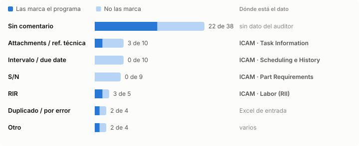

# Auditor de DIPs: con y sin modelo local

Excel de entrada completo del histórico (jul-ago 2026): **915 DIPs**, 629 Others auditados y 286 de otros tipos fuera de alcance. Comparados contra el veredicto de los auditores. Mismo equipo, sin GPU.

**El modelo no mejoró ningún resultado.** Tardó ×767 y cambió 7 DIPs, todos a peor: generadores de oxígeno que el auditor dio OK quedaron con una discrepancia falsa.

## Resumen

| | Sin modelo local | Con modelo local |
| --- | ---: | ---: |
| Tiempo para auditar 915 DIPs | 2.4 s | 30 min 18 s |
| Tiempo por DIP | 2.6 ms | 2.0 s |
| Consultas al modelo | 0 | 90 |
| Segundos por consulta (CPU) | - | 20.1 s |
| Coincide con el auditor | 64.6% | 64.6% |
| DIPs con un estado distinto al otro modo | - | 7, todos a peor |
| Referencias sugeridas por el modelo | - | 14: 1 correcta, 11 equivocadas, 2 dudosas |
| Referencias equivocadas aceptadas | 0 | 11 |
| Casos de prueba (46, inventados) bien resueltos | 20 de 46 | 44 de 46 |
| Memoria adicional | 0 | 5.3 GB |
| Instalación | Python | Python + Ollama + modelo de 6 GB |
| Mismo resultado en cualquier equipo | Sí | No siempre (CPU y GPU difieren) |

## Velocidad

## Resultado frente al auditor

El modelo no mejora ningún indicador y agrega 7 discrepancias falsas.

## Reglas que aplica (desde el Excel de entrada)

| Regla | Qué verifica | Si falla |
| --- | --- | --- |
| Referencia | El Fault Name se asocia a una fila Others de `DIPs References.xlsx` por palabras clave (45 entradas en `config/catalogo_others.yaml`). | Sin referencia: REVISAR |
| Intervalo | Intervalo del DIP contra el TA de la referencia, con variantes por flota o presión. | Mayor: CRÍTICA · 0: NO CRÍTICA |
| Tipo de intervalo | Días, FH o FC según la referencia. | CRÍTICA |
| Parent assy | AIRCRAFT o ENGINE según la referencia. | CRÍTICA |
| Due date | Apertura + intervalo (±1 día) y que no pase el vencimiento escrito en la descripción. | CRÍTICA o REVISAR |
| Vencidos y cierre | DIP activo vencido, cierre fuera de plazo, Usage Remaining mayor que el intervalo. | CRÍTICA / NO CRÍTICA |
| Duplicados | Mismo avión y componente abiertos a la vez, o el mismo S/N en dos DIPs activos. | NO CRÍTICA |
| Deferral Reference | Prefijo igual al ATA. | NO CRÍTICA |
| Datos faltantes | Sin intervalo o sin tipo de intervalo en el Excel de entrada. | REVISAR |
| Observaciones | S/N ausente en la descripción, ATA distinto, intervalo menor que el TA. | No cambian el estado |

Attachments, referencia técnica y RIR no vienen en el Excel: quedan como verificación manual.

## Qué agregaría ICAM

**DIPs en REVISAR (sin modelo)**

| Motivo | DIPs | ¿Lo resuelve ICAM? |
| --- | ---: | --- |
| Sin intervalo en el Excel | 66 | Sí: Scheduling |
| Sin referencia Others en la tabla | 61 | No: hay que completar la tabla |
| Sin referencia y sin intervalo | 34 | Solo el intervalo |
| Due date posterior al intervalo | 4 | Sí: History |

Detalle: [analisis_modelo_local.md](analisis_modelo_local.md) · [analisis_icam_others.md](analisis_icam_others.md).
