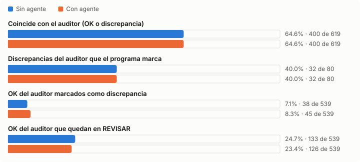

# Auditor de DIPs: con y sin agente

> **Registro histórico.** El agente se eliminó del programa el 24-09-2026. Este documento guarda las mediciones que llevaron a esa decisión. Los comandos, archivos y opciones que se nombran aquí (`--llm`, `benchmark_con_agente.bat`, `dips_audit/llm.py`, sección `llm` de `config.yaml`) ya no existen; se pueden recuperar del historial de git.

## Qué era el agente

Una sola consulta de clasificación al modelo local `ministral-3:8b` en Ollama, activada con `auditar --llm`. No navegaba ni usaba herramientas. Solo se consultaba cuando las reglas no encontraban la referencia del DIP (11% del histórico). Recibía el Fault Name, el intervalo y 6 referencias candidatas, y debía elegir una o responder NINGUNA.

La sugerencia se validaba con reglas: debía compartir una palabra distintiva con el Fault Name, no contener una frase excluida para esa referencia, y el intervalo del DIP debía ser compatible con el TA (al menos el 20% del TA). Todo DIP que pasaba por el agente quedaba en **REVISAR**: el agente nunca decidía OK ni discrepancia.

Configuración usada: temperatura 0, contexto de 2048 tokens, máximo 300 tokens de respuesta, justificación de hasta 25 palabras, sin modo thinking. Con 4 candidatos y sin justificación cada consulta bajaba de 41 s a 24 s en CPU, pero acertaba 41 de 46 casos en vez de 44.

## Resultado con los 915 DIPs del histórico

Excel de entrada completo del histórico (jul-ago 2026): **915 DIPs**, 629 Others auditados y 286 de otros tipos fuera de alcance. Comparados contra el veredicto de los auditores. Mismo equipo, sin GPU.

**El agente no mejoró ningún resultado.** Tardó ×767 y cambió 7 DIPs, todos a peor: generadores de oxígeno que el auditor dio OK quedaron con una discrepancia falsa.

| | Sin agente | Con agente |
| --- | ---: | ---: |
| Tiempo para auditar 915 DIPs | 2.4 s | 30 min 18 s |
| Tiempo por DIP | 2.6 ms | 2.0 s |
| Consultas al modelo | 0 | 90 |
| Segundos por consulta (CPU) | - | 20.1 s |
| Coincide con el auditor | 64.6% | 64.6% |
| DIPs con un estado distinto al otro modo | - | 7, todos a peor |
| Referencias sugeridas por el agente | - | 14: 1 correcta, 11 equivocadas, 2 dudosas |
| Referencias equivocadas aceptadas | 0 | 11 |
| Casos de prueba (46, inventados) bien resueltos | 20 de 46 | 44 de 46 |
| Memoria adicional | 0 | 5.3 GB |
| Instalación | Python | Python + Ollama + modelo de 6 GB |
| Mismo resultado en cualquier equipo | Sí | No siempre (CPU y GPU difieren) |

Las 11 referencias equivocadas fueron generadores de oxígeno de pasajeros sin intervalo en el Excel: sin intervalo, la validación no podía descartar la sugerencia y el agente los asoció a la botella portátil. Después se agregó la regla de descartar toda sugerencia de un DIP sin intervalo.

## Benchmark de 50 DIPs

| Indicador | Sin agente | Con agente |
| --- | ---: | ---: |
| Coincide con el auditor (OK o discrepancia) | 42 de 50 | 42 de 50 |
| OK del auditor que el programa marca con discrepancia | 3 de 44 | 3 de 44 |
| OK del auditor que el programa deja en REVISAR | 3 de 44 | 3 de 44 |
| Discrepancias del auditor que el programa marca | 4 de 6 | 4 de 6 |
| DIPs consultados al agente | - | 5 (respondió NINGUNA en los 5) |
| Casos: con referencia, asociados a la correcta | 0 de 26 | 24 de 26 |
| Casos: sin referencia, quedan sin referencia | 20 de 20 | 20 de 20 |
| Casos: referencia equivocada aceptada | 0 de 46 | 0 de 46 |
| Tiempo total | 1 s | 33 min |

En la auditoría los dos modos fueron idénticos. La diferencia apareció solo en los 46 casos escritos para medir al agente, que exageran su aporte:

- 25 de los 26 casos con referencia eran inventados (`CREW 02 BOTLE LOW`, `BRK 4 PIN FLUSH`, `KIT MEDICO DE EMERGENCIA...`). El único real, `DIP - NOSE INTERNAL INSPECTION`, el agente lo falló (respondió NINGUNA).
- 14 de los 20 casos sin referencia eran reales, y en esos el agente y las reglas coincidieron.
- Los casos inventados miden sinónimos, abreviaturas y español, que en los DIPs reales casi no aparecen.

## Histórico de 528 DIPs Others (GPU)

DIPs Others con veredicto e intervalo, auditados entre el 13-jul y el 21-ago-2026: 464 OK, 53 con discrepancia no crítica y 11 críticas. Las reglas asociaron 468 (88.6%); los 60 restantes se consultaron al agente. De esos 60, solo 2 tenían referencia Others en `DIPs References.xlsx` (fumigación con error de escritura y radomo).

| Método | Referencias correctas (de 2) | Equivocadas aceptadas (de 58) | DIPs cuyo estado cambia (de 528) |
| --- | ---: | ---: | ---: |
| Solo reglas | 0 | 0 | - |
| Agente | 1 (fumigación) | 0 | **0** |
| "Más parecido" (elige la referencia con más palabras en común) | 2 | **12** | **6** (discrepancias falsas) |
| Reglas con tolerancia a errores de escritura | 1 (fumigación) | 0 | 0 |

Frente al auditor, los dos modos dieron exactamente lo mismo: 384 de 528 coinciden, 16 de 64 discrepancias marcadas, 38 falsas discrepancias y 58 REVISAR de más. El aporte real del agente fue 1 referencia bien sugerida en 528 DIPs (0.2%), y ese DIP quedaba en REVISAR igual. La tolerancia a errores de escritura en las reglas logra lo mismo sin costo y es la que quedó en el programa.

## Costos y riesgos

- **Recursos:** 5.3 GB de RAM de 16 GB, 25 s de carga y entre 20 y 40 s por consulta en CPU. Los equipos del departamento no tienen GPU.
- **Instalación:** Ollama como servicio y 6 GB de modelo. Cada versión nueva del modelo o de Ollama obliga a medir de nuevo.
- **Reproducibilidad:** con temperatura 0, el mismo modelo respondió distinto en CPU y en GPU (`DIP-EMERGENCY LOCATER TRANSMITER BATERY`: ELT portátil en CPU, ELT fijo en GPU).
- **Explicación:** una regla se puede mostrar ("contiene FUMIGATION"); la justificación del agente es texto generado que puede sonar convincente sin ser la razón real.

## Cuándo volver a evaluarlo

Un agente tendría sentido si el auditor empieza a leer texto libre que las reglas no cubren bien: attachments o PDFs de ICAM, comentarios o descripciones largas, u otros tipos de DIP (Structures, Powerplant). Criterio para adoptarlo: en DIPs **reales** debe cambiar el resultado frente al auditor, o sugerir bien la referencia en más de 1% de los DIPs, sin aceptar referencias equivocadas y ganándole a las reglas con tolerancia.

El margen de mejora del histórico no está en encontrar la referencia: las 48 discrepancias del auditor que el programa no marca ya tienen referencia por reglas, y las falsas discrepancias vienen de la calibración de la tabla y las reglas.

## Cómo se obtuvieron los números

- Muestra de 50 y 915 DIPs: benchmarks de los dos modos en un i7-1265U sin GPU.
- Histórico de 528: copia anónima de los Others con veredicto e intervalo; las respuestas del agente se obtuvieron en GPU (RTX 3070) con la misma configuración. Esos archivos no se suben porque el histórico no está en el repositorio.
