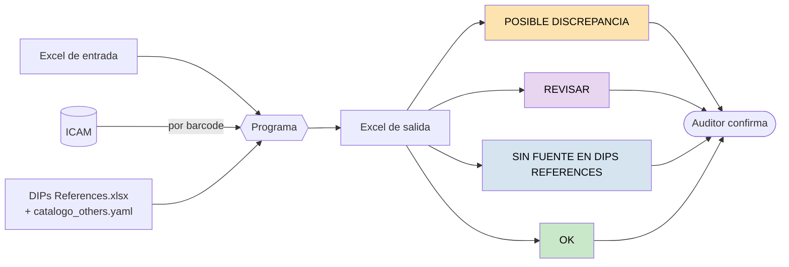
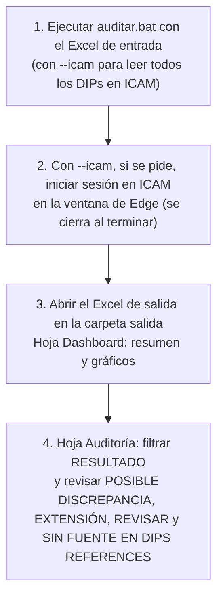
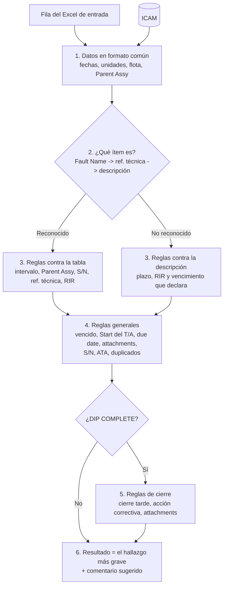
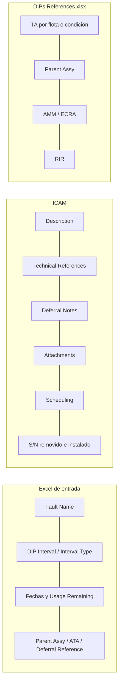
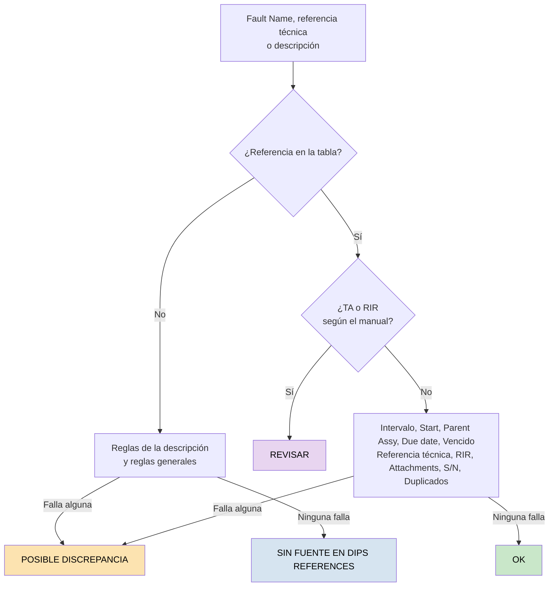
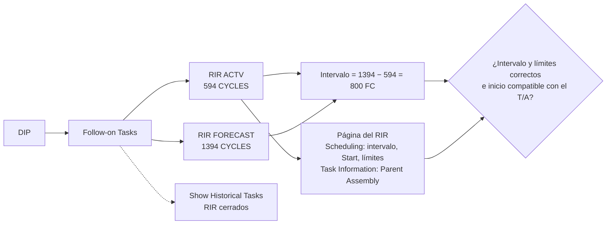
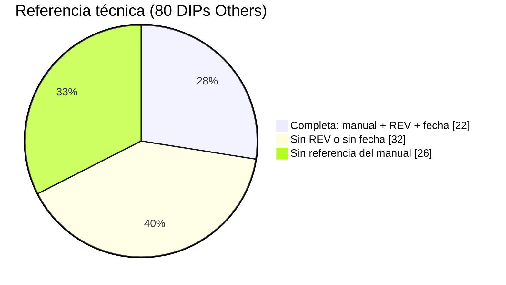
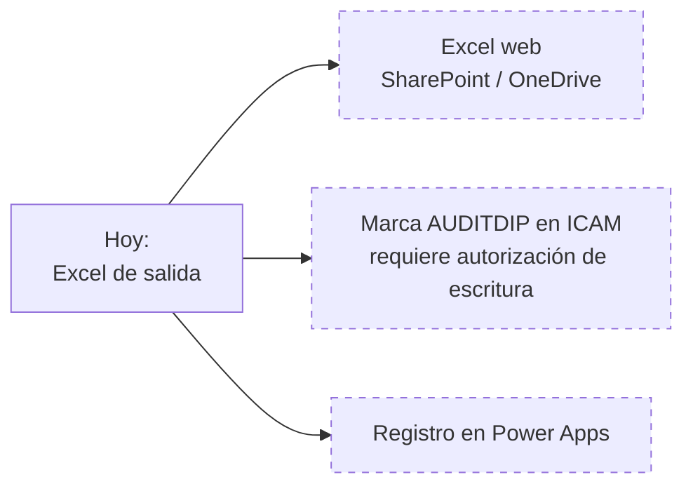

# Auditoría preliminar de DIPs

El programa hace la primera pasada de la auditoría de DIPs: lee el Excel de entrada y, con `--icam`, los datos de cada DIP en ICAM, aplica las reglas de apertura y cierre y entrega un Excel con el resultado de cada DIP y sus motivos. El auditor confirma.

**En una frase:** Excel de entrada + ICAM + tabla de referencias -> reglas fijas -> un resultado por DIP con evidencia.

- **No usa IA.** Cada hallazgo sale de una regla escrita y dice qué dato lo produjo.
- **No escribe en ICAM.** Solo busca el barcode y lee las pestañas.
- **No modifica el Excel de entrada.** El resultado es un Excel nuevo en `salida/`.

El detalle está en [tecnico.md](tecnico.md).

## Proceso



`DIPs References.xlsx` dice qué exige cada ítem (TA, Parent Assy, AMM/ECRA, RIR). El **catálogo** (`config/catalogo_others.yaml`) dice cómo reconocer ese ítem en el Fault Name: qué palabras debe tener y cuáles no ("CREW OXY 850 PSI" -> `CREW OXYGEN BOTTLE PRESSURE`). También resuelve los TA que en la tabla dependen de la flota o de la presión. Un DIP que no coincide con ninguna entrada sale SIN FUENTE EN DIPS REFERENCES.

| Resultado            | Qué significa                                                                           | Qué hace el auditor                               |
| -------------------- | ---------------------------------------------------------------------------------------- | -------------------------------------------------- |
| POSIBLE DISCREPANCIA | Falló al menos una regla                                                                | Lee`HALLAZGOS` y decide                          |
| REVISAR              | La tabla da el TA o el RIR según el daño o el tipo ("DEPENDING ON...", "CONSULT REF.") | Lo verifica en el manual que indica el hallazgo    |
| SIN FUENTE EN DIPS REFERENCES           | El DIP no está en la tabla de referencias                                               | Lo verifica contra la fuente que cita el DIP       |
| OK                   | No falló ninguna regla (puede incluir detalles adicionales)                                      | Hace las verificaciones de`VERIFICACIÓN MANUAL` |
| FUERA DE ALCANCE     | Tipo de DIP excluido con`--tipos-dip`                                                  | No se revisa                                       |

## Formas de usarlo

| Entrada                           | Cómo                                                                               | Salida                                                                                                            |
| --------------------------------- | ----------------------------------------------------------------------------------- | ----------------------------------------------------------------------------------------------------------------- |
| Excel de entrada                  | Arrastrar el Excel sobre`auditar.bat` (en consola, con `--icam` para leer ICAM) | `salida/..._AUDITORIA_...xlsx`                                                                                 |
| Solo los pendientes               | `auditar.bat "DIPs Audit (...).xlsx" --pendientes`                                | Primero `filtered/... FILTERED.xlsx` dentro de la carpeta del original (ACTV, ACTIVE, OPEN, IN WORK o PAUSE sin auditoría de apertura, COMPLETE sin la de cierre), después la auditoría |
| Un DIP, sin Excel                 | `auditar.bat T40S0099V9C`                                                         | En consola; lee el DIP en ICAM y no genera archivos                                                               |
| Comparar con la auditoría manual | Arrastrar el Excel sobre`comparar.bat`                                            | `salida/..._COMPARACION_...xlsx`                                                                               |



Sin `--icam` se audita solo con el Excel: menos reglas (no hay Start del T/A, RIR vigentes, notas de la descripción ni acción correctiva) y más verificaciones manuales.

## Recorrido de un DIP



## Lectura de ICAM

```mermaid
sequenceDiagram
    participant P as Programa
    participant E as Edge de ICAM (sesión iniciada)
    participant I as ICAM
    P->>E: Abre la ventana (si está cerrada) y se conecta
    E->>I: Abre ICAM (no la página de inicio de sesión)
    alt Sin sesión
        P-->>P: Avisa; sigue apenas se inicia sesión y se detiene apenas hay un error
    end
    loop Cada barcode (3 a la vez)
        E->>I: Barcode Search (ScanBarcode)
        par 5 pestañas en paralelo
            E->>I: Task Execution
            E->>I: Fault Information
            E->>I: Task Information
            E->>I: Scheduling
            E->>I: History
        end
        E->>I: Show Historical Tasks (RIR cerrados)
        E->>I: Página de cada RIR vigente (Scheduling, Task Information)
        P->>P: Valida y guarda en data/icam.json
    end
```

| Control        | Cómo                                                                                                                                                                                                                                                                             |
| -------------- | --------------------------------------------------------------------------------------------------------------------------------------------------------------------------------------------------------------------------------------------------------------------------------- |
| Solo lectura   | Las únicas consultas son la búsqueda, la lectura de las pestañas y la descarga de los PDF adjuntos de los DIPs de oxígeno (inventario de generators). No se abre ningún formulario de edición ni corre código de ICAM                                                    |
| Sin errores    | Cada respuesta se valida (DIP, barcode y contenido). 3 reintentos por consulta. Un DIP incompleto no se guarda. Si la sesión vence, se detiene y lo leído queda guardado                                                                                                        |
| Datos actuales | Con`--icam` (y al auditar por barcode) se leen en ICAM los DIPs del archivo. Un DIP leído hace menos de 1 hora se toma de `data/icam.json`, sin volver a leerlo; `--no-cache` los lee todos. Para reusar una lectura sin importar la hora: `--datos-icam data/icam.json` |
| Rapidez        | Sin dibujar páginas ni descargar imágenes. 3 DIPs a la vez, pestañas en paralelo: unos 5 minutos para 380 DIPs                                                                                                                                                                 |

## Datos que se usan



El catálogo tiene 70 entradas: Others, Powerplant y Structures.

## Reglas



Si en un DIP con REVISAR además falla otra regla, queda en POSIBLE DISCREPANCIA: manda el hallazgo más grave. Un hallazgo con resultado OK se anota en `HALLAZGOS` y no desplaza otros resultados.

| Regla                                                                                              | Resultado              |
| -------------------------------------------------------------------------------------------------- | ---------------------- |
| Intervalo mayor que el TA, o en otra unidad (días, FH, FC)                                        | POSIBLE DISCREPANCIA   |
| Intervalo menor que el TA                                                                          | OK           |
| Intervalo 0                                                                                        | POSIBLE DISCREPANCIA   |
| La tabla pide dos límites ("45 DAYS OR 225 FC") y el T/A en ICAM tiene uno                        | POSIBLE DISCREPANCIA   |
| Parent Assy distinto (AIRCRAFT / ENGINE)                                                           | POSIBLE DISCREPANCIA   |
| Start del T/A distinto de la apertura (o de la apertura + A en ventanas "AFTER A, BEFORE B")       | POSIBLE DISCREPANCIA   |
| Due date después del Start + intervalo, o del vencimiento del ítem                               | POSIBLE DISCREPANCIA   |
| Generators de oxígeno: due date después del Exp. Date del PDF de inventario, o S/N que no está en el PDF | POSIBLE DISCREPANCIA   |
| DIP activo vencido, o paquete programado después del due date                                     | POSIBLE DISCREPANCIA   |
| Usage Remaining mayor que el intervalo                                                             | OK           |
| Sin referencia técnica (ni cargada, ni captura adjunta, ni citada)                                | POSIBLE DISCREPANCIA   |
| Referencia técnica sin REV o sin fecha                                                            | OK           |
| Referencia técnica de otra referencia de la tabla, o tarea que la tabla no tiene                  | POSIBLE DISCREPANCIA   |
| Otra tarea del mismo capítulo-sección-tema                                                       | OK           |
| Barcode de trabajo citado como referencia (no específica)                                         | POSIBLE DISCREPANCIA   |
| Sin attachments (apertura o cierre)                                                                | POSIBLE DISCREPANCIA   |
| Cerrado antes de A en una ventana "AFTER A, BEFORE B" (con ICAM en FH y FC)                        | POSIBLE DISCREPANCIA   |
| S/N distinto del de las notas de la descripción                                                    | POSIBLE DISCREPANCIA   |
| DIP duplicado, declarado duplicado o con S/N completo repetido en DIPs que coexistieron, incluso cerrados o con OK manual de cierre | POSIBLE DISCREPANCIA   |
| DIP creado por error sin evidencia de duplicación, ya cerrado | OK           |
| Deferral Reference distinto del ATA                                                                | OK           |
| RIR faltante, con otro intervalo, sin un límite del T/A, en otro Parent Assembly, con inicio calendario posterior al T/A o Start distinto en FH/FC | POSIBLE DISCREPANCIA   |
| Sin intervalo o sin tipo de intervalo                                                              | POSIBLE DISCREPANCIA   |
| Cierre después del due date vigente, incluida su extensión                                     | POSIBLE DISCREPANCIA   |
| DIP abierto o cerrado con extensión del T/A por fecha, FH o FC | EXTENSIÓN: revisar el soporte |
| Cierre sin acción correctiva                                                                      | OK           |
| Acción correctiva sin cita del manual                                                             | OK           |
| TA o RIR según el daño o el tipo ("DEPENDING ON...", "CONSULT REF.")                             | REVISAR (ir al manual) |
| Sin referencia en la tabla                                                                         | SIN FUENTE EN DIPS REFERENCES             |
| DIP SIN FUENTE EN DIPS REFERENCES con T/A mayor que el plazo de su descripción, o sin el RIR que pide                | POSIBLE DISCREPANCIA   |

Qué tipos de discrepancia y reglas se revisan, y cuáles son OK, se configura en `config/discrepancias.yaml`. Sus valores son POSIBLE DISCREPANCIA, EXTENSIÓN, REVISAR, SIN FUENTE EN DIPS REFERENCES y OK. La prioridad sigue ese orden; OK no cambia el resultado. CORREGIDO EN CIERRE se calcula a partir de los resultados de apertura y cierre.

## RIR en ICAM



| Se revisa       | Criterio del auditor                                                            |
| --------------- | ------------------------------------------------------------------------------- |
| Intervalo       | "RIRs (2 DAY INTERVAL)", "T/A y RIRs correctos (100 FH y 50 FH)"                |
| Límites        | "RIRs aperturados solo con limitantes de ciclos. Agregar limitante de 30 Meses" |
| Start           | "RIRs de 200FH con START values diferentes al T/A ocasiona que corran mal"      |
| Parent Assembly | "RIRS aperturados correctamente al motor ESN …"                                |

Se acepta que el T/A empiece días después del RIR (límites DAY o MONTH). Un inicio calendario del RIR posterior al T/A sigue siendo posible discrepancia; en FH/FC los Start deben coincidir salvo redondeo.

Las Follow-on Tasks REQ (servicio de taller) no son RIR.

## Excel de salida

| Hoja       | Contenido                                                                                                                                                                                                                                        |
| ---------- | ------------------------------------------------------------------------------------------------------------------------------------------------------------------------------------------------------------------------------------------------ |
| Dashboard  | Indicadores y gráficos: resultado, apertura y cierre, DIPs por tipo y por flota, referencias y aviones con posible discrepancia                                                                                                                |
| Resumen    | Archivo, fecha y conteos                                                                                                                                                                                                                         |
| Auditoría | Las columnas del Excel de entrada y, al final, las del programa:`RESULTADO`, `HALLAZGOS`, `COMENTARIO SUGERIDO`, `VERIFICACIÓN MANUAL`, `REFERENCIA ASOCIADA`, `REFERENCIA TÉCNICA DEL DIP`, `RIR EN ICAM`, `ADJUNTOS EN ICAM`, `AUDITORÍA MANUAL EN ICAM` |
| Hallazgos  | Un hallazgo por fila, con su tipo de discrepancia y si es de apertura o de cierre                                                                                                                                                                |

## Referencia técnica en los DIPs Others leídos de ICAM

Se buscaron el manual, la REV y la fecha en 80 DIPs Others leídos de ICAM.



## Pendiente


