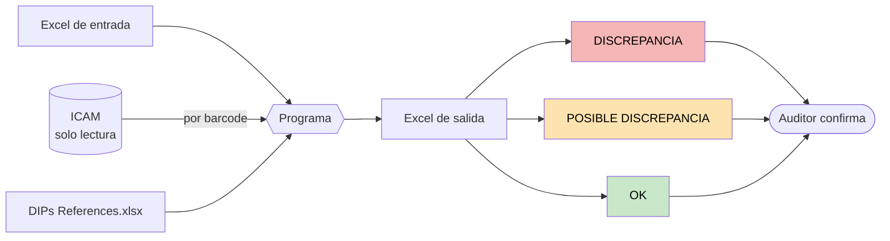
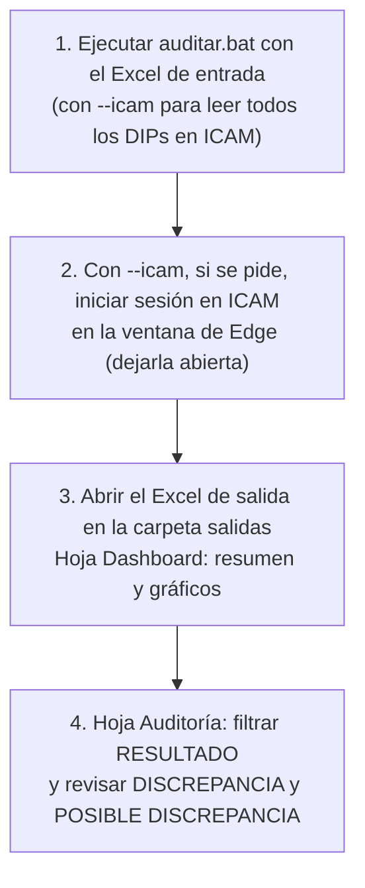
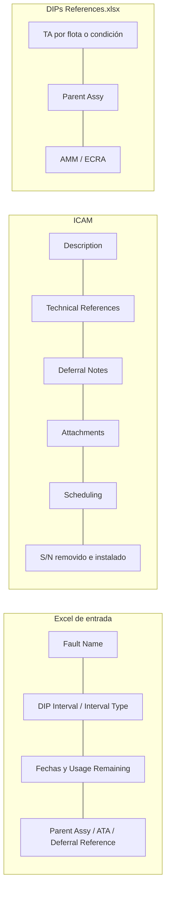
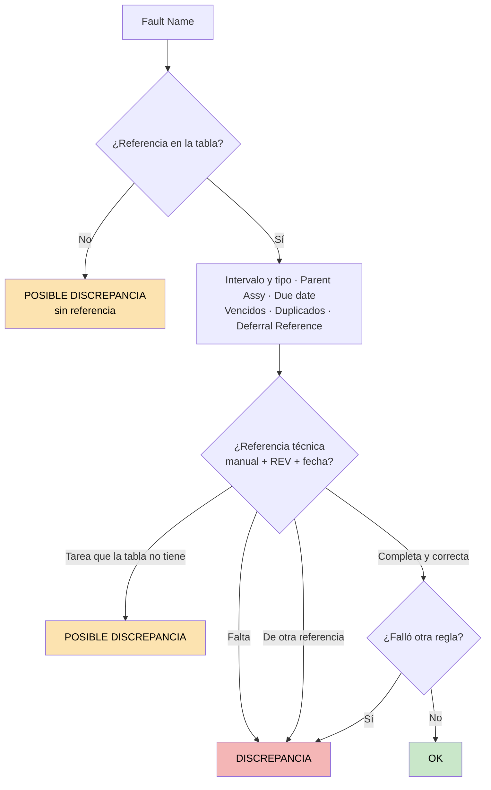
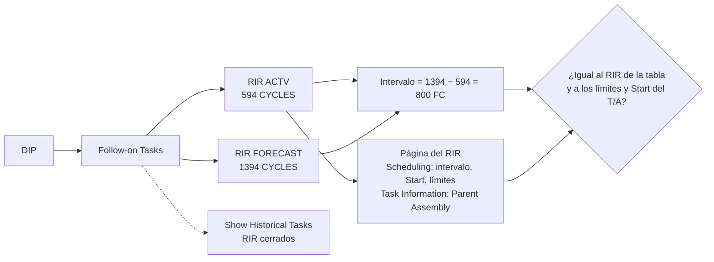
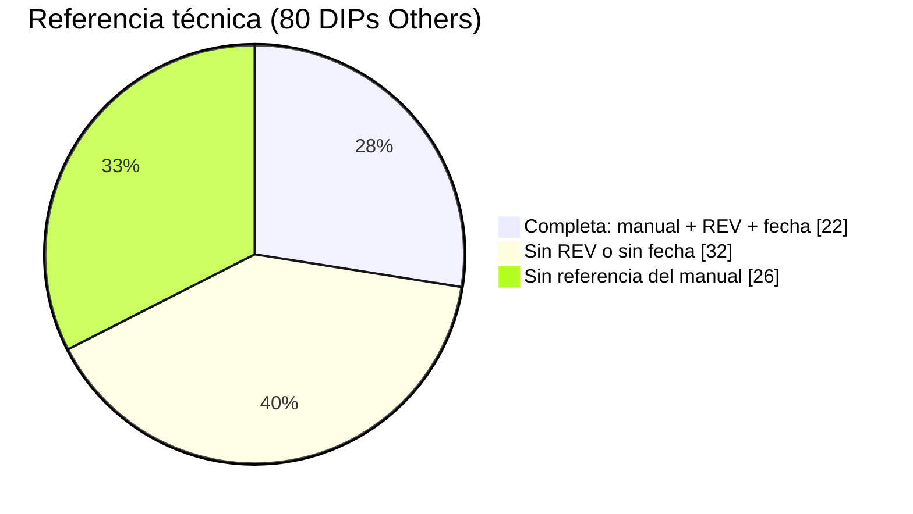
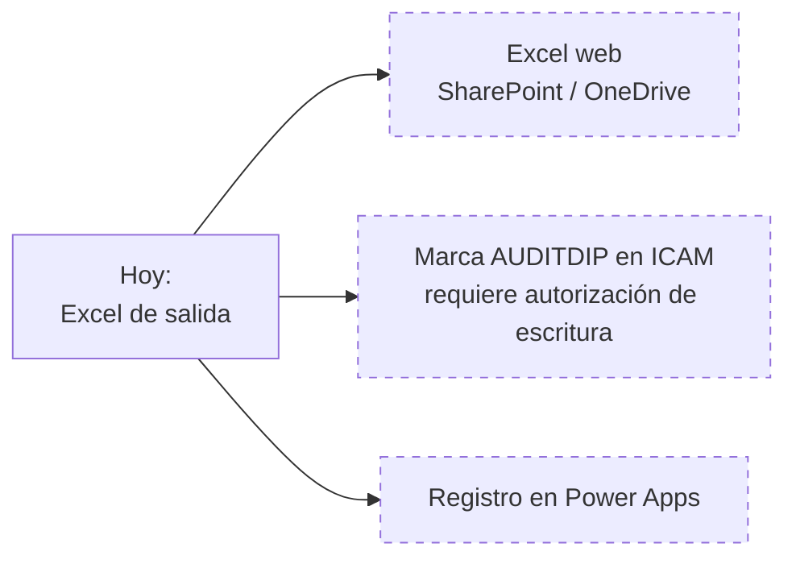

# Auditoría preliminar de DIPs

El programa lee el Excel de entrada y, con `--icam`, los datos de cada DIP en ICAM, aplica las reglas y entrega un Excel con el resultado de cada DIP. El auditor confirma.

## Proceso



## Uso



## Lectura de ICAM

```mermaid
sequenceDiagram
    participant P as Programa
    participant E as Edge de ICAM (sesión iniciada)
    participant I as ICAM
    P->>E: Abre la ventana (si está cerrada) y se conecta
    E->>I: Abre ICAM (no la página de inicio de sesión)
    alt Sin sesión
        P-->>P: Avisa; sigue apenas se inicia sesión y se detiene apenas hay un error
    end
    loop Cada barcode (3 a la vez)
        E->>I: Barcode Search (ScanBarcode)
        par 5 pestañas en paralelo
            E->>I: Task Execution
            E->>I: Fault Information
            E->>I: Task Information
            E->>I: Scheduling
            E->>I: History
        end
        E->>I: Show Historical Tasks (RIR cerrados)
        E->>I: Página de cada RIR vigente (Scheduling, Task Information)
        P->>P: Valida y guarda data/icam/barcode.json
    end
```

| Control | Cómo |
| --- | --- |
| Solo lectura | Las únicas consultas son la búsqueda y la lectura de las pestañas. No se abre ningún formulario de edición ni corre código de ICAM |
| Sin errores | Cada respuesta se valida (DIP, barcode y contenido). 3 reintentos por consulta. Un DIP incompleto no se guarda. Si la sesión vence, se detiene y lo leído queda guardado |
| Rapidez | Sin dibujar páginas ni descargar imágenes. 3 DIPs a la vez, pestañas en paralelo. Un DIP ya leído no se vuelve a leer |

## Datos que se usan



## Reglas



| Regla | Si falla |
| --- | --- |
| Intervalo mayor que el TA | DISCREPANCIA CRÍTICA |
| Tipo de intervalo distinto (días, FH, FC) | DISCREPANCIA CRÍTICA |
| Parent Assy distinto (AIRCRAFT / ENGINE) | DISCREPANCIA CRÍTICA |
| Due date después del vencimiento del ítem | DISCREPANCIA CRÍTICA |
| DIP activo vencido o cerrado fuera de plazo | DISCREPANCIA CRÍTICA |
| Referencia técnica sin manual, REV o fecha | DISCREPANCIA NO CRÍTICA |
| Referencia técnica de otra referencia | DISCREPANCIA NO CRÍTICA |
| Intervalo 0, Usage Remaining mayor que el intervalo | DISCREPANCIA NO CRÍTICA |
| DIP duplicado, S/N repetido, Deferral Reference distinto del ATA | DISCREPANCIA NO CRÍTICA |
| RIR faltante o con intervalo distinto del de la tabla | DISCREPANCIA NO CRÍTICA |
| RIR sin un límite del T/A o en otro Parent Assembly | DISCREPANCIA NO CRÍTICA |
| RIR con Start distinto del T/A | POSIBLE DISCREPANCIA |
| Sin referencia en la tabla, sin intervalo, due date dudoso | POSIBLE DISCREPANCIA |

Qué tipos de discrepancia y reglas se revisan, y la severidad de cada regla, se configuran en `config/discrepancias.yaml`.

## RIR en ICAM



| Se revisa | Criterio del auditor |
| --- | --- |
| Intervalo | "RIRs (2 DAY INTERVAL)", "T/A y RIRs correctos (100 FH y 50 FH)" |
| Límites | "RIRs aperturados solo con limitantes de ciclos. Agregar limitante de 30 Meses" |
| Start | "RIRs de 200FH con START values diferentes al T/A ocasiona que corran mal" |
| Parent Assembly | "RIRS aperturados correctamente al motor ESN …" |

Las Follow-on Tasks REQ (servicio de taller) no son RIR.

## Referencia técnica en los DIPs Others leídos de ICAM

Se buscaron el manual, la REV y la fecha en 80 DIPs Others leídos de ICAM.



## Pendiente


