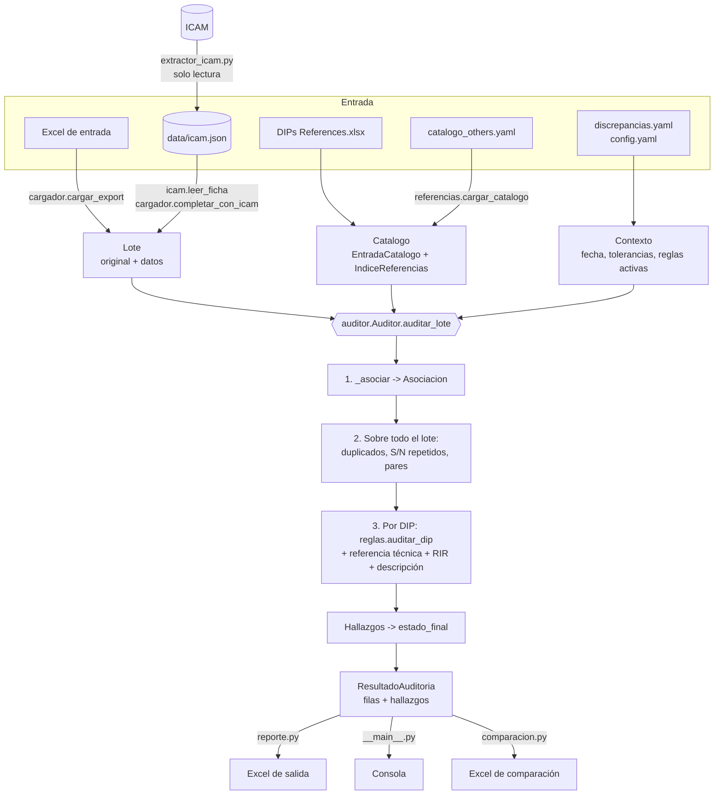

# Cómo funciona el auditor de DIPs

Este documento explica qué hace el programa con cada DIP y por qué. Está escrito para quien necesita entender o ajustar el programa. Para usarlo alcanza con el [README](../README.md); para una vista en diagramas, [proceso.md](proceso.md).

La sección 0 es la introducción: qué hace, por qué está armado así y cómo fluyen los datos. Las secciones 1 a 12 son el detalle de cada paso.

## 0. Para empezar

### Qué hace

El programa hace lo mismo que un auditor, en este orden:

1. **Lee el Excel de entrada** (por ejemplo `DIPs Audit (23SEP2026).xlsx`) y ordena sus datos.
2. **Lee cada DIP en ICAM** (con `--icam`): referencia técnica, attachments, intervalos, RIR, acción correctiva e historial.
3. **Reconoce qué ítem es cada DIP** y busca su fila en la tabla de referencias (`DIPs References.xlsx`).
4. **Aplica las reglas de apertura** y, si el DIP está cerrado, **las de cierre**.
5. **Da un resultado** por DIP (POSIBLE DISCREPANCIA, REVISAR, SIN FUENTE u OK) con los motivos.
6. **Escribe un Excel nuevo** en `salidas/`. El de entrada no se toca.

**¿Usa inteligencia artificial?** No. Todo lo deciden reglas escritas en el código y en los archivos de configuración, y cada hallazgo dice qué dato lo produjo. Hubo un agente opcional (un modelo de lenguaje local) para sugerir la referencia de los DIPs que no se reconocen; no mejoró el resultado y se eliminó ([comparacion_modos.md](comparacion_modos.md)).

### Por qué está armado así

| Decisión | Por qué |
| --- | --- |
| **Reglas fijas, sin IA** | El auditor tiene que poder rastrear cada hallazgo hasta un dato y una regla. Una regla se prueba, se desactiva y se mide; una respuesta de un modelo, no |
| **El conocimiento va fuera del código** | La tabla de referencias (`DIPs References.xlsx`), las palabras clave de cada ítem (`catalogo_others.yaml`), qué regla es discrepancia u observación (`discrepancias.yaml`) y las tolerancias (`config.yaml`) cambian con los criterios de los auditores. Se ajustan sin tocar Python. Al cargar, el catálogo se valida contra la tabla: si una referencia no existe con el texto exacto, el programa se detiene |
| **Etapas en un solo sentido** | Entrada -> formato común -> asociación -> reglas -> resultado -> salida. Cada etapa solo usa la anterior. Así una regla no sabe si el dato vino del Excel o de ICAM, y el Excel de salida no sabe cómo se decidió el resultado |
| **Reglas como funciones pequeñas** | Cada regla recibe un DIP (`dict`), su entrada del catálogo y un `Contexto`, y agrega hallazgos. No lee archivos ni ICAM. Por eso cada una se prueba sola en `tests/` |
| **ICAM se lee y se interpreta por separado** | `extractor_icam.py` guarda el texto de las pestañas en `data/icam.json`; `icam.py` lo interpreta después. Se puede volver a auditar o corregir la interpretación sin volver a leer ICAM (`--datos-icam`). Y la lectura es solo de lectura: nunca escribe en ICAM |
| **"Sin dato" no es "cero"** | `None` significa que no se leyó (por ejemplo, `adjuntos` sin ICAM); `[]` significa que se leyó y no hay nada. Sin dato, la regla no marca discrepancia: usa lo que dice el Excel o deja una verificación manual |
| **La fecha de auditoría es un parámetro** | `Contexto.fecha_referencia` dice "auditar como si fuera tal día y hora". Con eso `comparar` audita cada DIP a la hora en que lo auditó la persona, y se puede calibrar contra la auditoría manual |
| **Severidad interna ≠ resultado mostrado** | Cada regla guarda una severidad (CRITICA, NO CRITICA...), pero hoy el auditor solo ve POSIBLE DISCREPANCIA. Los niveles se conservan para cuando se definan con los auditores |
| **Benchmark con línea base** | Cambiar una regla puede arreglar un caso y romper diez. `benchmark` mide contra DIPs ya auditados y falla si algún indicador empeora |
| **Datos sensibles fuera de Git** | El Excel de entrada, `data/`, `pruebas/` y `salidas/` tienen nombres del personal y datos operativos: están en `.gitignore`. El benchmark usa una copia sin nombres (`anonimizar.py`) |

### Flujo de datos



En palabras:

1. **Carga.** `cargador.cargar_export` busca la fila de encabezados, reconoce las columnas por sus nombres posibles y arma un `Lote`: `original` (las columnas tal cual, para copiarlas a la salida) y `datos` (columnas estándar ya interpretadas: `barcode`, `nombre`, `intervalo`, `unidad`, `found_date`, `due_date`, `estado`...).
2. **ICAM.** Con `--icam`, `extractor_icam.extraer` lee todos los barcodes y guarda el texto en `data/icam.json`. Después `completar_con_icam` interpreta ese texto (`icam.leer_ficha`) y agrega columnas al `Lote`: referencia técnica, attachments, intervalos del T/A, RIR, acción correctiva, notas de la descripción. La descripción, la referencia técnica, los attachments y los RIR de ICAM reemplazan a los del Excel (son más actuales); el intervalo y la fecha de cierre del Excel se mantienen, e ICAM solo los llena si faltan.
3. **Referencias.** Al crear el `Auditor` se cargan la tabla y el catálogo (`Catalogo`, una `EntradaCatalogo` por ítem con sus variantes de TA, RIR y Parent Assy) y el índice de números de tarea (`IndiceReferencias`), además de `discrepancias.yaml`.
4. **Asociación.** Para cada DIP, `Auditor._asociar` decide qué entrada del catálogo es: por el Fault Name, y si no alcanza, por la referencia técnica o la descripción. Devuelve una `Asociacion` con la entrada (o ninguna) y el método usado.
5. **Reglas de lote.** Duplicados, S/N repetidos y Parent Assembly distinto de sus pares se buscan entre todos los DIPs del archivo, porque comparan un DIP con otros.
6. **Reglas por DIP.** `reglas.auditar_dip` y los métodos del `Auditor` (`_referencia_tecnica`, `_rir`) y `reglas_descripcion.revisar_descripcion` agregan `Hallazgo`s a un `ResultadoReglas`. Cada `agregar` consulta `discrepancias.yaml`: si la regla está inactiva no se agrega, y si está activa toma de ahí su severidad y su tipo de discrepancia.
7. **Resultado.** `reglas.estado_final` toma el hallazgo más grave y lo traduce al resultado que ve el auditor. `_comentario` arma el `COMENTARIO SUGERIDO` ("T/A aperturado correctamente // ..."). Un DIP cerrado sin attachments tiene dos hallazgos (apertura y cierre), pero el comentario lo dice una sola vez.
8. **Salida.** Todo termina en un `ResultadoAuditoria` con dos tablas: `filas` (un DIP por fila) y `hallazgos` (un hallazgo por fila). `reporte.py` las escribe en Excel; la consola y `comparacion.py` leen las mismas tablas.

`auditar.bat T40S...` (un DIP sin Excel) usa el mismo camino: `cargador.lote_desde_icam` arma un `Lote` de una fila con lo leído en ICAM.

### Objetos principales

| Objeto | Archivo | Qué contiene |
| --- | --- | --- |
| `Lote` | `cargador.py` | El Excel de entrada: `original` (tal cual) y `datos` (formato común), más notas de la carga |
| `dip` (un `dict`) | fila de `Lote.datos` | Lo que reciben las reglas. Los datos de ICAM son `None` si no se leyó |
| `EntradaCatalogo` | `referencias.py` | Un ítem de la tabla: sus filas, variantes de TA (límites, flotas, ventana "AFTER A, BEFORE B"), RIR y Parent Assy |
| `Asociacion` | `asociacion.py` | La entrada elegida y el método: `REGLAS` (Fault Name), `REF_TECNICA`, `DESCRIPCION`, `AMBIGUA` o `NINGUNA` |
| `Contexto` | `reglas.py` | Fecha y hora de la auditoría, tolerancias y reglas activas |
| `Hallazgo` | `reglas.py` | Código de la regla, tipo de discrepancia, severidad y mensaje |
| `ResultadoAuditoria` | `auditor.py` | `filas` y `hallazgos` (DataFrames), advertencias y tiempo |

### Cómo se decide el resultado

Cada hallazgo tiene una severidad, que sale de `discrepancias.yaml`. El resultado del DIP es el de su hallazgo más grave (`reglas.ORDEN_SEVERIDAD`):

| Severidad del hallazgo | Se muestra como | Resultado del DIP |
| --- | --- | --- |
| CRITICA, NO CRITICA, REVISAR | `[POSIBLE DISCREPANCIA]` | POSIBLE DISCREPANCIA |
| CONSULTAR MANUAL | `[REVISAR]` | REVISAR |
| SIN FUENTE | `[SIN FUENTE]` | SIN FUENTE |
| OBSERVACION | `[OBSERVACIÓN]` | No cambia el resultado |
| (sin hallazgos) | | OK |

Cada hallazgo es de apertura o de cierre: los códigos de `reglas.CODIGOS_CIERRE` son de cierre y todos los demás, de apertura. Así salen `ESTADO APERTURA` y `ESTADO CIERRE`.

### Dónde tocar según el cambio

| Quiero... | Dónde |
| --- | --- |
| Que se lea bien un error de escritura frecuente | `_SINONIMOS` en `texto.py` |
| Cubrir un ítem que sale SIN FUENTE | Fila en `DIPs References.xlsx` + entrada en `catalogo_others.yaml` (sección 3.8) |
| Que una regla sea observación, o desactivarla | `config/discrepancias.yaml` |
| Cambiar una tolerancia | `config/config.yaml` |
| Agregar una regla | Una función en `reglas.py` (o un método en `auditor.py` si necesita la asociación o datos de ICAM), su código en `discrepancias.yaml` (si es de cierre, también en `CODIGOS_CIERRE`) y un test |
| Usar un dato nuevo de ICAM | `icam.leer_ficha` (interpretarlo) -> `cargador._dato_icam` y `completar_con_icam` (pasarlo al `dip`) -> la regla |

Después de cualquiera de estos cambios: `.venv\Scripts\python -m pytest` y `.venv\Scripts\python -m dips_audit benchmark`.

---

## 1. Lectura del Excel de entrada

Archivo: `dips_audit/cargador.py`.

El programa busca, entre las primeras 20 filas de cada hoja, una fila que tenga las columnas `Fault Barcode` y `Fault Name`. Esa es la fila de encabezados, así que el Excel puede traer títulos arriba.

**Nombres de columna.** Cada dato se reconoce por varios nombres posibles, sin importar mayúsculas. Por ejemplo, la fecha de apertura puede llamarse `Found On Date` (formato actual) o `Fault Found on Date` (formato anterior), y la de cierre `Complete Dt` o `Completed Date`. Si falta una columna obligatoria (barcode, nombre, intervalo, tipo de intervalo, estado o avión), el programa lo dice y se detiene.

**Limpieza de datos:**

| Situación | Qué hace |
| --- | --- |
| El mismo barcode en dos filas | Audita la primera y avisa cuántas omitió |
| Fechas con día y mes invertidos por Excel (9-jul guardado como 7-sep) | Las corrige solo si la fecha corregida es coherente con el due date, y lo anota |
| Espacios raros, celdas con un espacio, textos con saltos de línea | Se limpian |
| Tipo de intervalo escrito de varias formas (`CDY`, `DAYS`, `HOURS`, `HRS`, `CYCLES`, `LANDINGS`) | Se lleva a cuatro unidades: días, horas de vuelo (FH), ciclos (FC) y meses |
| Flota del avión | Sale del Task Parent Assy (`Boeing 737-8V3` -> NG-800, `737-9 MAX9` -> MAX). Si el DIP está en un motor, se toma la flota de otro DIP del mismo avión |
| Columnas `Rir Barcode`, `Rir Name`, `Rir Driver Interval`, `Rir Driver Type` | Dan el RIR activo del DIP cuando no se lee ICAM |
| Columnas `Attachment Status` y `Attach Docs` | Cuántos attachments tenía el DIP al exportar el Excel (`PENDING` = ninguno). Se usan cuando no se lee ICAM |
| Columna `Defer Dt` | Defer Date: el Start de un T/A en días puede ser esa fecha |

Las columnas de la auditoría manual (`DIP Open - RT Audit Completed`, `DIP Discrepancy Found`, etc.) no se usan para auditar, solo para comparar (sección 9).

---

## 2. Lectura de ICAM

Archivos: `dips_audit/extractor_icam.py` (cómo se lee) y `dips_audit/icam.py` (cómo se interpreta).

**Cómo entra a ICAM.** El programa abre un Edge aparte, con su propio perfil (`.icam_perfil/`), directo en ICAM, o usa esa ventana si ya está abierta. El usuario inicia sesión ahí. El programa usa esa sesión, igual que si alguien navegara: nunca escribe usuario ni contraseña. Si no hay sesión, avisa y revisa la ventana cada medio segundo: sigue apenas aparece ICAM con Barcode Search, y se detiene apenas la página de inicio de sesión muestra un error (`selector_error_sesion`; por defecto, los mensajes de Keycloak y de Microsoft) o se cierra la ventana. Si nadie inicia sesión, se detiene a los `espera_sesion_minutos` (3 por defecto). Terminada la lectura, o si se interrumpe, cierra el Edge de ICAM: le pide cerrarse, espera hasta 10 s a que guarde la sesión y cierra a la fuerza (`taskkill /T`) los procesos que queden. Los procesos del programa se reconocen por el perfil (`--user-data-dir` de `.icam_perfil/`), así el Edge de uso diario nunca se toca. Si una corrida anterior dejó alguno abierto (o colgado, sin responder en el puerto), se cierra antes de abrir uno nuevo y al final de cualquier corrida, con o sin `--icam` (menos `abrir-icam`, que deja la ventana abierta para iniciar sesión). `python -m dips_audit abrir-icam` abre la ventana sin auditar.

**Qué lee de cada DIP.** Busca el barcode con Barcode Search y lee cinco pestañas:

| Pestaña | Datos que se usan |
| --- | --- |
| Task Execution | Descripción, acción correctiva, S/N removido e instalado |
| Fault Information | Estado, severidad, Deferral Reference, Follow-on Tasks (RIR) |
| Task Information | Parent Assembly, fecha real de cierre, Technical References, Attachments. Las marcas que pone el auditor al terminar ("DIP OPEN / CLOSED - RT AUDIT COMPLETED", tipo AUDITDIP, AUDITTR o sin tipo) se ignoran: no son referencias. Si hay alguna de tipo AUDITDIP, el DIP ya se auditó manualmente: se audita igual y se anota en VERIFICACIÓN MANUAL. La Description de cada marca dice qué encontró el auditor: "DIP DISCREPANCY FOUND: motivo" es discrepancia; vacía, sin discrepancia; otro texto ("DIP DUPLICATED, REFERENCE TO BC ..."), una nota. Va por etapa (OPEN = apertura, CLOSED = cierre) en la columna AUDITORÍA MANUAL EN ICAM. En los 415 DIPs leídos al 28-sep: 17 marcas con discrepancia, 393 vacías y 4 con nota |
| Scheduling | Intervalos del T/A, inicio, deadline, extensión y uso restante |
| History | Cambios de deadline, notas de la descripción y uso al encontrar la falla (Usage When Found: ciclos y horas) |

Además lee las RIR cerradas ("Show Historical Tasks") y la página de cada RIR vigente. En los DIPs de oxígeno descarga los PDF de Attachments y guarda los campos del formulario (`pdf` en `data/icam.json`, no el archivo): así se lee el inventario de generators.

**Solo lectura.** Las únicas consultas son la búsqueda, la lectura de las pestañas y la descarga de los PDF adjuntos de los DIPs de oxígeno. El HTML se muestra en una página aislada, sin red y sin los scripts de ICAM. No se abre ningún formulario ni se pulsa ningún botón.

**Detalle importante.** ICAM entrega las pestañas y sus tablas ocultas y las muestra con sus scripts. Como aquí los scripts no corren, el programa las hace visibles antes de copiar el texto. Sin ese paso se perdían las referencias técnicas, los adjuntos y los intervalos.

**Qué se lee y dónde se guarda.** Con `--icam` (y en `extraer-icam` y la auditoría por barcode) se leen los DIPs del archivo, de cualquier tipo. Un DIP leído hace menos de 1 hora (`icam.vigencia_minutos` en `config.yaml`) se toma de lo guardado, sin volver a leerlo; los demás se leen de nuevo, para auditar con los datos actuales, por ejemplo la acción correctiva y los adjuntos del cierre. `--no-cache` lee todos, aunque sean recientes. Todos los DIPs leídos se guardan juntos en un solo JSON, `data/icam.json` (en modo prueba, `pruebas/icam.json`; ver sección 9): cada DIP leído se agrega o reemplaza su lectura anterior. No se sube al repositorio porque tiene nombres del personal. Si quedan JSON sueltos de versiones anteriores (un archivo por DIP en `data/icam/`), el programa los une a `data/icam.json` y los borra. Para auditar de nuevo con esos datos sin volver a leer ICAM: `--datos-icam data/icam.json`.

**Un solo DIP, sin Excel.** `auditar.bat T40S0099V9C` (o `python -m dips_audit barcode T40S0099V9C [T40S...]`) lee ese DIP en ICAM, lo audita y muestra en consola sus datos, el resultado, los hallazgos y el comentario sugerido; no genera ningún archivo de resultado. Los datos que en una auditoría normal vienen del Excel salen de ICAM (`cargador.lote_desde_icam`): el Fault Name del título de la página, el estado de la tarea (ACTV, COMPLETE), el Defer Date y la de cierre del Fault History, el paquete de trabajo de Subtask Of y, como due date, el límite que vence primero (en uno por uso, su Estimated Date). ICAM no trae el tipo de DIP (Area), así que no se aplica `--tipos-dip`, ni la matrícula cuando el Parent Assembly es un motor (la flota sale entonces del modelo: LEAP es MAX y CFM56, NG). Tampoco se buscan duplicados ni S/N repetidos, porque para eso hacen falta los otros DIPs del avión. En los 64 DIPs de `DIPs Audit (28).xlsx` leídos en ICAM, 62 dan el mismo resultado que con el Excel; los otros 2 cambiaron en ICAM después de exportar el Excel (uno ya se cerró y otro tiene el intervalo corregido).

**Rapidez y errores.** Lee 3 DIPs a la vez y las pestañas en paralelo: unos 5 minutos para 380 DIPs. Cada respuesta se valida (que sea la página del DIP pedido y que la pestaña traiga contenido) y cada consulta se reintenta 3 veces. Un DIP incompleto no se guarda. Si la sesión vence a mitad de camino, lo leído queda guardado.

---

## 3. Cómo se reconoce cada DIP (variabilidad de nombres)

Archivos: `dips_audit/texto.py`, `dips_audit/asociacion.py`, `dips_audit/referencias.py` y `config/catalogo_others.yaml`.

Este es el paso más delicado. El `Fault Name` lo escribe el técnico a mano y la tabla de referencias usa sus propias descripciones. El mismo ítem aparece de muchas formas:

| Tabla de referencias | Así aparece en los DIPs |
| --- | --- |
| `CREW OXYGEN BOTTLE PRESSURE` | "BOTTLE CREW OXYGEN 850 PSI", "LINE-18 (CREW OXYGEN BOTTLE WITH LOW PRESSURE)", "DURING SERVICE VISIT 2 WAS FOUND CREW OXY WITH 900 PSI", "DURING OVERNIGHT CABIN CHECK WAS FOUND CREW OXIGEN LESS THAN 1000 PSI" |
| `FIRST AID KIT LESS THAN 130 DAYS DUE DATE` | "DIP - FAK", "DIP-FWD CABIN FIRT AID KIT", "DIP - AFT BIN FIRST AID KIT S/N CA025 DUE DATE 30-SEP-2026.", "FWD FAK with les than 130 days to due Date" |
| `CABIN PORTABLE OXYGEN BOTTLE (POB)` | "DIP-PORTABLE OXYGEN BOTTLE (POB)", "DIP- FORWARD PAX CABIN POB", "DIP-forward Pax Cabin POB 1", "FWD POB" |

(Ejemplos reales del Excel del 23-sep-2026.)

Para manejar esa variedad, el programa trabaja en capas: primero limpia el texto, después busca palabras clave, después tolera errores de escritura y, por último, usa el número de tarea técnica.

### 3.1 Limpieza del texto

Antes de comparar nada, todo texto (del DIP y del catálogo) pasa por la misma limpieza (`normalizar` en `texto.py`):

1. **Mayúsculas y sin acentos:** "Oxígeno" -> "OXIGENO".
2. **Siglas con puntos:** "P.O.B" -> "POB", "E.L.T." -> "ELT".
3. **Signos a espacios:** guiones, barras, paréntesis y comas se vuelven espacios. "DIP-CREW/OXY" -> "DIP CREW OXY".
4. **Errores y sinónimos frecuentes** vistos en el histórico. Algunos ejemplos:

| Se escribe | Se lee como |
| --- | --- |
| FIRT, FIRTS | FIRST |
| OXIGEN, OXIGENO, OXY, O2 | OXYGEN |
| EXTINTOR, EXTINGUIHSER, FIRE EXT | EXTINGUISHER |
| CERTIFICADO, CERTICATE | CERTIFICATE |
| TIRES, TYRE | TIRE |
| BREAK | BRAKE |
| LIFE VEST, LIVEVEST, LIFE JACKET | LIFEVEST |
| AID KID | AID KIT |
| ELT2, FAK1, MLG3 | ELT 2, FAK 1, MLG 3 |

La lista completa está en `_SINONIMOS` de `texto.py`. Agregar un error nuevo es agregar una línea.

### 3.2 Palabras clave del catálogo

Cada ítem de la tabla tiene una entrada en `config/catalogo_others.yaml` (hoy 88: Others, Powerplant y Structures). La entrada dice qué palabras debe tener el nombre del DIP para ser ese ítem:

```yaml
- id: OXIGENO_TRIPULACION
  nombre: Botella de oxígeno de tripulación (presión baja)
  referencias: ["CREW OXYGEN BOTTLE PRESSURE"]     # fila de DIPs References.xlsx
  requiere: [[OXYGEN], [CREW, FLIGHT COMPARTMENT, FLIGHT DECK, COCKPIT]]
  excluir: [PORTABLE, HYDRO, POB, MASK, MASKS]
```

- **`requiere`**: grupos de palabras. El nombre debe tener **al menos una frase de cada grupo**. Aquí: OXYGEN, y además CREW o COCKPIT o FLIGHT DECK… El orden y las palabras de más no importan: "DIP - LOW PRESSURE CREW OXYGEN BOTTLE" también coincide.
- **`excluir`**: si aparece alguna de estas palabras, no es este ítem. "CREW PORTABLE OXYGEN BOTTLE" no es la botella de tripulación sino la portátil (POB).
- Las frases se comparan como **palabras completas**: "ELT" no coincide dentro de "BELT".

**Si coinciden varias entradas**, gana la más específica: la que exige más grupos de palabras y frases más largas. Si empatan pero llevan a las mismas verificaciones (mismo TA, mismo Parent Assembly), da igual cuál se elija. Si empatan y son distintas, el DIP queda **SIN FUENTE** por **ambiguo**, con las candidatas en el hallazgo.

### 3.3 Errores de escritura

Si ninguna entrada coincide exacto, se vuelve a intentar tolerando errores de escritura, con dos cuidados:

- Solo en **palabras de 5 letras o más** y con al menos **85 % de parecido**: "FUNIGATION" se lee como "FUMIGATION" y "EXTINGUSHER" como "EXTINGUISHER".
- En **siglas y palabras cortas no hay tolerancia**, porque un cambio de letra es otra cosa: ELT y EMK son ítems distintos.

Si así coincide una sola entrada, se acepta y se anota como **observación**: "'FUNIGATION' se leyó como 'FUMIGATION'". Así el auditor ve qué se interpretó.

### 3.4 Por la referencia técnica o la descripción

Muchos Fault Names no dicen qué ítem es ("AFT PASSENGER CABIN LESS THAN 130 DAYS FOR DUE DATE", "DIP// Battery Due Date"), pero la descripción sí. Si el nombre no alcanza, se prueba en este orden:

1. **La referencia técnica cargada en ICAM.** Si su número de tarea (AMM, EC/RA, JIC, SRM) está en una sola entrada del catálogo, el DIP se asocia a esa entrada. Si varias lo comparten pero llevan a las mismas verificaciones (la AMM 12-15-31-610-802 está en MAIN LANDING GEAR SHOCK STRUT y en el amortiguador genérico), se elige la más específica.
2. **El Fault Name junto con la descripción**, con las mismas palabras clave del catálogo ("...WAS FOUND FIRST AID KIT..." -> FAK), sin tolerar errores de escritura. Juntos, cada uno puede aportar una parte: "OPEN DIP FOR FLIGHT COMPARTMENT AND CONTROL CABIN WINDOWS" en el nombre y "before the sealant fully cures" en la descripción -> SEALANT (WINDOWS). No se acepta si la descripción cita una tarea que no es la de esa referencia, porque el DIP sigue otra fuente: una muestra nueva de combustible por la SUBTASK 28-10-00-280-056 (10 días) no es FUEL MICROBIAL GROWTH (AMM 28-10-00-200-802, 4 días).
3. **La tarea citada en la descripción** ("IAW EC/RA 2500-0538C" -> LIFEVEST DOOR LATCH DAMAGED).

Las task cards JIC de la descripción no cuentan: son la tarea donde se encontró la falla. Cada asociación así se anota como observación ("identificada por la descripción, no por el Fault Name") para que el auditor la confirme.

### 3.5 Cuando no se reconoce: SIN FUENTE

El DIP queda **SIN FUENTE**: no está en la tabla de referencias, así que no hay contra qué auditar el intervalo, el Parent Assembly ni la referencia técnica. No es una posible discrepancia. Las reglas que no dependen de la tabla (DIP vencido, cierre tarde, S/N repetido, due date contra el T/A) se siguen aplicando, y si alguna falla el DIP queda en posible discrepancia. Para ayudar, el hallazgo muestra las filas más parecidas de la tabla, de cualquier tipo. Si se parece mucho a una fila de Powerplant o Structures, se anota que quizá se abrió con el tipo equivocado.

**Contra la fuente que cita** (`reglas_descripcion.py` y `limites_declarados.py`). Un DIP SIN FUENTE se revisa contra lo que dice su propia descripción:

| Qué dice la descripción | Qué se revisa |
| --- | --- |
| El plazo: "within 60 days", "open DIP for 45 days or 225 FC", "in no more than 100FH, 50FC or 10 days whichever occurs first" | El T/A no puede ser mayor (62 días con "within 60 days"), ni estar en otra unidad. Si pide varios límites, el T/A en ICAM debe tenerlos todos; sin ICAM queda para verificar (el Excel solo muestra el que vence primero) |
| Una inspección repetitiva: "every 30 days", "after each 400 cycles", "inspect within 50 FH and correct within 100 FH" | El DIP debe tener el RIR, con ese intervalo (y los dos límites si pide dos) |
| El vencimiento del ítem: "DUE DATE NOVEMBER/2027", "DUE DATE 11/2029" | El due date no puede pasarlo. En un grupo de componentes manda el que vence primero (generadores con NOVEMBER/2027 y OCTOBER/2027 en un DIP que vencía en enero de 2028) |
| Nada de plazo, y el DIP no tiene intervalo | Posible discrepancia, salvo que solo siga un RIR o se haya abierto y cerrado el mismo día |

"Not prior to 7 days" no es un plazo (es cuándo empieza) y "50.000 FC" son cincuenta mil ciclos. En los DIPs de la tabla manda la tabla.

**Contra sus pares.** Si los demás DIPs del archivo que citan la misma EC/ECRA (al menos dos) están todos en otro Parent Assembly, se marca para revisar: cinco cambios de toberas por la ECRA 7300-0132C en el motor y uno en el avión. Solo las EC: una AMM puede ser genérica (la 05-00-00-750-801 revisa mensajes AHM de sistemas distintos).

En la auditoría del 23-sep-2026, 120 de 363 DIPs quedaron sin fuente: eran ítems que la tabla no tenía. Con las filas 83 a 93 agregadas a la tabla (generadores de oxígeno, 46 NFS, sensores de proximidad de flaps y slats, re-torque de puertas de tanque, presión de llantas, CNR, umbral de reparaciones...) y sus entradas en el catálogo, en `DIPs Audit (25SEP2026).xlsx` los DIPs sin referencia bajaron de 286 a 98 de 795 (SIN FUENTE de 210 a 70). Los que quedan son sobre todo daños de Structures con una ECRA propia de cada avión, CNR de vibración, aire o combustible y cables de spoiler, que la tabla no tiene.

### 3.6 Variabilidad en la tabla de referencias

La tabla también se escribe a mano, así que se interpreta con cuidado (`referencias.py`):

| Situación en la tabla | Qué hace el programa |
| --- | --- |
| TA simple: "3 DAYS", "60 DAYS OR 500 FH" | Lo convierte en límites comparables (uno o dos) |
| TA en meses | 1 mes = entre 30 y 31 días, más 1 día de tolerancia |
| "UNTIL DUE DATE" | El DIP debe ir en días y su due date no puede pasar el vencimiento que dice la descripción |
| TA condicional: por flota, por presión ("IF…", "DEPENDING…") | No se adivina. El catálogo define las variantes en `intervalos` (p. ej. oxígeno de tripulación: 3 días, 1 día o 1 ciclo según la presión) |
| Parent Assy con asterisco | Acepta avión o motor (se transfiere al robar el motor): la diferencia queda como observación |

Al cargar, el programa verifica que cada referencia del catálogo exista **con el texto exacto** en la columna DESCRIPTION de la tabla; si no existe, se detiene con un mensaje claro. Para ver todo esto: `.venv\Scripts\python -m dips_audit referencias`.

**Fila nueva sin entrada en el catálogo.** Una fila de la tabla (de cualquier tipo) que el catálogo no tiene se usa igual, con una entrada automática (`FILA_<n>`): el DIP se asocia si su referencia técnica tiene un número de tarea de esa fila, o si tiene todas las palabras de la DESCRIPTION antes de la aclaración ("TIRE PRESSURE RECHECK IN 24 HOURS (LOW PRESSURE...)" -> TIRE, PRESSURE, RECHECK, HOURS). Solo se prueba si ninguna entrada del catálogo coincide, y queda como observación ("Fila n de la tabla sin entrada en el catálogo... Verificar"). Al cargar se avisa qué filas están así. Es un respaldo: la entrada del catálogo, con sinónimos y exclusiones, reconoce muchos más DIPs.

**"[AIRCRAFT SPECIFIC]".** Si la columna REFERENCES empieza así ("ECRA OF EACH REPAIR, E.G. ECRA 5300-3447C"), los números son ejemplos: no se exige que el DIP cite esos.

**TA según el MMEL** ("MMEL 32-51-02"): como "DEPENDING ON", queda en REVISAR.

### 3.7 Variabilidad en las referencias técnicas

Las referencias técnicas tampoco tienen un formato único. El programa reconoce (`referencia_tecnica.py`):

| Dato | Formatos aceptados |
| --- | --- |
| Manual | AMM, SWPM, SRM, FIM, IPC, CMM, EC, ECRA, EC/RA, EA, FCD, JIC, TASK CARD, T/C, TC… (AMM, SRM y task card no necesitan REV ni fecha: `referencia_tecnica.revision_opcional` en `config.yaml`) |
| Número AMM | `12-15-21-210-801`; se ignora el sufijo de efectividad (`-F00`) |
| Número EC/RA | `2901-0036C`, `EC/RA #: 2901-0036C`, `ECRA 2901-0036C R4`, `FCD 3500-0018C-JIC`, `7300-0132C` (sin sigla, como se carga en ICAM) |
| Task card | `B737-05-1-0005-U-JIC`, `MAX-05-1-0001-U-JIC`, `B737-73-1-0001-JIC`, `B737 -05-1-0004-U-JIC`, `0001U-JIC`, `32-020-02-U-JIC` |
| Número SRM | `SRM 51-10-05-0G-0`, `SRM TASK 54-10-01-1A-1` |
| Revisión y fecha | "REV 85, 15-MAY-2026", "REV.90 DATE 15JUN2026", "Rev No. / Date : 90 / 15 Jun 2026", "REV 92 JUN 15/26", "REV05, 11/SEP/2026", "15-MAY-2026 REV 28" |

Y descarta lo que parece referencia pero no lo es:

- **El MGM** (manual general de mantenimiento): no es referencia técnica. Un DIP que solo cita el MGM queda sin referencia técnica, y el hallazgo lo aclara.
- **Marcadores de ICAM:** "REFERENCE REQUIRED" (el campo está vacío), las marcas "DIP OPEN / CLOSED - RT AUDIT COMPLETED" y las notas sin ningún número ("nota").
- **Fechas de vencimiento del ítem** ("Battery Due: 31-JAN-2027"): una fecha solo cuenta como fecha de revisión si está junto a "REV".

Las task cards sí son referencia técnica: cargadas en ICAM, citadas en la descripción ("IAW TASK B737-05-1-0005-U-JIC", "REF. TASK CARD…", "DURING TASK CARD…") o en un attachment. Al comparar con la tabla, la task card de la descripción se toma como la tarea donde se encontró la falla (el Service Visit) y no se compara, salvo que sea justo la que da la tabla.

Al comparar con la tabla, una tarea **del mismo capítulo-sección-tema** pero con otro número (AMM 12-15-21-**200**-801 cuando la tabla dice 12-15-21-**210**-801) se anota como observación: el auditor la acepta.

### 3.8 Cómo agregar un nombre o un ítem nuevo

1. Si es un error de escritura frecuente, agréguelo a `_SINONIMOS` en `dips_audit/texto.py`.
2. Si es un ítem nuevo, agregue la fila a `DIPs References.xlsx`. Con eso ya se reconoce por su referencia técnica y por las palabras de la DESCRIPTION (3.6). Para reconocer todos los DIPs de ese ítem, agregue también su entrada en `config/catalogo_others.yaml` con `requiere` (y `excluir` si se confunde con otro); `parent_assy_flexible: true` hace que otro Parent Assembly quede como observación, igual que el asterisco en la tabla.
3. Ejecute `python -m dips_audit referencias` para ver cómo quedó y `.venv\Scripts\python -m dips_audit benchmark` para verificar que nada empeoró.

---

## 4. Auditoría de apertura

Archivos: `dips_audit/reglas.py` y `dips_audit/auditor.py`. Se aplica a todo DIP.

| Qué se revisa | Cómo |
| --- | --- |
| Intervalo | Se compara con el TA de la tabla (o la variante que corresponda a la flota o la presión). Mayor o en otra unidad -> posible discrepancia; menor -> observación |
| Start del T/A | Ver abajo (**Incorrect DIP Start Values**) |
| Due date | Debe ser el Start del T/A en ICAM más el intervalo (1 día de tolerancia); sin ICAM, la apertura más el intervalo (o la apertura + 7 días en un FDR armado con 23 días). En ítems con vencimiento (UNTIL DUE DATE) no se cuenta por intervalo: el due date no puede pasar la fecha que dice la descripción. En generators de oxígeno, la fecha es la del PDF de inventario (ver abajo) |
| DIP vencido | Un DIP abierto con due date anterior al **momento de la auditoría** (día y hora) es crítico. Un due date sin hora vence al final del día |
| Usage Remaining | Mayor que el intervalo se anota como observación: pasa cuando el T/A empieza después de la apertura, y los auditores lo aceptan |
| Parent Assembly | Avión o motor, según la tabla |
| ATA y Deferral Reference | El Deferral Reference debe empezar con el ATA del DIP |
| Referencia técnica | Ver abajo |
| S/N | Si la tabla lo pide, debe estar en la descripción. Un S/N repetido en otro DIP abierto del mismo avión se marca. El S/N del Fault Name y la descripción debe ser el de las notas de la descripción en ICAM: se compara el número (P11101989 y 11101989 son el mismo S/N); si el número difiere (11101989 / 11101998) es posible discrepancia. Un S/N de más en uno de los dos textos no cuenta |
| Attachments | Todo DIP debe tener attachments: sin ninguno es posible discrepancia, aunque la descripción cite el manual. Se cuentan en ICAM y, sin ICAM, en el Excel (`Attach Docs`) |
| RIR | Si la tabla pide RIR, debe existir en Follow-on Tasks con el intervalo correcto, en el mismo Parent Assembly y con el mismo inicio que el T/A (ver abajo) |
| Duplicados | Mismo avión, mismo ítem, misma posición (FWD/AFT, LH/RH, #1/#2; también la de la descripción: el squib LEFT y el RIGHT de la misma botella no son duplicados), S/N compatibles (del nombre y la descripción), los mismos mensajes de mantenimiento si los citan (SHORT TIME 75-20451 y 75-10451 son dos fallas) y abiertos a la vez según la fecha de cierre. En una referencia con varias etapas, otro intervalo es otra etapa y no un duplicado (re-torque a los 60 días y a los 12 meses; cable ajustado a 6 meses y nuevo a 4). Si uno de los dos ya estaba cerrado a la hora de la auditoría, el duplicado ya se corrigió: observación |
| Duplicado o creado por error | El técnico lo dice en la acción correctiva ("ENTERED BY MISTAKE", "DUPLICATED DIP") o en el nombre, la descripción o las notas de la descripción, referido al DIP ("DIP DUPLICADO"; "MASK DEPLOYED BY MISTAKE" es la falla). El DIP no se audita: el único hallazgo y el comentario son "DIP creado por error." o "DIP duplicado (ver T40S...).". Cerrado, observación; abierto, discrepancia no crítica |

**Referencia técnica en la apertura.** Se acepta cualquiera de estas tres evidencias, que es lo que acepta el auditor:

1. la referencia cargada en ICAM (Technical References);
2. una captura adjunta (Attachments);
3. la referencia citada en la descripción.

Si no hay ninguna, es posible discrepancia. Si la cita no trae la revisión o su fecha, se anota como observación. Este criterio se calibró con la auditoría del 23-sep-2026: 153 de 154 aperturas sin discrepancia tenían referencia cargada o captura adjunta. Sin datos de ICAM no se marca, porque no se sabe si hay captura: queda como verificación manual. Un DIP sin attachments ya es posible discrepancia por la regla de attachments.

**Referencia no específica.** Si el DIP cita como su fuente un barcode de trabajo ("TO BE ACCOMPLISHED IN 500FH IAW BARCODE: TRF7N00900V4, STEP 63") y no cita una referencia del manual, es posible discrepancia (*Non-Specific Technical Reference*, como la anota el auditor). La task card JIC del Service Visit ("REF TASK CARD B737-05-1-0001-U-JIC STEP 3") sí se acepta: así se abren los DIPs de oxígeno, halon, FAK o fumigación, y los auditores no los marcan. Una task card JIC cargada en Technical References en lugar de la AMM de la tabla ya la marca la revisión contra la tabla.

**Start del T/A (*Incorrect DIP Start Values*).** El T/A debe empezar en la apertura:

| Unidad | Start aceptado |
| --- | --- |
| Días | Entre la fecha en que se encontró la falla y el Defer Date, con 1 día de tolerancia. Un T/A "within 4 months from the performance date of this task" cuenta desde el trabajo, que suele ser el Defer Date |
| FH / FC | El uso al encontrar la falla (History, "Usage When Found"), con 2 FH o 0 FC de tolerancia (`tolerancias.inicio_fh` e `inicio_fc` en `config.yaml`). En un motor se compara con el uso del motor y con el del avión |

Si la tabla dice **"AFTER A, BEFORE B"**, el T/A empieza A después de la apertura y dura B − A, para vencer a los B de la tabla. Así lo exigen los auditores desde el 10-sep:

| Ítem | Ventana en la tabla | T/A correcto |
| --- | --- | --- |
| Amortiguador NG | After 5 landings, not later than 20 | Start + 5 FC, intervalo 15 FC |
| Amortiguador MAX | Five to ten landings | Start + 5 FC, intervalo 5 FC |
| FDR | 30 días; Ingeniería, no antes de 7 días | Start + 7 días, intervalo 23 días |
| Desgaste de frenos | NG-700 27/37 FC, NG-800 12/20 FC, MAX 34/42 FC | Start + A, intervalo B − A |
| Filtro de combustible del motor | 75 FH (la AMM: "after 10 hours but prior to 75") | Start + 10 FH, intervalo 65 FH |

La ventana se define con `inicio` en `config/catalogo_others.yaml`. Se marca:

- el T/A que empieza en la apertura con B (vence igual, pero con otro Start): así lo marcó el auditor en los dos amortiguadores de HP-1828;
- el que empieza antes de la apertura (muestra microbiana con Start 3 días antes);
- el que empieza a los A pero dura B, porque vence después de la ventana.

Un T/A con otro intervalo es otro trabajo sobre el mismo ítem ("NLG STRUT COMPRESSED UNDER 5 INCHES" en 4 FC) y empieza en la apertura. En los ítems con vencimiento (UNTIL DUE DATE) no se revisa el Start: manda la fecha del ítem. En un DIP SIN FUENTE no se sabe si el ítem tiene ventana: un Start posterior a la apertura queda como observación, y uno anterior sí es posible discrepancia. Sin ICAM no hay Start que revisar.

**RIR (inspecciones repetitivas).** Archivo: `dips_audit/rir.py`. En ICAM, las RIR son Follow-on Tasks del DIP de clase ADHOC; las de clase REQ (por ejemplo, el servicio de taller) no son RIR. La página de Fault Information trae dos tablas: las tareas abiertas y las históricas (cerradas o canceladas). Se leen las dos, y también la página de cada RIR vigente.

| Qué se revisa | Si falla |
| --- | --- |
| La tabla pide RIR y el DIP abierto no tiene ninguna | Posible discrepancia. Si el DIP ya está cerrado y no se ve ninguna, queda para verificar en "Show Historical Tasks" |
| El intervalo de la RIR es distinto del de la tabla | Posible discrepancia |
| El T/A tiene dos límites (p. ej. CYCLES y CDY) y la RIR solo uno | Posible discrepancia |
| La RIR está en otro Parent Assembly (avión en vez de motor) | Posible discrepancia |
| La RIR empieza en otra fecha que el T/A | Posible discrepancia |

El intervalo de la RIR sale de su página en ICAM (Scheduling). Si no se pudo leer, se calcula como la diferencia entre la RIR vigente y la siguiente (594 -> 1394 CYCLES = 800 FC). Sin ICAM, se usa el RIR activo de las columnas `Rir …` del Excel. La columna `RIR EN ICAM` muestra cada RIR con su intervalo.

La tabla pide RIR en freno de parqueo (1 día), DPI (100 FH), VCD seal (1 día), mensajes long time (200 FH), short time, EGT (50 FH) y sellante de ventanas (2 días). Un RIR **más seguido** que el de la tabla (cada 1 día cuando pide 2) es más conservador: observación. Un Start del RIR que difiere del T/A solo por redondeo (50890.3 y 50890.29) no se marca.

**Límite dual de la tabla.** Si la tabla pide "45 DAYS OR 225 FC" y se leyó ICAM, el T/A debe tener los dos límites (`limite_faltante`); sin ICAM queda para verificar.

**Generators de oxígeno (FCD 3500-0018C-JIC).** El vencimiento de cada generator está en el PDF de inventario adjunto (Oxygen Generators Inventory): un formulario con Position, PN, SN, Manufac. Date, Exp. Date y DIP Barcode. Archivo: `dips_audit/inventario.py`; en el catálogo, `inventario: true`.

| Caso | Resultado |
| --- | --- |
| Generators del DIP | Los que tienen su barcode en DIP Barcode y los de los S/N de la descripción |
| Vencimiento | Último día del mes de Exp. Date ("01-2029" = 31-JAN-2029). Con varios generators manda el que vence primero. La fecha que escribe la descripción no cuenta |
| Due date después del Exp. Date | Posible discrepancia (`due_date_posterior_a_vencimiento_item`) |
| Due date antes del Exp. Date | Observación |
| S/N del DIP que no está en el PDF | Posible discrepancia (`sn_fuera_de_inventario`) |
| Sin PDF en los attachments (con ICAM) | Observación (`sin_inventario_generadores`); el vencimiento se toma de la descripción |
| PDF sin formulario (escaneado) o que no se pudo leer; sin ICAM | Verificación manual; el vencimiento se toma de la descripción |

**Otras reglas generales:**

| Regla | Cuándo |
| --- | --- |
| Paquete programado después del due date | DIP activo cuyo `Scheduled Date` (Work Package) es posterior al due date: va a vencer si no se reprograma |
| Attachment de otro avión | El nombre del attachment tiene otra matrícula ('PASS OXY GEN HP1830.png' en un DIP del HP-1836): observación |
| Solo capturas de barcode | Sin referencia cargada, sin cita en la descripción y todos los attachments son la captura de un barcode de trabajo ("T40S00993NB 2 DAY INTERVALS.png"): sin referencia técnica. La captura de una task card sí es referencia |
| Referencia que la tabla no tiene | Posible discrepancia si la tabla pide una EC/ECRA y el DIP no la cita, o si el DIP solo cita una task card JIC. Si cita la ECRA que lo originó y la tabla da la AMM del procedimiento (lavado de motor), observación |

---

## 5. Auditoría de cierre

Se aplica además a los DIPs COMPLETE.

| Qué se revisa | Cómo |
| --- | --- |
| Fecha de cierre | En un DIP cerrado, `Usage Remaining` es lo que le quedaba al cerrarlo (ICAM): negativo es cierre tarde. Sin ese dato, `Complete Dt` (o la fecha real de cierre de ICAM) no puede pasar el due date, con 5 horas de tolerancia (`tolerancias.horas_cierre`), porque el cierre viene en UTC y el due date en hora de Panamá (UTC-5). Si la acción correctiva dice que el trabajo se hizo en otra tarea, queda para verificar la fecha en esa tarea |
| Deadline extendido | Si el due date es posterior al original (`Orig Fault Due Date`) y el DIP cerró después del original, queda en posible discrepancia para verificar el sustento de la extensión |
| Acción correctiva | Sin acción correctiva es posible discrepancia. Si no cita el manual, se anota como observación (el 23-sep-2026 los auditores lo aceptaron). No se anota si la acción remite a otra tarea ("CLOSED IN REFERENCE BARCODE T40S009H0DK"): la referencia está en esa tarea. Tampoco si no hubo trabajo ("OPEN BY MISTAKE", "PREVIOUSLY ACCOMPLISHED", "NO FURTHER ACTION REQUIRED"). En ambos casos queda una nota para verificar |
| S/N removido | Si el número no es el de la descripción, observación. En un cambio (botella, generator) vale el S/N removido o el instalado de Part Requirements |
| Attachments | Sin adjuntos es posible discrepancia (en ICAM o, sin ICAM, en el Excel). La mayoría de los DIPs cerrados sin attachments se abrió antes de la auditoría manual y el auditor solo revisó el cierre |
| Cambios de deadline | Si el historial muestra cambios, se listan para verificar |

---

## 6. Resultado de cada DIP

El programa da **cuatro resultados**:

| Resultado | Cuándo |
| --- | --- |
| POSIBLE DISCREPANCIA | Falló al menos una regla o falta un dato |
| REVISAR | La tabla da el TA o el RIR según el daño, la medición o el tipo (el texto dice DEPENDING, DEPENDS, CONSULT o SEGÚN) y no falló ninguna otra regla. El programa no compara ese TA o RIR: el hallazgo cita el texto de la tabla y el manual donde verificarlo. `python -m dips_audit referencias` muestra cuáles son |
| SIN FUENTE | El DIP no está en la tabla de referencias y no falló ninguna regla que no dependa de la tabla. Se verifica contra la fuente que cita el DIP |
| OK | No falló ninguna regla (puede tener observaciones) |

Además, un DIP de un tipo excluido con `--tipos-dip` (o `tipos_auditados` en `config.yaml`) queda **FUERA DE ALCANCE** y no se revisa.

No clasifica la discrepancia en crítica o no crítica ni en tipos, porque esos criterios todavía no coinciden con el proceso de los auditores. El auditor decide si la posible discrepancia lo es y de qué nivel.

Cada hallazgo se muestra como `[POSIBLE DISCREPANCIA]`, `[REVISAR]`, `[SIN FUENTE]` u `[OBSERVACIÓN]`. Una observación se anota, pero no cambia el resultado. Qué reglas se revisan y cuáles son solo observación se configura en `config/discrepancias.yaml`. Ese archivo conserva además una gravedad interna por regla (crítica, no crítica, revisar); hoy no se muestra, pero permitirá volver a separar niveles cuando se definan. Un hallazgo de cierre aparece con `[CIERRE]` y tiene su propio resultado en la columna `ESTADO CIERRE`.

---

## 7. Excel de salida

Archivo: `dips_audit/reporte.py`. Se crea en `salidas/<archivo>_AUDITORIA_<fecha>.xlsx`.

| Hoja | Contenido |
| --- | --- |
| Dashboard | Indicadores por resultado y gráficos: resultado, apertura y cierre, DIPs por tipo, DIPs por flota (MAX 8, MAX 9, 700 y 800), referencias y aviones con posible discrepancia. Los datos de cada gráfico están a la derecha (columna T) |
| Resumen | Archivo, fecha y conteos |
| Auditoría | Un DIP por fila: resultado, hallazgos, comentario sugerido, referencia, TA, referencia técnica, RIR, adjuntos, apertura/cierre y las columnas originales |
| Hallazgos | Un hallazgo por fila: posible discrepancia u observación, y si es de apertura o de cierre |

---

## 8. Configuración

| Archivo | Qué se ajusta |
| --- | --- |
| `config/discrepancias.yaml` | Reglas activas y cuáles son solo observación |
| `config/config.yaml` | Tolerancias, tipos de DIP auditados, manuales sin REV/fecha e ICAM (lectura en paralelo, reintentos) |
| `config/catalogo_others.yaml` | Palabras clave de cada ítem (Others, Powerplant y Structures) y variantes de intervalo |
| `DIPs References.xlsx` | TA, Parent Assembly, referencia técnica y RIR de cada ítem |

---

## 9. Comparación con la auditoría manual

Archivo: `dips_audit/comparacion.py`. Se ejecuta con `comparar.bat`.

El Excel `DIPs Audit (...)` trae, por DIP, cuándo y quién hizo la auditoría de apertura y la de cierre, y si el auditor encontró discrepancia (`DIP Discrepancy Found = Y`). Esa marca es una sola por DIP, no una por auditoría.

El programa audita cada DIP **dos veces**: a la fecha y hora de la auditoría de apertura, contando solo los hallazgos de apertura, y a la de cierre, contando solo los de cierre. El resultado del programa para el DIP es el peor de esas auditorías. Luego lo compara con la marca del auditor:

| Auditor | Programa | Se lee como |
| --- | --- | --- |
| Sin discrepancia | OK | Sí: ambos OK |
| Con discrepancia | Posible discrepancia | Sí: ambos encuentran discrepancia |
| Sin discrepancia | Posible discrepancia | No: el programa marca y el auditor no |
| Con discrepancia | OK | No: el programa no la detecta |

**Excel de la comparación.** La hoja **Resumen** no usa cruces tipo matriz: cada tabla responde una sola pregunta, con una fila por respuesta (qué se comparó; si el resultado es el mismo; qué dijo el programa de los DIPs sin discrepancia; qué dijo de los DIPs con discrepancia; resultado de la apertura; resultado del cierre; motivos de las marcas, por separado en apertura y cierre; y la lista de discrepancias del auditor). **Detalle por DIP** tiene una fila por barcode y **Hallazgos del programa**, una fila por hallazgo.

**Resultado con la auditoría del 23-sep-2026** (363 DIPs Others, 245 aperturas y 221 cierres, todos leídos en ICAM). Son datos de prueba y están en `pruebas/`.

DIPs que el auditor dio **sin discrepancia** (347):

| Resultado del programa | DIPs |
| --- | ---: |
| OK: coincide | 227 (65 %) |
| Posible discrepancia: el auditor no la marcó (86 son DIPs que no están en la tabla de referencias) | 120 (35 %) |

DIPs en que el auditor **encontró discrepancia** (16):

| Resultado del programa | DIPs |
| --- | ---: |
| Posible discrepancia: coincide | 8 |
| OK: no la detecta | 8 |

En total, el programa llega al mismo resultado que el auditor en 235 de 363 DIPs (65 %).

Antes de calibrar las reglas de referencia técnica con estos datos, el programa marcaba discrepancia en 201 de los 347 DIPs sin discrepancia; ahora marca 120, de los cuales 86 son DIPs que la tabla de referencias no tiene.

**Limitación:** ICAM muestra el estado actual del DIP, no el que vio el auditor en su momento. Por ejemplo, un attachment agregado después cuenta como si hubiera estado.

### 9.1 Calibración con los motivos del auditor (25-sep-2026)

El Excel solo trae "Y", pero el auditor anota el motivo en ICAM, en la marca "DIP OPEN / CLOSED - RT AUDIT COMPLETED" ("DIP DISCREPANCY FOUND: Missing Technical Reference"). Se leyeron esos motivos en los datos de ICAM ya guardados (`pruebas/icam.json`, `data/icam.json`), sin volver a consultar ICAM, para los DIPs Others de `DIPs Audit (23SEP2026)` y `DIPs Audit (28)`: 379 DIPs auditados, 17 con discrepancia.

| Motivo del auditor | DIPs | Qué hace el programa |
| --- | ---: | --- |
| Missing Technical Reference | 7 | Sin attachments es posible discrepancia (2). Otro se marca por el Start. Los otros 4 hoy tienen attachments en ICAM: la falta ya no se ve |
| Incorrect DIP Start Values | 4 | Regla nueva del Start del T/A (amortiguadores, muestra microbiana). El FDR ya se corrigió en ICAM |
| Non-Specific Technical Reference | 3 | Regla nueva del barcode de trabajo; la task card JIC en lugar de la AMM ya se marcaba |
| Incorrect DIP Interval | 1 | DIP SIN FUENTE: sin TA con qué compararlo |
| Incorrect Parent Assembly | 1 | Ya se marcaba; se corrigió en ICAM después |
| Incorrect Serial Number Referenced | 1 | Regla nueva: S/N distinto de las notas de la descripción |
| Sin motivo anotado | 1 | DIP SIN FUENTE |

Un DIP puede tener dos motivos. Otros 3 DIPs auditados después de exportar el Excel suman 2 Missing Technical Reference y 1 Incorrect DIP Interval (un MAX con 15 FC, que el programa marca).

Las auditorías viejas dejaron pasar discrepancias: el auditor dio OK al cierre de DIPs sin attachments abiertos antes de la auditoría manual, a FDR con 30 días desde la apertura (antes del 10-sep; desde ese día se marcan) y a S/N con errores de escritura. Por eso no se usan para relajar una regla.

| Resultado | Antes | Ahora |
| --- | ---: | ---: |
| Discrepancias del auditor que el programa marca | 4 de 17 | 9 de 17 |
| Ídem, auditorías desde el 10-sep | 2 de 11 | 7 de 11 |
| OK del auditor que el programa marca | 16 de 362 | 101 de 362 |

De las 85 marcas nuevas en DIPs que el auditor dio OK, 80 son DIPs sin attachments (77 cerrados que el auditor solo revisó al cierre), 3 son S/N con errores de escritura (AB7 / A87, BEDN / BEDM, 218 / 219) y 2 son FDR con 30 días desde la apertura auditados antes del 10-sep. De las 8 discrepancias que no marca, 5 hoy se ven bien en ICAM (4 con attachments agregados y un FDR corregido) y 3 son DIPs SIN FUENTE.

**Modo prueba.** Si el Excel está dentro de `pruebas/` (o se usa `--prueba`), el programa guarda los datos de ICAM en `pruebas/icam.json` y los resultados en `pruebas/salidas/`, con el prefijo `PRUEBA_` y un aviso en el Excel. Así las corridas de prueba no se mezclan con las auditorías reales en `data/icam.json` y `salidas/`. La carpeta se configura con `carpeta_pruebas` en `config/config.yaml`.

---

## 10. Benchmark

Archivo: `dips_audit/benchmark.py`. Se ejecuta con `.venv\Scripts\python -m dips_audit benchmark` (1 segundo).

Audita 50 DIPs ya auditados (`benchmark/dips_auditados.xlsx`, copia sin nombres del histórico) y 46 nombres difíciles de asociar (`benchmark/casos_asociacion.yaml`). Compara los indicadores con la **línea base** (`benchmark/linea_base.json`). Si alguno empeora, lo avisa y termina con error. Si el cambio era intencional, se copia el resultado nuevo sobre la línea base. Los resultados quedan en `benchmark/resultados/`.

Conviene ejecutarlo después de cualquier cambio en reglas, catálogo o configuración.

---

## 11. Mapa del código

| Archivo | Qué hace |
| --- | --- |
| `__main__.py` | Comandos de consola: `auditar`, `barcode`, `comparar`, `abrir-icam`, `extraer-icam`, `benchmark`, `anonimizar`, `referencias`, `categorias` |
| `filtrar.py` | Deja solo los DIPs pendientes de auditar (`filtrar.bat`, `--pendientes`) |
| `cargador.py` | Lee el Excel de entrada y los datos de ICAM, y los deja en un formato común |
| `extractor_icam.py` | Lee las páginas de ICAM (solo lectura) y las guarda todas en `data/icam.json` |
| `icam.py` | Interpreta el texto de cada pestaña de ICAM |
| `texto.py` | Limpieza de texto, sinónimos, S/N, fechas y presiones |
| `inventario.py` | Inventario de generators de oxígeno (PDF adjunto): S/N y Exp. Date |
| `referencias.py` | Lee la tabla de referencias, interpreta el TA y carga el catálogo |
| `asociacion.py` | Reconoce qué ítem es cada DIP |
| `referencia_tecnica.py` | Encuentra y compara referencias técnicas |
| `reglas.py` | Reglas de apertura y de cierre, duplicados y S/N repetidos |
| `rir.py` | RIR: cómo se leen y qué se revisa |
| `limites_declarados.py` | Plazo, inspección repetitiva y vencimiento que declara la descripción |
| `reglas_descripcion.py` | Reglas de los DIPs SIN FUENTE contra su descripción y contra sus pares |
| `discrepancias.py` | Carga `discrepancias.yaml`: reglas activas y gravedad |
| `auditor.py` | Une todo: carga, asociación, reglas y resultado |
| `reporte.py` | Escribe el Excel de salida |
| `comparacion.py` | Compara con la auditoría manual |
| `benchmark.py`, `evaluacion.py`, `anonimizar.py` | Benchmark y su muestra anónima |

Pruebas: `.venv\Scripts\python -m pytest` (carpeta `tests/`).

`tools/` tiene los scripts de la primera extracción de ICAM (JavaScript en la consola de Edge y Node). El programa no los llama: la lectura de ICAM está en `extractor_icam.py`.

---

## 12. Pendientes

- **Completar la tabla de referencias** con los ítems que faltan (CNR de vibración, aire y combustible; cables de spoiler; ULB del FDR; PBE). Es lo que más reduce los DIPs SIN FUENTE.
- **SHORT TIME (ECRA 7300-0142C):** la tabla dice Parent Assembly AIRCRAFT y los DIPs de mensajes short time están en ENGINE. Está en el catálogo con `parent_assy_flexible` (observación) hasta confirmarlo.
- **TA a confirmar en la tabla:** P-STATIC BONDING JUMPER ("NEXT MAINTENANCE INTERVAL (CONFIRMAR)") y TIRE PRESSURE RECHECK, que dice NG pero los DIPs MAX citan la misma AMM (se acepta en las dos flotas).
- **Sellante de ventanas:** los auditores aceptan 7 días desde la apertura y también Start + 3 días con 4 días (22 DIPs); el programa acepta las dos. Confirmar con Ingeniería.
- **Pitot MAX:** el sellante después de reemplazar el pitot (AMM 27-31-94-400-801) pide 10 días; la tabla solo tiene el del NG (7 días).
- **Revisión vigente de los manuales:** hay DIPs NG que citan AMM REV 28 (la del MAX), un MAX con SRM REV 88 (la del NG) y una SRM REV 75 de 2022 en un DIP de sep-2026. El auditor anotó una vez "Technical reference obsolete". Con la revisión vigente por flota en `config.yaml` se podría marcar.
- **Amortiguadores MAX:** la tabla dice 10 FC para MAX, pero las descripciones citan "not to exceed 20 landings" (GMM 3.6) y los auditores aceptaron 15 FC (Start + 5) en los 6 DIPs así del 23 y el 28-sep. En cambio, marcaron "Incorrect DIP interval" en T40S009J4L4 (MAX, 15 FC) cuya descripción dice "not to exceed 10 landings": el auditor compara con la descripción del DIP. Confirmar cuál es el TA correcto y, si corresponde, corregir la tabla.
- **Filtro de combustible del motor:** la tabla dice 75 FH; la ventana de 10 FH (Start + 10, 65 FH) sale de la AMM citada en las descripciones y de un DIP aceptado. Confirmar con los auditores y, si corresponde, escribirla en la tabla.
- **Contenido de los attachments:** el programa cuenta los attachments, no sabe si uno es la captura de la referencia o una foto. El auditor marcó Missing Technical Reference en un UPK cuyo único attachment era la captura de la task card del Service Visit; desde el 28-sep la task card cuenta como referencia técnica, así que el programa ya no lo marca.
- **Criterio del auditor no uniforme:** T40S009H0QN y T40S009H0QR citan la misma AMM 28-11-11-420-006; uno se marcó como referencia no específica y el otro no. Igual con los FDR antes y después del 10-sep.
- **Definir con los auditores** los niveles (crítica / no crítica) y los tipos de discrepancia del proceso. Hasta entonces el programa solo da posible discrepancia.
- **Criterio de cierre tarde:** T40S009H94W cerró con Usage Remaining −1 (31 h tarde) y el auditor lo dio OK. T40S00992SM (5 días) se hizo en otra tarea y queda para verificar.
- **Motivo de las discrepancias manuales:** el Excel solo marca "Y", pero el motivo está en ICAM (ver 9.1). La comparación podría leerlo de los datos de ICAM y mostrarlo junto al resultado del programa.
